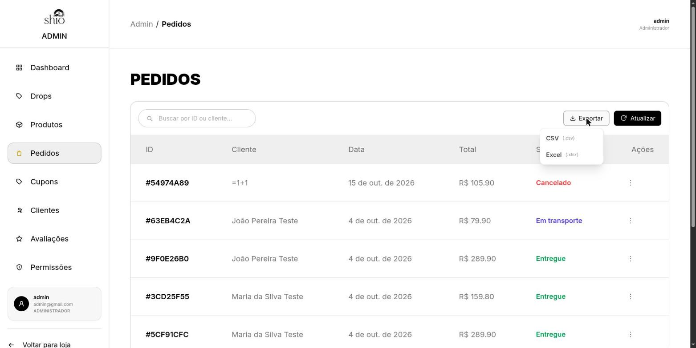
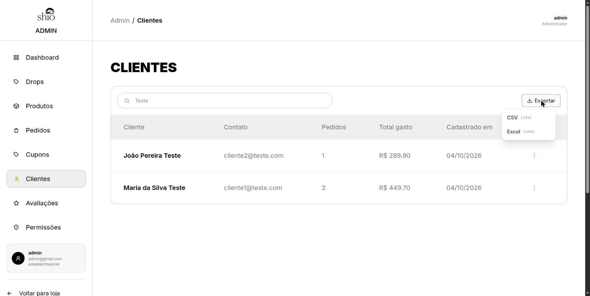
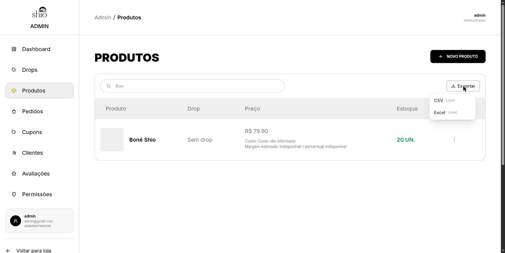
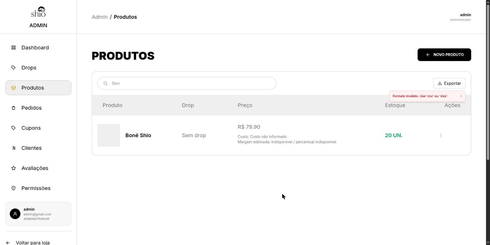

# Exportação de Dados do Painel Administrativo

**Trio:** Ian, Arthur e Danilo

**Origem:**
- [Issue #62](https://github.com/Shio-Enterprise/Documentacao/issues/62) — exportação de dados do painel admin em CSV e Excel.

## Contexto e Relevância

Antes desta funcionalidade, o painel administrativo não permitia exportar dados operacionais e analíticos. Para fins de contabilidade, conciliação de pedidos, campanhas com a lista de clientes ou controle de estoque fora da plataforma, os administradores precisavam copiar as informações manualmente tela a tela.

Esta melhoria implementou a exportação estruturada em **CSV** e **Excel (.xlsx)** nas telas de **Pedidos**, **Clientes (CRM)** e **Estoque/Catálogo**, com a mesma busca da tela e as mesmas permissões de acesso já existentes no sistema.

---

## Regras e Especificações Implementadas

1. **Formatos suportados**:
   - **CSV**: codificado em UTF-8 com BOM (``), delimitador ponto e vírgula (`;`), quebra de linha `\r\n` para abertura imediata no Microsoft Excel (pt-BR) com caracteres e acentuações corretas. Valores em moeda no padrão brasileiro (`R$ 1.234,56`).
   - **Excel (.xlsx)**: gerado nativamente via `openpyxl`, com cabeçalho em negrito, primeira linha congelada (`freeze_panes = 'A2'`), largura de colunas ajustada automaticamente, valores monetários como número com máscara de moeda (`R$ #,##0.00`, permitindo somar a coluna) e datas formatadas no fuso horário `America/Sao_Paulo`.
2. **Proteção contra injeção de fórmula (CSV / Formula Injection)**:
   - Todo campo textual que se inicia por `=`, `+`, `-` ou `@` é sanitizado recebendo o prefixo `'` para impedir execução inadvertida de fórmulas ao abrir a planilha.
3. **Mesma busca da tela**:
   - O arquivo exportado respeita a busca digitada no momento do download, com o mesmo critério da tela, para que o arquivo traga exatamente o que o administrador está vendo:
     - Pedidos: ID do pedido ou nome do cliente (o e-mail só entra quando o cliente não tem nome, pois nesse caso a tela mostra o e-mail no lugar do nome).
     - Clientes: nome ou e-mail.
     - Estoque: nome do produto.
4. **Dados ausentes não viram zero**:
   - Produto sem custo cadastrado sai com a célula de custo **vazia** (a tela mostra "Custo não informado"), evitando que a planilha sugira custo R$ 0,00 e margem de 100%.
   - Drop, categoria e cor ausentes saem como `—`.
5. **Controle de acesso por permissão administrativa**:
   - Cada exportação exige a mesma permissão administrativa da tela correspondente:
     - Pedidos: `CanManageOrders`
     - Clientes: `CanManageCustomers`
     - Estoque: `CanManageCatalog`
6. **Erros exibidos em português**:
   - Se a exportação falhar, o botão mostra a mensagem enviada pela API (por exemplo, "Formato inválido. Use 'csv' ou 'xlsx'.") ou, sem resposta legível, "Não foi possível exportar os dados. Tente novamente.".

---

## Colunas Exportadas

- **Pedidos:** Número, Data, Cliente, E-mail, Itens (resumo das peças e variações), Subtotal, Desconto, Cupom, Frete, Total, Status do Pedido, Status do Pagamento.
- **Clientes:** Nome, E-mail, Data de Cadastro, Pedidos Concluídos, Total Gasto, Última Compra, Inscrito na Newsletter.
- **Estoque:** Produto, Drop, Categoria, Tamanho, Cor, Quantidade em Estoque, Preço de Custo, Preço de Venda.

---

## Endpoints do Backend

- `GET /api/orders/admin/export/` — Exportação de pedidos filtrados por `status`, `search` e `file_format`.
- `GET /api/auth/crm/customers/export/` — Exportação de clientes via `@action` no `CustomerCRMViewSet`, com filtros de busca e ordenação.
- `GET /api/catalog/inventory/export/` — Exportação de estoque/variações de catálogo filtrados por `search`, `drop`, `category` e `file_format`.
- `backend/core/exports.py` — Helper centralizado de exportação e neutralização de fórmulas.

> O frontend envia hoje apenas a busca digitada (`search`) e o formato. Os demais filtros (`status`, `drop`, `category`, ordenação) ficam disponíveis na API para uso futuro.

---

## Componentes do Frontend

- `src/lib/downloadFile.js` — Helper baseado em `apiClient` com `responseType: 'blob'`, extração de nome do arquivo via cabeçalho `Content-Disposition` (RFC 5987 / UTF-8) e disparo do download no navegador.
- `src/components/admin/ExportButton.jsx` — Botão reutilizável com menu suspenso "CSV" / "Excel (.xlsx)", estado de carregamento com bloqueio de múltiplos cliques e mensagem de erro acessível (`role="alert"`). Como a resposta é um `Blob`, o corpo de erro da API é lido do `Blob` para exibir a mensagem correta.
- Integrado nas telas:
  - `OrdersPage` (`/admin/orders`)
  - `CustomersPage` (`/admin/customers`)
  - `ProductsPage` (`/admin/products`)

---

## Evidências (Pull Requests)

- [Backend PR #29](https://github.com/Shio-Enterprise/backend/pull/29)
- [Frontend PR #26](https://github.com/Shio-Enterprise/frontend/pull/26)

---

## Validação Automatizada

### Backend (Pytest)
- **`core/test_exports.py`**:
  - Neutralização de prefixos de fórmula (`=`, `+`, `-`, `@`).
  - Conversão de fuso horário para `America/Sao_Paulo`.
  - Resposta `400 Bad Request` para formato inválido.
  - Geração de CSV com BOM e separador `;`.
  - Geração de XLSX (freeze panes, fontes em negrito, máscara de moeda e data).
- **`orders/test_exports.py`**:
  - `401` para requisições anônimas, `403` sem permissão `manage_orders` e `200` com permissão.
  - Filtro por status (`?status=PAID`) e busca por nome do cliente.
  - Busca por e-mail só quando o cliente não tem nome (igual à tela).
  - Itens com o nome no formato salvo pelo checkout ("Produto - GG / Azul") exibem a variação uma única vez.
  - Desconto e Cupom em colunas separadas, com o desconto numérico em moeda no XLSX.
  - Validação do XLSX gerado via `openpyxl.load_workbook`.
- **`authentication/test_exports.py`**:
  - `401` anônimo, `403` sem `manage_customers`, `200` com permissão.
  - Inscrição na newsletter ("Sim" / "Não").
  - Filtro por busca de clientes.
- **`products/test_exports.py`**:
  - `401` anônimo, `403` sem `manage_catalog`, `200` com permissão.
  - Filtro por drop e busca pelo nome do produto (SKU, tamanho e cor não entram, igual à tela).
  - Custo não informado exportado como célula vazia no CSV e no XLSX.

### Frontend (Vitest & Testing Library)
- **`src/lib/downloadFile.test.js`**:
  - Requisição com `responseType: 'blob'`, parse de `Content-Disposition` e acionamento de download no DOM.
- **`src/components/admin/ExportButton.test.jsx`**:
  - Renderização do menu, disparos de exportação em CSV e XLSX com parâmetros preservados e estado de carregamento.
  - Mensagem de erro da API lida do `Blob`, e mensagem genérica em português quando não há resposta legível.
- **`src/pages/admin/OrdersPage/index.test.jsx`**:
  - Presença do botão de exportação na tela de Pedidos.

---

## Validação Manual

Fluxos testados no navegador com backend e frontend rodando localmente, comparando cada arquivo baixado com o que a tela exibia:

1. **Pedidos:** exportação em CSV com os 5 pedidos da tela; pedido com cupom `TESTE10` sai com Desconto `R$ 20,00` e Cupom `TESTE10` em colunas separadas e a variação aparece uma única vez nos itens. Buscando um trecho de e-mail (`cliente1@`), a tela fica vazia e o arquivo também.
2. **Clientes:** buscando `Teste`, a tela mostra 2 clientes e o arquivo traz os mesmos 2.
3. **Estoque:** buscando `Bon`, a tela mostra o Boné Shio com "Custo não informado" e o arquivo traz a célula de custo vazia. Buscando `G`, a tela e o arquivo ficam vazios.
4. **Excel:** o `.xlsx` baixa com o nome correto, cabeçalho em negrito, primeira linha congelada e Subtotal/Desconto como número em moeda.
5. **Erro:** forçando um formato inválido, o aviso "Formato inválido. Use 'csv' ou 'xlsx'." aparece em português, dentro do card.

---

## Evidências (prints)

Tela de Pedidos com o menu de exportação aberto (CSV ou Excel):



Tela de Clientes com a busca `Teste` aplicada antes de exportar:



Tela de Produtos com a busca `Bon`; o produto aparece com "Custo não informado":



Mensagem de erro em português quando a exportação falha:



---

## Evidências (conteúdo dos arquivos exportados)

Conteúdo real dos CSVs gerados a partir das telas acima (ambiente local com dados de teste).

**`pedidos.csv`** — Desconto e Cupom separados, fórmula neutralizada no nome do cliente (`'=1+1`) e variação exibida uma única vez (e-mail do primeiro pedido omitido):

```text
Número;Data;Cliente;E-mail;Itens;Subtotal;Desconto;Cupom;Frete;Total;Status do Pedido;Status do Pagamento
54974a89-331d-4822-9fde-b8e6bd8ecf7f;15/10/2026 20:59;'=1+1;(omitido);1x Camisa Azul (GG / Azul);R$ 100,00;R$ 20,00;TESTE10;R$ 25,90;R$ 105,90;Cancelado;Falhou
63eb4c2a-e3cf-4294-8418-8f0f91f91bd4;04/10/2026 23:25;João Pereira Teste;cliente2@teste.com;1x Boné Shio (U);R$ 79,90;R$ 0,00;;R$ 0,00;R$ 79,90;Em transporte;Pago
9f0e26b0-075f-4647-a30c-136a5bca0d55;04/10/2026 23:25;João Pereira Teste;cliente2@teste.com;1x Camisa Azul (GG / Azul), 1x Moletom Preto (G);R$ 289,90;R$ 0,00;;R$ 0,00;R$ 289,90;Entregue;Pago
3cd25f55-f72a-4166-a5ce-2c677a505a98;04/10/2026 23:25;Maria da Silva Teste;cliente1@teste.com;2x Boné Shio (U);R$ 159,80;R$ 0,00;;R$ 0,00;R$ 159,80;Entregue;Pago
5cf91cfc-358a-4704-97a7-22f188be8f26;04/10/2026 23:25;Maria da Silva Teste;cliente1@teste.com;1x Camisa Azul (GG / Azul), 1x Moletom Preto (M);R$ 289,90;R$ 0,00;;R$ 0,00;R$ 289,90;Entregue;Pago
```

**`clientes.csv`** com a busca `Teste`:

```text
Nome;E-mail;Data de Cadastro;Pedidos Concluídos;Total Gasto;Última Compra;Inscrito na Newsletter
João Pereira Teste;cliente2@teste.com;04/10/2026 23:25;1;R$ 289,90;04/10/2026 23:26;Não
Maria da Silva Teste;cliente1@teste.com;04/10/2026 23:25;2;R$ 449,70;04/10/2026 23:26;Não
```

**`estoque.csv`** com a busca `Bon` — custo não informado sai vazio:

```text
Produto;Drop;Categoria;Tamanho;Cor;Quantidade em Estoque;Preço de Custo;Preço de Venda
Boné Shio;—;—;U;—;20;;R$ 79,90
```

**`estoque.csv`** com a busca `G` — nenhum produto tem "g" no nome, então o arquivo vem só com o cabeçalho, igual à tela vazia:

```text
Produto;Drop;Categoria;Tamanho;Cor;Quantidade em Estoque;Preço de Custo;Preço de Venda
```
