# O10 — evidências visuais da etapa 1

**Capturas:** 21/10/2026, Chrome, workspace local com alterações ainda sem commit no momento das capturas. A implementação foi organizada em commits locais em 22/10, sem publicação.

## Ambiente da demonstração

Frontend em `http://localhost:5173` e Django em `http://localhost:8000`, com PostgreSQL 15 e Redis 7 reais e exclusivos deste ambiente. Redis limitado a 25 MB e 50 clientes, sem persistência. Contas, endereços e produtos são fictícios; os produtos não receberam imagens.

O cliente HTTP dos Correios e o cache Redis foram exercitados com um provedor HTTP simulado em `127.0.0.1:8011`. O gateway de pagamento foi substituído temporariamente por uma falha local: nenhuma cobrança foi enviada. Respostas 429/503 com `Retry-After: 30` foram injetadas por middleware temporário, fora dos repositórios do produto. Isso demonstra a reação do frontend; não significa que quota ou throttling de integração já estejam implementados.

## Fluxos do produto

### 1. Entrega e cálculo de frete

Dois itens de R$ 100,00, frete de R$ 25,90 e prazo de cinco dias úteis. A confirmação técnica dos parâmetros definidos pelo servidor aparece na evidência 12.

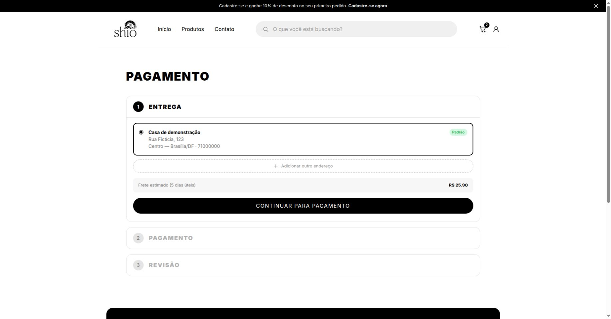

### 2. Confirmação obrigatória

Total de R$ 225,90. Sem marcar a conferência, a finalização permanece desabilitada.

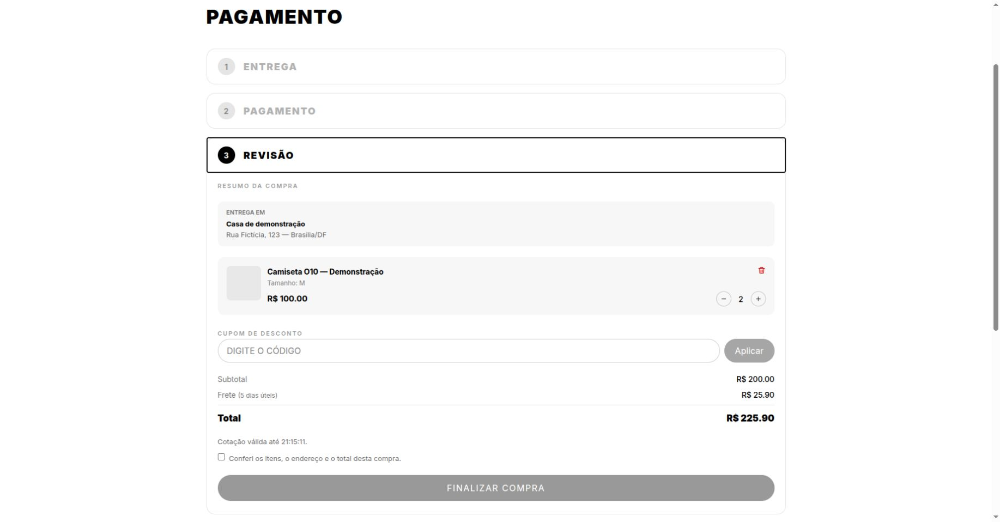

### 3. Compra conferida

Ao confirmar os itens, o endereço e o total, o botão de finalização é habilitado.

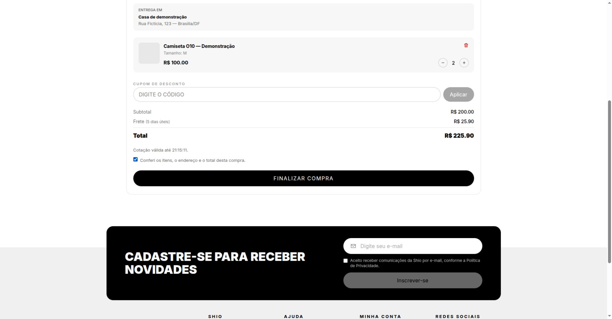

### 4. Alteração de quantidade

Três unidades resultam em R$ 325,90. A confirmação anterior é invalidada e exige nova conferência.

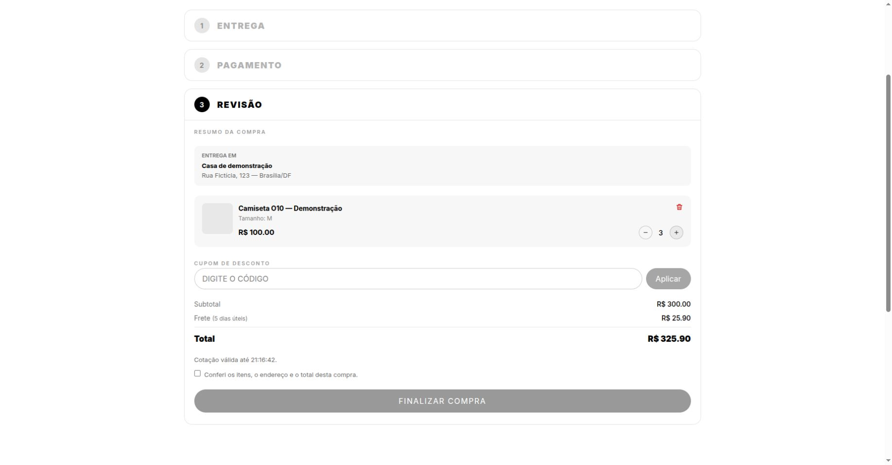

### 5. Cálculo com resposta 429

Captura refeita com outro cliente fictício e troca de endereço após carregar o carrinho. A mensagem apresenta a espera de 30 segundos e a referência da requisição; a continuação fica bloqueada.

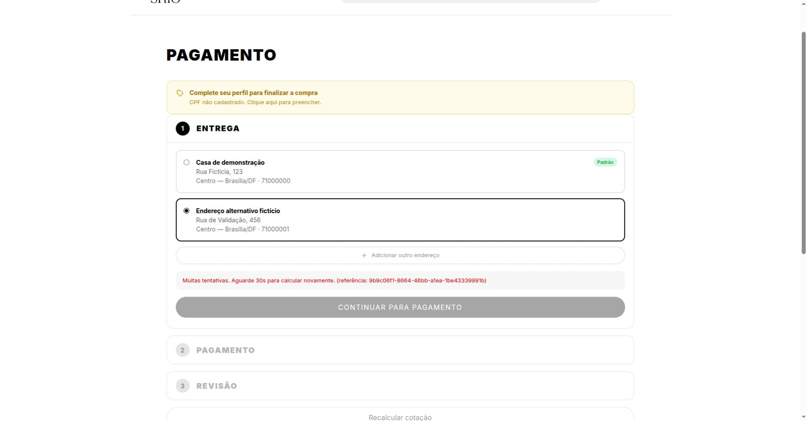

### 6. Cálculo com resposta 503

Indisponibilidade simulada, com referência e espera antes de recalcular.

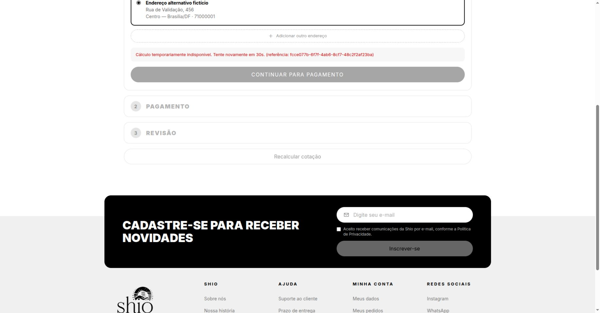

### 7. Checkout indisponível

Resposta 503 simulada antes de processar o checkout. A interface preserva a tentativa para reconsulta e desabilita a consulta durante a espera.

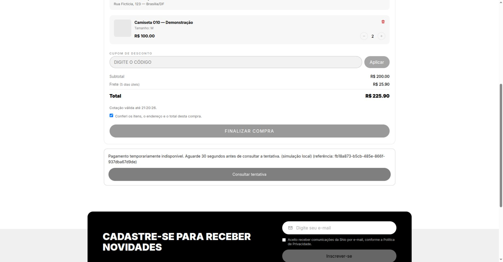

### 8. Resultado incerto do gateway

Ao remover a indisponibilidade do checkout, o gateway local falha. A interface orienta a consultar a tentativa e informa que o pedido foi preservado. A conferência do PostgreSQL após reconsultar encontrou **uma tentativa `UNCERTAIN`, um pedido e estoque oito**, com `last_error_code=gateway_error`.

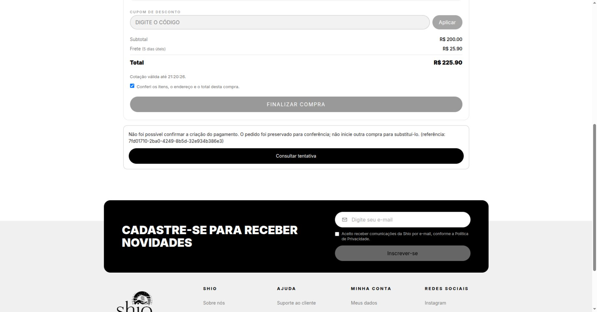

### 9. Inventário administrativo

Após a única reserva de duas unidades, o estoque passa de dez para oito. O produto sem variações é exibido com zero. A mudança da O10 é a agregação de inventário usada pela tela existente; os demais recursos do painel pertencem ao produto já integrado.

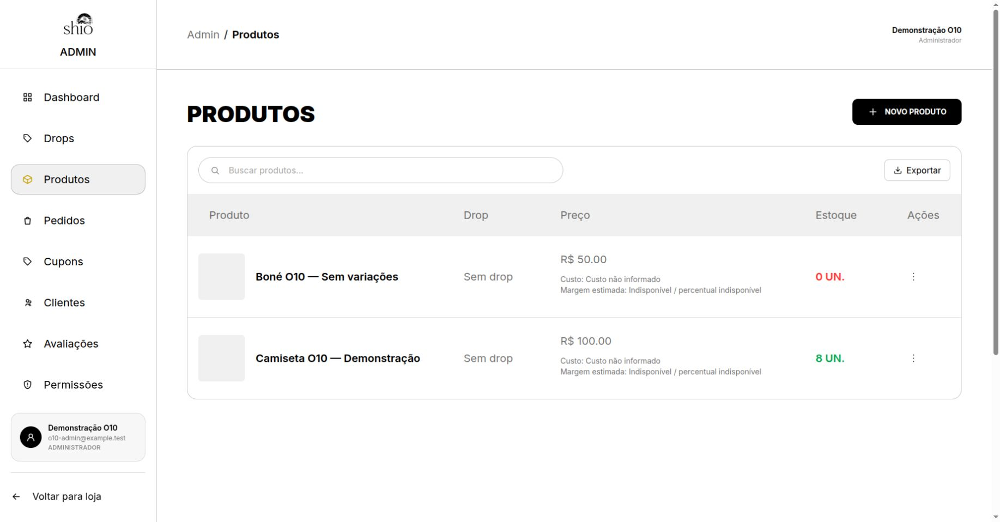

## Evidências técnicas exibidas no Chrome

As próximas imagens mostram **relatórios HTML temporários com saídas reais de testes/API**, abertos no navegador. Esses relatórios não são novas telas do produto.

### 10. Cache, lock e concorrência Redis

Reexecução de `orders/test_redis_shipping.py` e `core/test_cache_config.py`: **11 testes e dois subtestes passaram**, com um warning. Inclui oito acessos em quatro processos com uma única renovação. Não é teste de carga nem comprovação de dez mil usuários simultâneos.

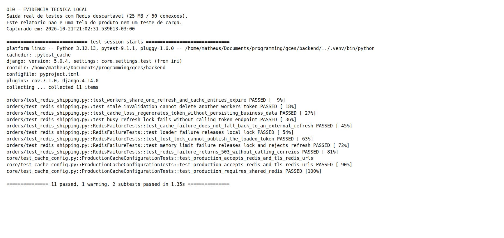

### 11. Permissões do inventário

Requisições reais ao backend local: anônimo recebe 401, cliente comum 403 e administrador 200. Este relatório foi coletado **antes** do checkout, com estoque dez; a evidência 9 mostra o estoque oito **após** a reserva.

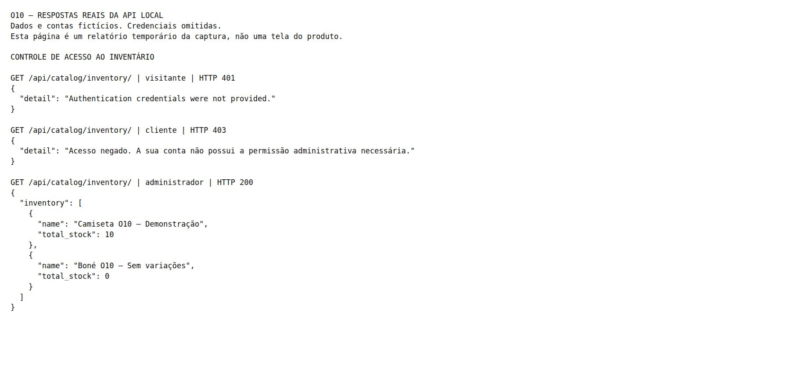

### 12. Parâmetros e snapshot logístico

A API rejeita com 400 a tentativa de enviar origem, peso e serviço pelo cliente. O snapshot consultado no PostgreSQL registra origem, serviço, dimensões, peso, valor declarado e versão da política. Esse snapshot pertence à cotação de **três unidades**, com valor declarado de R$ 300,00, antes de retornar às duas unidades do checkout.

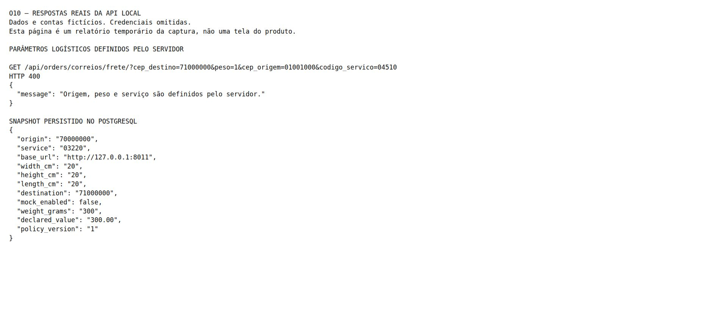

## Rastreabilidade e limites

- [Metadados dos PNGs, URLs e horários](../../../assets/evidencias-o10/capturas.json).
- [Validação e resultados das suítes](sprints/sprint_3/squad_1/o10-validacao-sprint-1.md).
- Render, TLS e provedores externos reais não foram validados nesta captura. O ambiente usa dados descartáveis e não comprova capacidade de produção.
- Na recaptura, uma resposta de erro durante o carregamento inicial, seguida da atualização do carrinho, deixou a interface em “Calculando frete” sem a mensagem. A troca de endereço após o carregamento exibiu o erro corretamente. Essa condição precisa de investigação antes de considerar o tratamento de erros totalmente fechado.
