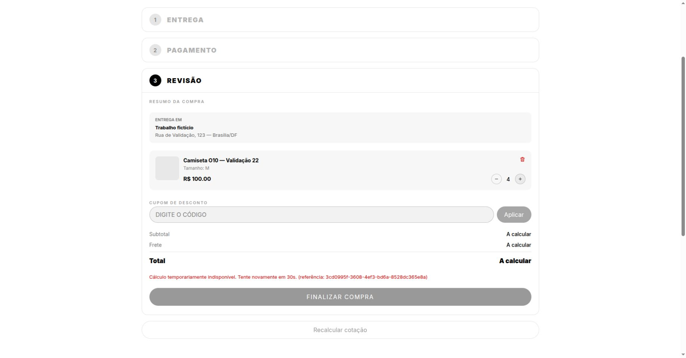
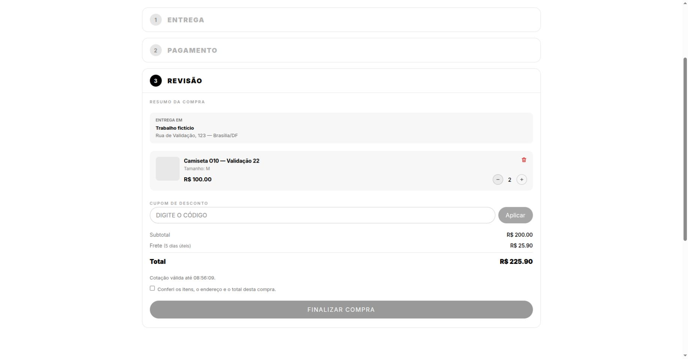

# O10 — validação da Sprint 1

**Atualizado:** 22/10/2026. A seção seguinte registra a revalidação e as correções; os registros posteriores preservam a execução de 21/10.

## Revalidação completa — 22/10/2026

O ambiente foi recriado com PostgreSQL 15 e Redis 7 exclusivos, sem tocar nos serviços existentes. Redis limitado a 25 MB, 50 clientes e sem persistência. Chrome acessou Django em `localhost:8000` e Vite em `localhost:5173`; o cliente HTTP dos Correios apontou para um provedor simulado em `127.0.0.1:8011`. O gateway foi substituído por uma falha local, sem cobrança externa.

### Correções confirmadas por regressão

- **Frete preso em carregamento:** respostas canceladas de cálculos antigos alteravam a espera por Retry-After, enquanto a mensagem era descartada. Além disso, a troca do objeto do carrinho ou as ações de endereço/quantidade podiam ocultar/apagar o erro durante o bloqueio. Agora respostas canceladas são ignoradas antes de alterar o estado, e erros recuperáveis permanecem disponíveis até recálculo ou sucesso. O recálculo continua manual após a espera; não há polling automático.
- **Inicialização:** `wait_for_database` não era reconhecido pelo Django porque `core` não constava em `INSTALLED_APPS`. O registro foi acrescentado. Três testes verificam descoberta do comando, recuperação da conexão e timeout; o comando também retornou `Database ready.` contra o PostgreSQL local.
- Oito novos casos do frontend cobrem 429/503 com atualização inicial em StrictMode, respostas antigas de outro endereço e mudanças de endereço/quantidade durante a espera. As regressões foram observadas antes das respectivas correções.

Correções registradas em `backend/f280225` (comando de inicialização) e `frontend/65b6c27` (recuperação do frete). Nenhum push ou deploy foi realizado.

### Resultado final

| Verificação | Resultado |
| --- | --- |
| Backend completo, PostgreSQL e Redis reais | **731 testes e 299 subtestes passaram**, sem testes ignorados. |
| Frontend completo, dois workers | **267 testes em 50 arquivos passaram**. |
| Ruff lint e formatação | Passaram, 163 arquivos. |
| Django check e migrations | Sem problemas ou alterações pendentes. |
| Dependências Python, sintaxe do entrypoint e configuração Compose | Passaram. |
| Frontend lint e build | Sem erros; 18 warnings existentes no lint; build passou. |

Comandos principais: `PYTHONPATH=<configuração temporária>:$PWD TEST_REDIS_URL=redis://127.0.0.1:26379/0 ../.venv/bin/python -m pytest -q --ds=o10_postgres_settings` no backend, e `npm run test -- --run --maxWorkers=2`, `npm run lint`, `npm run build` no frontend. A configuração temporária herda `core.settings.test` e altera a conexão para o PostgreSQL descartável na porta 25432.

### Verificação funcional

- Chrome: 429 no carregamento inicial e 503 no recálculo mantiveram mensagem/referência, bloqueio e recuperação. Trocar endereço e quantidade durante os 30 segundos de espera preservou o erro e a opção de recálculo.
- Cotação recuperada: quatro unidades totalizaram R$ 425,90; ao voltar para duas, total de R$ 225,90 e confirmação anterior invalidada.
- Checkout: 429/503 com espera de cinco segundos preservaram a tentativa. Após retirar a falha injetada, o gateway isolado resultou em UNCERTAIN. Reconsulta manteve **um pedido, uma tentativa e estoque oito**, com `last_error_code=gateway_error`.
- Permissões HTTP: inventário 401 para anônimo, 403 para cliente e 200 para administrador; parâmetro logístico controlado pelo cliente rejeitado com 400. Cliente comum redirecionado ao abrir `/admin/products`; administrador visualizou oito unidades e zero para produto sem variações.
- Redis real parado: frete retornou 503. Após reiniciar o container sem persistência, voltou a retornar 200, regenerando o token. A suíte também cobriu cache/lock e concorrência entre processos.
- Snapshot conferido no PostgreSQL: origem 70000000, destino 72000000, serviço 03220, peso 300 g, dimensões 20 cm, valor declarado 200,00 e política 1.

[Metadados das capturas de 22/10](../../../assets/evidencias-o10/validacao-22-capturas.json). [Resultados HTTP, Redis e checkout](../../../assets/evidencias-o10/validacao-22-resultados.json). Logs completos da execução estão no workspace em `output/o10-validacao-22/`. Os 497 warnings do backend incluem depreciação do Django e diretório de estáticos ausente nos testes; o jsdom também informa navegação externa não implementada.

**Limites:** não houve deploy, teste de carga, TLS de conexão real nem chamada aos provedores comerciais. A validação é funcional local e não comprova capacidade para dez mil usuários simultâneos. Quota, throttling e observabilidade continuam fora desta etapa.

## Histórico da execução de 21/10

 Validação do workspace local sobre `backend/dev` e `frontend/dev`; alterações capturadas antes dos commits locais de 22/10, ainda sem publicação. Os fluxos de navegador foram validados em 20/10 e novamente capturados em 21/10 com PostgreSQL e Redis reais locais.

## Ambiente e dependências

Em 20/10, foi instalado `openpyxl==3.1.5` (e sua dependência `et-xmlfile`) no ambiente `.venv`, usando o `requirements.txt` existente; o frontend foi instalado com `npm ci`. Em 21/10, foi declarada e instalada a dependência `redis==8.1.0` para cache e locks compartilhados.

Os testes manuais usaram Chrome, frontend em `localhost:5173` e backend em `localhost:8000`, com SQLite separado em `/tmp/gces-o10-validation/db.sqlite3`, usuários e produtos fictícios, Correios em modo mock e falha simulada do gateway. As respostas 429/503 com `Retry-After: 15` foram injetadas por middleware exclusivo desse ambiente temporário. Nenhuma cobrança foi enviada a um provedor externo.

A suíte de PostgreSQL usou um container exclusivo `gces-o10-validation-postgres`, imagem `postgres:15-alpine`, banco em memória temporária e porta local `25432`. Os bancos e containers existentes não foram usados para os testes.

## Testes automatizados

| Verificação | Resultado |
| --- | --- |
| Backend completo com PostgreSQL 15 e Redis, 21/10 | **728 testes e 299 subtestes passaram**, sem falhas ou testes ignorados; inclui concorrência, checkout, permissões, inventário e integração Redis. |
| Frontend completo: `npm run test -- --run --maxWorkers=2` | **259 testes passaram em 50 arquivos**. |
| `ruff check .` e `ruff format --check .` | Passaram; 162 arquivos formatados. |
| `manage.py check --settings=core.settings.test` | Sem problemas. |
| `manage.py makemigrations --check --dry-run --settings=core.settings.test` | Sem migrations pendentes. |
| `sh -n entrypoint.sh` | Passou. |
| `npm run lint` | Sem erros; 18 warnings existentes. |
| `npm run build` | Passou. |

O backend foi executado com `../.venv/bin/python -m pytest -q --ds=o10_postgres_settings`, com `PYTHONPATH` incluindo o módulo temporário de configuração e o backend. O módulo herda `core.settings.test` e altera somente a conexão para o PostgreSQL temporário. A suíte padrão usa SQLite e ignora sete testes que exigem concorrência/bloqueios do PostgreSQL.

Na execução de 21/10, `TEST_REDIS_URL=redis://127.0.0.1:26379/0` habilitou também os quatro testes de Redis real. O serviço era exclusivo e descartável, nunca um Redis existente ou de produção. A suíte normal permite executar sem Redis; nesse caso, esses quatro testes são ignorados. A CI recebeu um serviço Redis e define `TEST_REDIS_URL` para executá-los.

A primeira execução sem limite de concorrência do Vitest apresentou um timeout de inicialização no checkout. A execução completa passou com dois workers; nenhuma espera foi aumentada para ocultar a falha.

Na primeira conferência de fechamento de **21/10/2026**, sete testes específicos passaram antes da ampliação para Redis. Depois da decisão de antecipar Redis para esta entrega, a suíte completa foi reexecutada com o resultado atualizado acima. Em 21/10, uma nova execução no Chrome gerou [12 capturas documentadas](sprints/sprint_3/squad_1/o10-evidencias-sprint-1.md), usando PostgreSQL isolado e Redis real. O cliente HTTP apontou para um provedor Correios simulado localmente; 429/503 usaram espera de 30 segundos. Os testes direcionados de Redis/configuração foram reexecutados: 11 testes e dois subtestes passaram, com um warning.

## Redis Free: validação de 21/10

- Redis local real limitado a **25 MB**, política `noeviction`, sem persistência; no smoke test de reinício foi aplicado também o limite de **50 clientes**.
- Oito acessos em quatro processos distintos leram o mesmo token com **uma única renovação**. As duas chaves de token tinham TTL positivo de até 60 segundos no teste.
- Dois provedores distintos compartilharam o token; a invalidação de um token antigo preservou o mais novo.
- Perda das chaves regenerou o token; lock ocupado impediu chamar o endpoint externo sem proteção; perda de propriedade do lock impediu publicar o token carregado.
- Falha do Redis retornou **503** na rota de frete sem chamar Correios. Memória esgotada resultou em erro controlado e liberação do lock.
- Configuração de produção sem `REDIS_URL` falhou na inicialização; URLs `redis://` e `rediss://` foram aceitas, com limite de cinco conexões em cada pool.
- Um smoke test usando o alias configurado em Django, sem injetar cache no provedor, compartilhou o token entre duas instâncias e renovou uma vez. Após reiniciar de verdade o container sem persistência, o token foi regenerado e novamente compartilhado. Memória total observada com esse conjunto mínimo: **aproximadamente 1,2–1,4 MB**; isso não é medição de carga nem previsão para dez mil usuários.

Orçamento do cliente: cinco conexões para `RedisCache` e cinco para lock em cada um dos três workers atuais, até 30 conexões da aplicação. O Redis recebe apenas dados temporários; pedidos, pagamentos, idempotência e estoque permanecem no PostgreSQL.

O backend mantém o cache padrão separado e usa Redis apenas no alias `correios`, para não fazer outras funções do catálogo dependerem da disponibilidade do cache das integrações.

## Validação manual no Chrome

| Cenário | Resultado observado |
| --- | --- |
| Login do cliente fictício e cálculo de frete | Endereço selecionado; dois itens de R$ 100,00, frete R$ 25,90, prazo de cinco dias úteis e total R$ 225,90. |
| Revisão e confirmação | Finalização bloqueada antes de conferir os itens; habilitada após marcar a confirmação. |
| Alteração de quantidade | Total recalculado para R$ 325,90 com três unidades; confirmação anterior invalidada. Ao voltar para duas unidades, total de R$ 225,90 e nova confirmação obrigatória. |
| 429 e 503 no cálculo | Erro apresentado com referência `X-Request-ID`; recálculo bloqueado durante `Retry-After` e liberado após a espera. |
| Recuperação do cálculo | Nova cotação obtida ao remover a indisponibilidade simulada. |
| 429 e 503 no checkout | Consulta da tentativa bloqueada durante a espera; mesma tentativa mantida para reconsulta. |
| Falha do gateway | Mensagem de conferência apresentada; tentativa persistida como `UNCERTAIN`, com `last_error_code=gateway_error`. |
| Reconsulta após falha | Continuaram existindo uma tentativa e um pedido; estoque permaneceu em oito unidades após uma única reserva de duas unidades. |
| Cliente comum em `/admin/products` | Redirecionado para a loja. |
| Administrador em `/admin/products` | Produto exibido com oito unidades, consistente com o estoque reservado. |

O snapshot persistido contém origem, destino, serviço, peso, dimensões, valor declarado e versão da política logística.

## Pendência observada nas capturas de 21/10

Uma resposta 429 durante o carregamento inicial, seguida da atualização do carrinho, deixou a interface em “Calculando frete” sem exibir o erro. Após carregar normalmente e trocar o endereço, 429/503 exibiram a mensagem e o bloqueio corretamente. A condição foi corrigida e revalidada em 22/10, conforme o registro acima.

## Correções encontradas na validação

- Dois testes antigos ainda esperavam o contrato de frete sem dimensões/valor declarado. As expectativas e o mock de alteração concorrente foram adequados ao contrato atual.
- O backend não expunha `Retry-After` e `X-Request-ID` via CORS. Isso impedia a leitura desses cabeçalhos pelo frontend em outra origem. A configuração foi corrigida e recebeu teste de regressão.
- A cobertura do frontend foi ampliada para 429 e 503 no cálculo e no checkout, verificando espera, ausência de polling automático e reutilização do payload da tentativa.

## Limites

Correios e InfinitePay reais e TLS de produção não foram validados nesta etapa. Redis distribuído entre processos foi validado localmente; a instância Render Free ainda não foi provisionada/conectada. O PostgreSQL local validou comportamento funcional e concorrência, sem TLS. O Render Free pode reiniciar e perder cache/locks; não usar esse serviço como registro durável de quota comercial. A exclusão do lock não é garantida durante perda de dados/reinício do Redis.

O `npm audit` identificou **16 vulnerabilidades nas dependências do lockfile existente: 1 baixa, 5 moderadas e 10 altas**. Atualizações dessas dependências não fizeram parte desta validação. Permanecem também avisos de depreciação do Django, diretório de estáticos ausente nos testes e navegação externa não implementada pelo jsdom.
