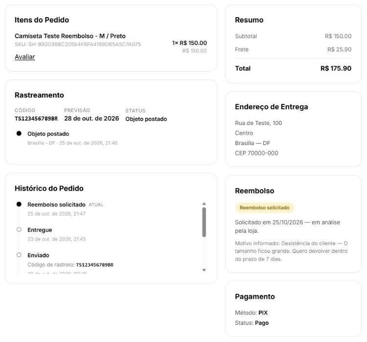
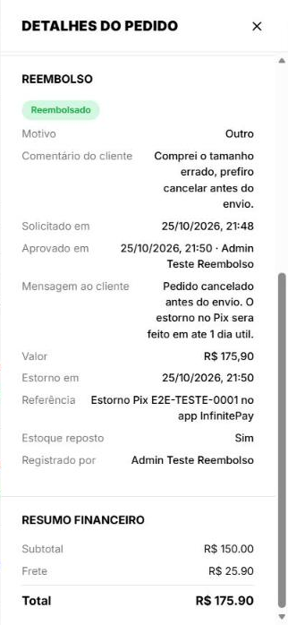
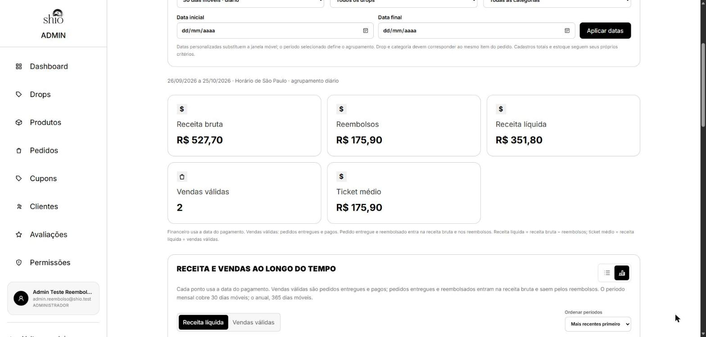

## Reembolso de compras — Solicitação, análise e registro do estorno
**Trio:** Amanda, Felipe e Cauã

**Origem:**
- [Issue #71](https://github.com/Shio-Enterprise/Documentacao/issues/71) — permitir que o cliente peça o reembolso e que a loja registre o estorno.

**Por que a melhoria foi relevante?**
O cliente não tinha como pedir a devolução do dinheiro de uma compra, inclusive dentro do prazo de arrependimento de 7 dias garantido pelo CDC, e a loja não tinha como registrar o estorno: o status `REFUNDED` existia, mas nenhum fluxo o gravava. Pedidos pagos depois que a reserva expirava ficavam cancelados com o dinheiro retido, e a tela de retorno só dizia "entre em contato". A entrega permite que o cliente solicite o reembolso pelo detalhe do pedido e que o administrador aprove ou recuse, faça o estorno no painel da InfinitePay e registre-o no sistema. O sistema cancela o pedido ou devolve o estoque conforme o momento da compra, bloqueia o envio enquanto a solicitação está em análise e avisa o cliente por e-mail em cada etapa. A entrega também corrige as métricas: um pedido entregue e reembolsado era descontado duas vezes, deixando a receita líquida negativa.

**Evidências (Pull Requests):**

- [Frontend PR #30](https://github.com/Shio-Enterprise/frontend/pull/30)
- [Backend PR #33](https://github.com/Shio-Enterprise/backend/pull/33)

**Evidências (prints):**

### Solicitação pelo cliente

O cliente solicitou o reembolso de um pedido entregue, dentro do prazo de 7 dias após a entrega. O detalhe do pedido passa a exibir **Reembolso solicitado**, em análise pela loja, com o motivo e o comentário informados, e o evento entra na linha do tempo. O pagamento continua **Pago**: a solicitação, sozinha, não devolve dinheiro nem altera o pedido:

### Análise e registro do estorno pelo administrador

No painel de pedidos, o administrador aprovou a solicitação de um pedido que ainda não tinha sido enviado: na aprovação, o pedido foi cancelado e o estoque voltou. Depois de fazer o estorno no painel da InfinitePay, o administrador registrou-o no sistema e o reembolso passou a **Reembolsado**. O painel reúne o motivo e o comentário do cliente, a aprovação com o responsável e a mensagem enviada ao cliente, o valor, a data e a referência do estorno, a reposição do estoque e quem registrou:

### Métricas sem dupla contagem

Depois dos reembolsos, o pedido entregue e reembolsado continua na **receita bruta** (R$ 527,70), aparece em **reembolsos** (R$ 175,90) e é descontado uma única vez da **receita líquida** (R$ 351,80). Os pedidos reembolsados que nunca foram entregues não alteram a receita. Com a regra anterior, os mesmos dados resultariam em receita líquida de −R$ 175,90:

