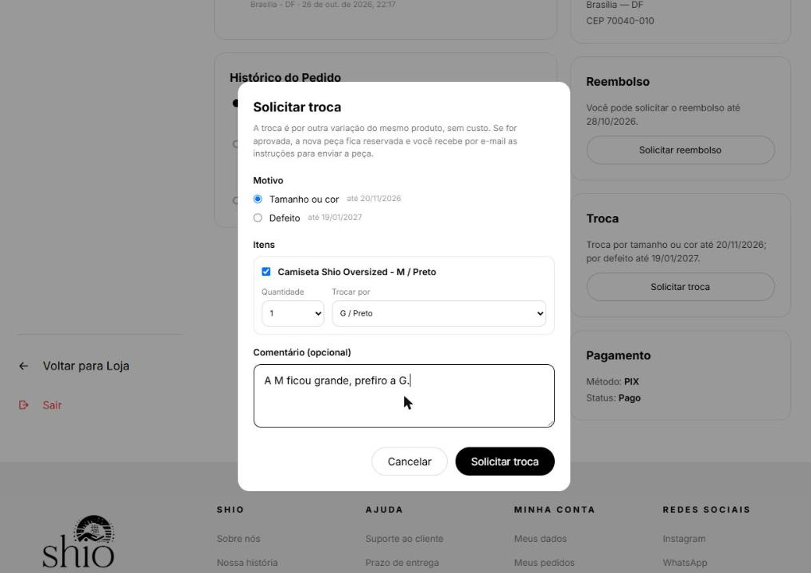
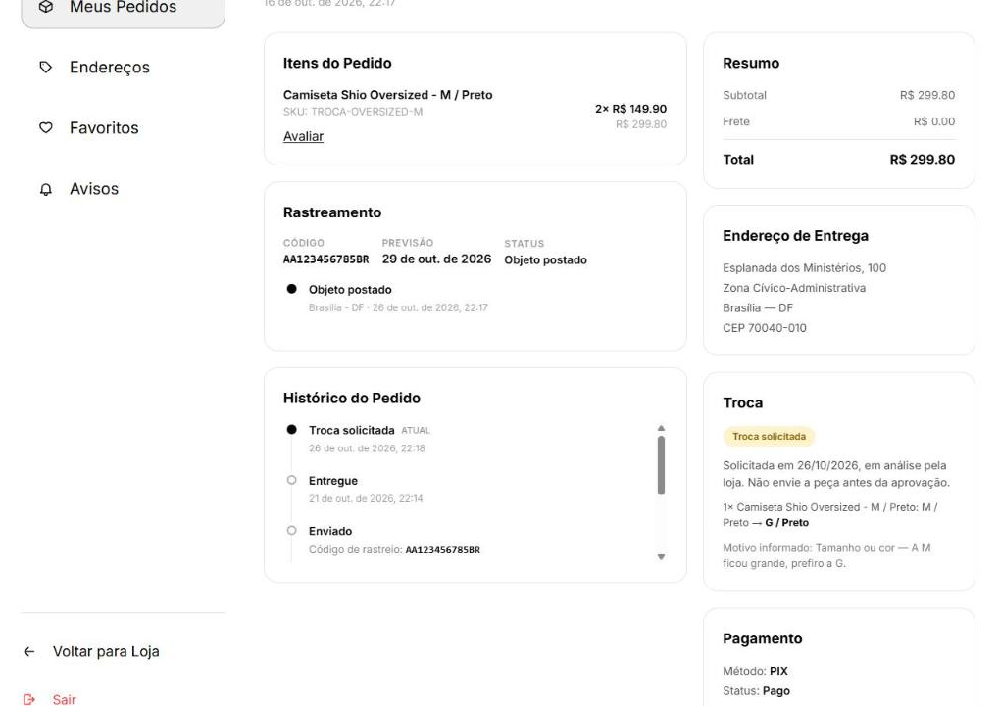
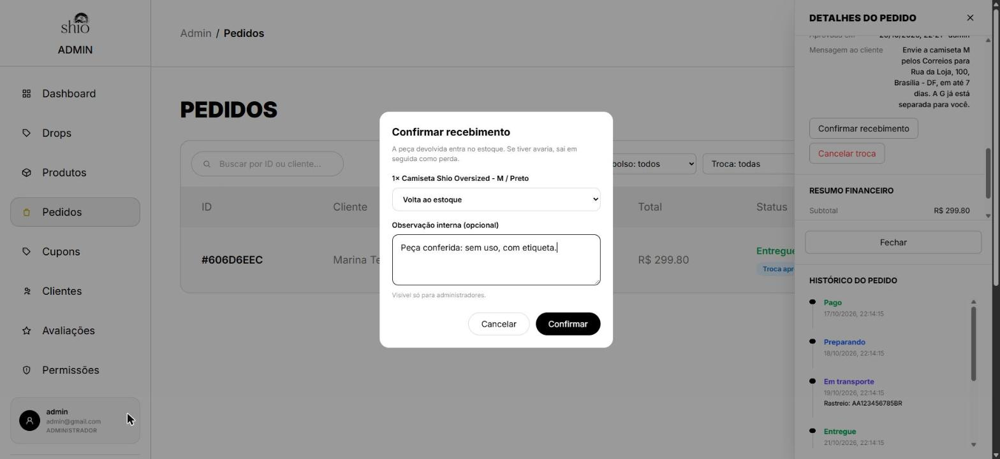
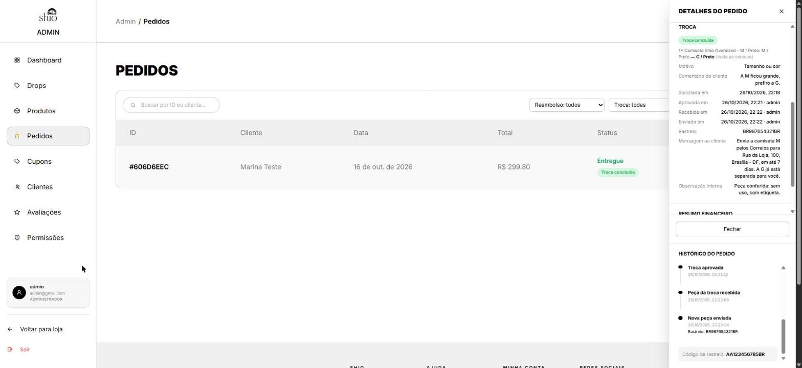
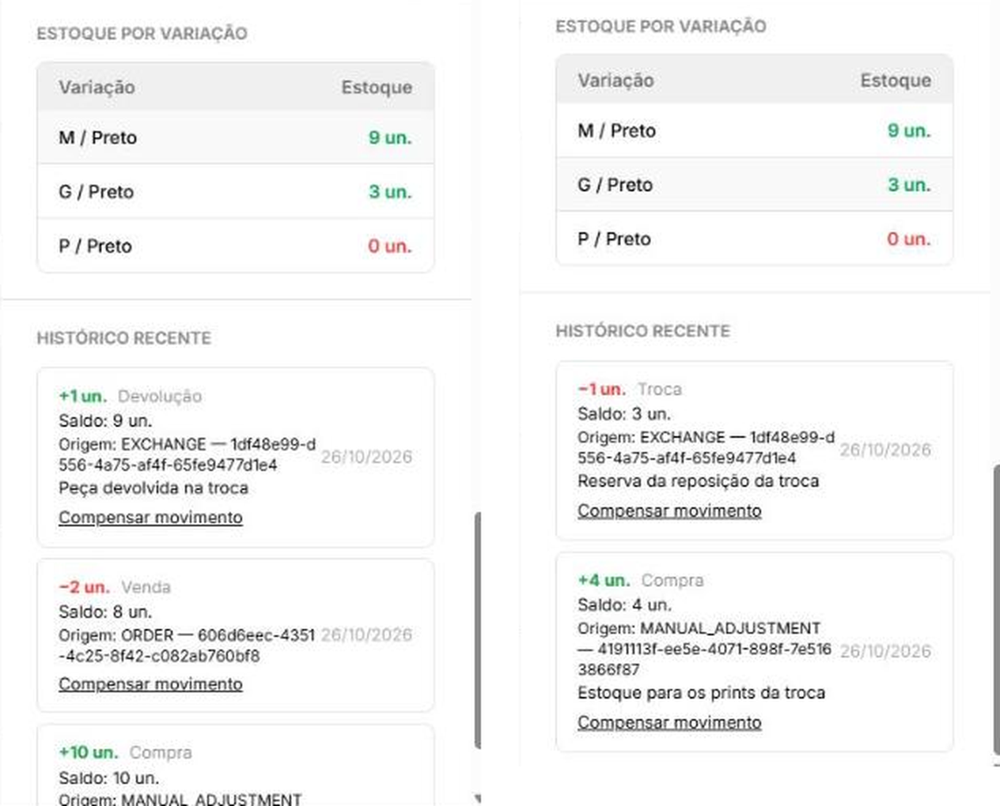

## Troca de itens — Solicitação, análise, recebimento e envio da reposição
**Trio:** Amanda, Felipe e Cauã

**Origem:**
- [Issue #73](https://github.com/Shio-Enterprise/Documentacao/issues/73) — permitir que o cliente peça a troca de itens de um pedido entregue e que a loja registre cada etapa, com o estoque refletindo as peças que saem e voltam.

**Por que a melhoria foi relevante?**
O cliente não tinha como pedir a troca de um item recebido, nem por tamanho ou cor errados, nem por defeito: o reembolso cobria só a devolução integral do pedido, então a única saída pelo sistema era desfazer a compra inteira. Na prática a troca era combinada por fora e não deixava registro: o histórico de estoque não mostrava a entrada da peça devolvida nem a saída da nova, e num drop com pouco estoque a última unidade podia ser vendida enquanto estava prometida para uma troca. A entrega permite que o cliente solicite, pelo detalhe do pedido entregue, a troca de um ou mais itens por outra variação do mesmo produto, dentro do prazo do motivo escolhido (30 dias para tamanho ou cor, política da loja; 90 dias para defeito, CDC art. 26, II). O administrador aprova com instruções de envio ou recusa com justificativa, confirma o recebimento informando se a peça volta ao estoque ou é perda/avaria, e registra o envio da reposição com código de rastreio. Na aprovação, a reposição fica reservada no estoque; cada movimento entra no histórico ligado à troca. Troca e reembolso não coexistem no mesmo pedido, a troca não altera as métricas, e o cliente é avisado por e-mail em cada etapa.

**Evidências (Pull Requests):**

- [Frontend PR #34](https://github.com/Shio-Enterprise/frontend/pull/34)
- [Backend PR #37](https://github.com/Shio-Enterprise/backend/pull/37)

**Evidências (prints):**

### Solicitação pelo cliente

Em um pedido entregue há 5 dias, a cliente abriu o formulário de troca pelo detalhe do pedido. O formulário mostra o prazo de cada motivo (tamanho ou cor até 20/11/2026; defeito até 19/01/2027), deixa escolher o item, a quantidade e a nova variação do mesmo produto, e marca como **esgotada** a variação sem estoque, que não pode ser escolhida. A cliente pediu a troca de uma camiseta M por uma G:

Depois do envio, o detalhe do pedido passa a exibir **Troca solicitada**, em análise pela loja, com o item trocado (M → G), o motivo e o comentário informados, e o evento entra no histórico do pedido. O quadro de reembolso deixa de aparecer: troca e reembolso não coexistem no mesmo pedido:

### Análise, recebimento e envio pelo administrador

No painel de pedidos, o administrador aprovou a troca com as instruções de envio da peça; na aprovação, a camiseta G foi reservada no estoque. Quando a peça chegou, ele confirmou o recebimento informando a condição de cada item (**volta ao estoque** ou **perda/avaria**) e uma observação interna, visível só para administradores:

Por fim, o administrador registrou o envio da nova peça com o código de rastreio, e a troca passou a **Troca concluída**, também no selo da lista de pedidos. O painel reúne o item trocado e a condição da peça devolvida, o motivo e o comentário da cliente, cada etapa com data e responsável, o rastreio, a mensagem enviada à cliente e a observação interna; o histórico do pedido registra a aprovação, o recebimento e o envio:

### Estoque registrado no histórico

Cada movimento da troca entra no histórico de estoque com origem `EXCHANGE`, ligado ao item da troca. À esquerda, a variação M: depois da venda de 2 unidades (saldo 8), a peça devolvida voltou como **Devolução** (+1, saldo 9). À direita, a variação G: a reposição saiu como **Troca** na aprovação (−1, saldo 3), reservada antes de a peça da cliente chegar, para não ser vendida no meio do processo:

