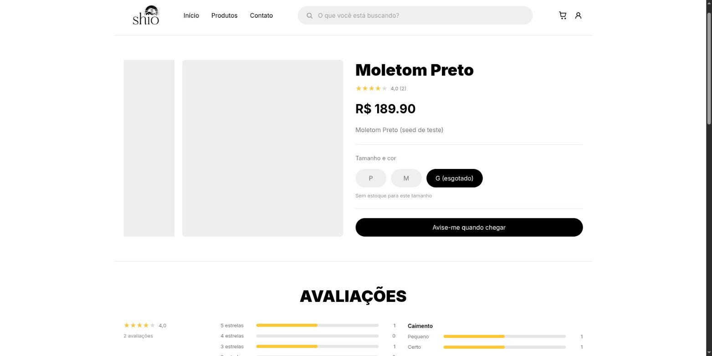
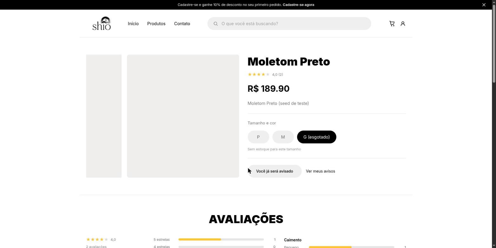
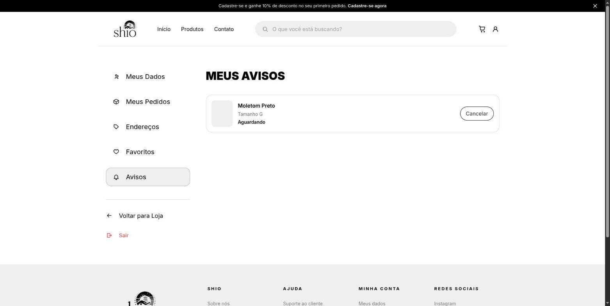
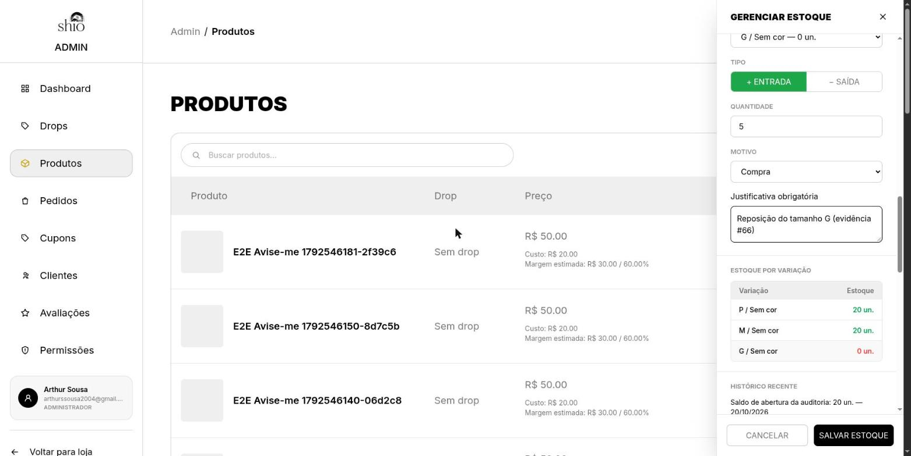
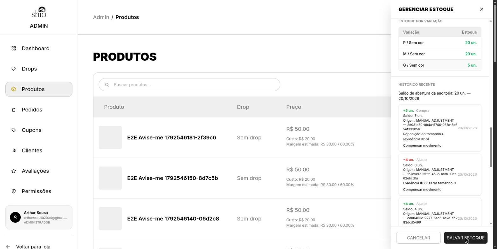
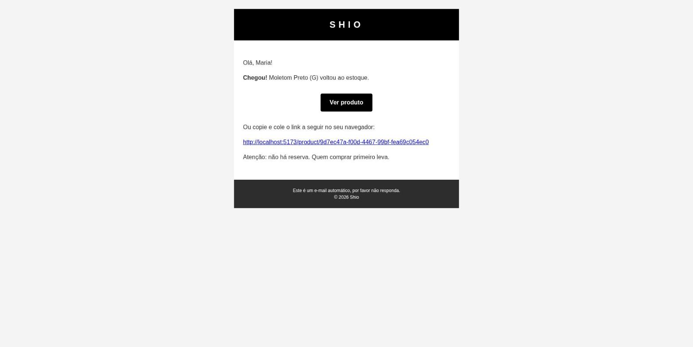
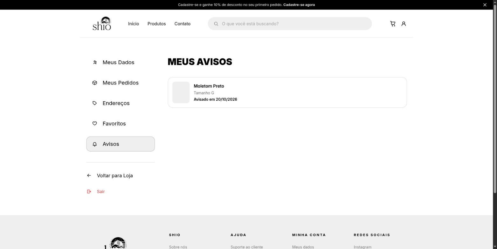

# "Avise-me quando chegar"

**Trio:** Ian, Arthur e Danilo

**Origem:**
- [Issue #66](https://github.com/Shio-Enterprise/Documentacao/issues/66): "Avise-me quando chegar" para tamanho esgotado.

## Contexto e Relevância

Quando um tamanho de um produto esgotava, o cliente não tinha como saber quando ele voltava, e a loja perdia a venda. Com esta funcionalidade, o cliente logado pede um **aviso** no tamanho esgotado e recebe um **e-mail** quando ele volta a ser vendido. Os pedidos ficam numa página nova, **"Meus avisos"**, onde também podem ser cancelados.

O envio usa o Resend, configurado na issue [#35](https://github.com/Shio-Enterprise/Documentacao/issues/35).

---

## Regras e Especificações Implementadas

1. **Por variação**: o aviso vale para o tamanho (e cor) escolhido. Quem pediu o M não é avisado quando o G volta.
2. **Só cliente logado**: o visitante que clica em "Avise-me quando chegar" vai para o login e volta para o produto. O pedido não tem prazo de validade: vale até o tamanho voltar.
3. **Um pedido por tamanho**: pedir de novo o mesmo tamanho mostra "Você já será avisado", sem duplicar.
4. **Um e-mail por pedido**: depois de avisado, o pedido é encerrado. Se o tamanho esgotar de novo, o cliente pede outra vez.
5. **Quando o aviso dispara**:
   - o estoque do tamanho passa de **0 para mais de 0**, seja por entrada de estoque pelo admin, cancelamento ou devolução de pedido;
   - o produto **volta a ser vendável** porque o admin reativou o produto, tornou o drop público ou ativo, vinculou ou desvinculou o produto de um drop, ou apagou o drop.
6. **Quando não dispara**: produto inativo, drop privado, encerrado ou esgotado. Os pedidos continuam aguardando.
7. **Envio**:
   - vai para todos os pedidos pendentes, na ordem em que foram feitos;
   - se o envio para uma pessoa falha, o pedido dela continua aguardando e as outras recebem normalmente;
   - se o tamanho esgota no meio do envio, o envio para e os demais continuam aguardando.
8. **Sem e-mail repetido**: antes de enviar, cada pedido é marcado como avisado com uma atualização condicional no banco. Mesmo com duas reposições ao mesmo tempo, cada pessoa recebe um e-mail só.
9. **O admin não espera**: os e-mails saem em segundo plano depois que a reposição é salva, com pausa de 0,6 s entre envios por causa do limite do Resend.
10. **E-mail**: traz o nome do produto, o tamanho, o botão "Ver produto" e o aviso "não há reserva, quem comprar primeiro leva".

---

## Endpoints do Backend

Rotas do cliente, todas com login obrigatório:

- `POST /api/catalog/stock-alerts/`: cria o pedido (201). Se já existe um pendente, responde 200 com `already_pending`. Tamanho com estoque ou produto não vendável retornam 400.
- `GET /api/catalog/stock-alerts/`: lista os pedidos do cliente, pendentes primeiro.
- `GET /api/catalog/stock-alerts/pending-variations/`: ids dos tamanhos com pedido pendente, para a página do produto.
- `DELETE /api/catalog/stock-alerts/<id>/`: cancela um pedido pendente do próprio cliente.

Arquivos principais:
- `products.StockAlert` (migration `products/0009`): cliente, tamanho, data do pedido e data do aviso.
- `products/stock_alerts.py`: envio dos avisos e detecção de produto que voltou a ser vendável.
- `move_stock`: único ponto que altera o estoque e onde o aviso é disparado.
- Template `stock_alert`: e-mail do aviso.

---

## Componentes do Frontend

- **Página do produto** (`ProductDetailPage`):
  - O tamanho esgotado pode ser escolhido e continua com "(esgotado)".
  - Com o tamanho esgotado selecionado, "Adicionar ao Carrinho" dá lugar a **"Avise-me quando chegar"**.
  - Depois do pedido aparece **"Você já será avisado"**, com o link "Ver meus avisos".
- **"Meus avisos"** (`/my-stock-alerts`), com o item "Avisos" no menu da conta:
  - pedidos aguardando, com botão Cancelar;
  - pedidos já avisados, com "Avisado em dd/mm/aaaa".
- `src/lib/stockAlertsApi.js`: chamadas da API de avisos.

---

## Evidências (Pull Requests)

- [Backend PR #31](https://github.com/Shio-Enterprise/backend/pull/31)
- [Frontend PR #28](https://github.com/Shio-Enterprise/frontend/pull/28)

---

## Validação Automatizada

Desenvolvido em TDD (o teste é escrito antes e falha antes do código existir), com revisão de código por tarefa e uma revisão final da branch inteira.

### Backend (Pytest): suíte completa com 741 testes passando
- **`products/test_stock_alerts.py`** (42 testes):
  - **Envio**:
    - envia para todos os pendentes na ordem do pedido;
    - não avisa outro tamanho;
    - falha num envio não afeta os outros;
    - produto não vendável não envia;
    - não reenvia para quem já foi avisado;
    - para quando o tamanho esgota no meio do envio;
    - usuário inativo é ignorado.
  - **Segundo plano**:
    - envio em thread separada;
    - erro registrado no log;
    - pausa entre envios, sem pausa antes do primeiro.
  - **Gatilhos**:
    - reposição de 0 para mais dispara, e de 3 para 5 não;
    - repetir a mesma movimentação não dispara de novo;
    - operação desfeita (rollback) não dispara;
    - cancelamento de pedido que devolve estoque dispara;
    - reativar produto, tornar drop público, tirar produto de drop encerrado e apagar drop disparam.
  - **API**:
    - 401 sem login;
    - pedido duplicado responde "já pendente";
    - tamanho com estoque ou produto não vendável responde 400;
    - lista só os pedidos do próprio cliente;
    - cancelar o pedido de outra pessoa responde 404;
    - pode pedir de novo depois de avisado.
  - **Concorrência no PostgreSQL**: dois envios simultâneos, dois pedidos simultâneos e duas reposições simultâneas resultam em um e-mail só por pedido. Teste de mutação: tirando a marcação feita antes do envio, o teste falha em 10 de 10 execuções.
- **E2E automatizado (Selenium)**: `selenium_tests/test_e2e_stock_alert.py`, com 3 testes passando:
  - visitante vai para o login;
  - fluxo completo do cliente até "Avisado em";
  - botão visível no celular.
  - Só roda contra localhost.

### Frontend (Vitest & Testing Library): suíte completa com 276 testes passando
- **`src/pages/public/ProductDetailPage/index.test.jsx`**:
  - botão "Avise-me quando chegar" no tamanho esgotado;
  - "Você já será avisado" depois do pedido ou se já havia pedido;
  - visitante e sessão expirada vão para o login;
  - produto não vendável continua "Indisponível".
- **`src/pages/user/MyStockAlertsPage/index.test.jsx`**:
  - pendentes com Cancelar;
  - avisados com "Avisado em";
  - produto que saiu da loja aparece sem link.
- **`src/lib/stockAlertsApi.test.js`**: chamadas da API.

O CI (GitHub Actions) passou nos dois PRs.

---

## Validação Manual

Fluxos testados no navegador com backend e frontend rodando localmente e **envio real pelo Resend**. Os e-mails de teste foram só para endereços do próprio time.

1. **Visitante**: escolheu o tamanho esgotado, viu "Avise-me quando chegar", foi levado ao login e, depois de entrar, voltou para o produto.
2. **Pedido**: o cliente pediu o aviso e a tela mostrou "Você já será avisado". Em "Meus avisos", o pedido aparece como "Aguardando".
3. **Reposição**: o admin deu entrada de 5 unidades no tamanho G pelo painel. A tela respondeu na hora, e o e-mail "Chegou! Moletom Preto — Shio" chegou na caixa de entrada. Em "Meus avisos", o pedido passou para "Avisado em".
4. **Sem repetição**: uma nova reposição não reenviou o e-mail.
5. **Produto inativo**: com o produto inativo, a reposição não enviou nada. Ao reativar o produto, o e-mail saiu.

---

## Limitações Conhecidas

- Drop que abre sozinho pela data de lançamento, sem ninguém salvar nada, não dispara o aviso. Os pedidos esperam a próxima reposição ou reativação.
- Se o servidor reiniciar no meio de um envio, um pedido pode ficar marcado como avisado sem o e-mail ter saído.
- Alterações feitas pelo Django admin (`/admin/`) não disparam o aviso; só as feitas pelo painel da loja.

---

## Evidências (prints)

Página do produto com o tamanho G esgotado selecionado e o botão "Avise-me quando chegar":

Depois do pedido, a página mostra "Você já será avisado" e o link para "Meus avisos":

"Meus avisos" com o pedido aguardando e o botão Cancelar:

Admin dando entrada de 5 unidades no tamanho G (que estava com 0):

Estoque atualizado e movimentação registrada no histórico:

E-mail do aviso como chega para o cliente:

"Meus avisos" depois da reposição, com "Avisado em":

