# Envio de Cupom por E-mail

**Trio:** Ian, Arthur e Danilo

**Origem:**
- [Issue #67](https://github.com/Shio-Enterprise/Documentacao/issues/67): envio de cupom por e-mail para clientes.

## Contexto e Relevância

O admin já criava cupons no painel, mas o cupom só chegava ao cliente se a loja divulgasse por fora (Instagram, WhatsApp). Com esta funcionalidade, o admin pode **enviar o cupom por e-mail** logo depois de criá-lo ou quando quiser, pela lista de cupons.

Para respeitar a LGPD, o envio vai apenas para quem tem relação com a loja e não pediu para sair. Junto vieram o **aceite de promoções** no cadastro e em "Minha conta" e o **descadastro por link** em todo e-mail promocional. O envio usa o Resend, configurado na issue [#35](https://github.com/Shio-Enterprise/Documentacao/issues/35).

---

## Regras e Especificações Implementadas

1. **Quem recebe o cupom**:
   - **Clientes que já compraram**: conta ativa com pelo menos um pedido pago, em preparação, enviado ou entregue (base legal: legítimo interesse).
   - **Quem aceitou receber**: inscritos na newsletter com consentimento, ou quem marcou a caixa no cadastro ou em "Minha conta".
   - **Ficam de fora** os que pediram para não receber. Comprar de novo não coloca a pessoa de volta na lista.
   - Ninguém recebe duas vezes: os e-mails são comparados sem diferenciar maiúsculas e minúsculas.
2. **Cupom "só primeira compra"**: vai apenas para inscritos que ainda não têm pedido válido, pela mesma regra do checkout. Assim ninguém recebe um cupom que depois é recusado na hora de pagar.
3. **Quando o envio é bloqueado**: cupom inativo, vencido ou esgotado não pode ser enviado. O backend confere isso de novo no momento do envio. Cupom com início no futuro pode ser enviado como pré-anúncio, e o e-mail mostra "Válido a partir de DD/MM/AAAA".
4. **Tela de envio**:
   - quantas pessoas recebem, separado por grupo;
   - mensagem opcional de até 500 caracteres, exibida como texto (HTML é escapado);
   - pré-visualização do e-mail;
   - "Enviar teste para mim";
   - confirmação antes do envio real ("Enviar para N pessoas? Não dá para desfazer."), com aviso extra se o cupom já foi enviado antes.
5. **Um e-mail por pessoa**: cada destinatário recebe o próprio e-mail, com o próprio link de descadastro. O endereço de um cliente nunca aparece para outro. Há uma pausa de 0,6 s entre envios por causa do limite por segundo do Resend.
6. **Histórico**: cada envio registra data, quem enviou, quantos foram entregues e quantos falharam. O e-mail de teste não entra no histórico.
7. **Descadastro**: todo e-mail tem o link "Não quero receber promoções".
   - A página mostra o e-mail mascarado e só descadastra quando a pessoa clica em "Confirmar descadastro". Robôs que abrem links (antivírus, pré-visualização do e-mail) não descadastram ninguém.
   - O link é assinado, não expira e funciona sem login. Link adulterado é recusado.
8. **Aceite**:
   - caixa "Quero receber novidades e cupons por e-mail" no cadastro, **desmarcada** por padrão;
   - interruptor com o mesmo texto em "Minha conta". Ele mostra se a pessoa receberia hoje e permite ligar ou desligar.
9. **Permissão**: os endpoints de envio exigem conta administrativa, a mesma permissão das telas de cupom.

---

## Bugs Encontrados e Corrigidos Durante os Testes

Durante os testes desta funcionalidade, foram encontrados e corrigidos problemas que já existiam na tela de cupons:

- Cupom **vencido** aparecia com o selo "Ativo" na lista. Agora o selo mostra **Ativo**, **Inativo**, **Vencido** ou **Esgotado**.
- Cupom com limite de usos **0** aparecia como "Ilimitado". Agora o backend exige limite mínimo de 1 (vazio continua significando ilimitado), e a lista mostra "0 restantes" para cupons antigos.
- Ao editar um cupom, **não era possível apagar** o limite de usos, o valor mínimo, o teto de desconto ou as datas: o valor antigo continuava salvo. Agora campo vazio é enviado como vazio.
- Erros de validação ao salvar um cupom apareciam como JSON. Agora aparecem como "Campo: mensagem".
- A exportação de clientes passou a comparar e-mails sem diferenciar maiúsculas. Sem isso, a coluna "Inscrito na Newsletter" ficaria errada depois desta entrega.

---

## Endpoints do Backend

- `GET /api/orders/admin/coupons/<id>/email/`: resumo com o público (total, compradores, inscritos, nos dois grupos, descadastrados), o motivo de bloqueio e o histórico de envios.
- `POST /api/orders/admin/coupons/<id>/email/preview/`: HTML da pré-visualização com a mensagem digitada.
- `POST /api/orders/admin/coupons/<id>/email/test/`: envia o e-mail de teste para o admin logado.
- `POST /api/orders/admin/coupons/<id>/email/send/`: envia para o público e grava o histórico.
- `GET`/`POST /api/auth/marketing/unsubscribe/<token>/`: GET mostra o e-mail mascarado; POST descadastra.
- `GET`/`PUT /api/auth/me/marketing/`: lê e altera o aceite de promoções do usuário logado.
- `POST /api/auth/register/`: passa a aceitar `marketing_opt_in`.

Arquivos principais:
- `notifications/marketing.py`: regra de quem recebe, aceite e bloqueio.
- `notifications/unsubscribe.py`: link de descadastro.
- `orders/coupon_email.py`: e-mail do cupom e envio.
- `CouponEmailSend`: modelo do histórico de envios.

---

## Componentes do Frontend

- `src/components/admin/CouponEmailModal.jsx`: tela de envio (público, mensagem, pré-visualização em iframe isolado, teste, confirmação, resultado e histórico). Não fecha durante o envio e o botão não permite clique duplo.
- `src/pages/admin/CouponsPage/index.jsx`:
  - aviso depois de criar o cupom;
  - item "Enviar por e-mail" no menu Ações, desabilitado com o motivo quando o cupom não pode ser enviado;
  - selo de status corrigido.
- `src/pages/public/UnsubscribePage`: página `/descadastrar/:token`.
- `src/pages/user/SignUpPage`: caixa de aceite no cadastro.
- `src/pages/user/MyAccountPage`: interruptor na seção "Comunicações".

---

## Evidências (Pull Requests)

- [Backend PR #30](https://github.com/Shio-Enterprise/backend/pull/30)
- [Frontend PR #27](https://github.com/Shio-Enterprise/frontend/pull/27)

---

## Validação Automatizada

Desenvolvido em TDD (o teste é escrito antes e falha antes do código existir), com revisão de código por tarefa e uma revisão final da branch inteira.

### Backend (Pytest): suíte completa com 754 testes passando
- **`notifications/test_marketing.py`** (12 testes): comprador pago recebe; pedido aguardando ou cancelado não conta; usuário inativo não recebe; inscrito sem consentimento não recebe; descadastrado não volta nem comprando; deduplicação e bloqueio sem diferenciar maiúsculas; regra de "só primeira compra".
- **`notifications/test_unsubscribe.py`** (4 testes): link válido, link adulterado ou truncado recusado, link nunca expira.
- **`authentication/test_marketing_api.py`** (8 testes): abrir o link não descadastra; confirmar descadastra (inclusive comprador que nunca se inscreveu); link adulterado retorna 400 sem alterar nada; cadastro com e sem aceite; interruptor de "Minha conta"; login obrigatório.
- **`orders/test_coupon_email.py`** (12 testes): bloqueio de cupom inativo, vencido e esgotado; cupom futuro liberado; condições exibidas; um e-mail por pessoa com link próprio; mensagem do admin escapada; saudação com e sem nome; falha num envio não interrompe os outros; teste não entra no histórico; pausa entre envios.
- **`orders/test_coupon_email_api.py`** (12 testes): resumo, pré-visualização, teste e envio; envio recusado se o cupom foi desativado depois de abrir a tela; público vazio; mensagem acima de 500 caracteres; 403 para não admin e 401 sem login nas 4 rotas.
- **`orders/test_admin_coupons.py`**: limite 0 e negativo recusados ao criar e ao editar; editar com vazio volta a ser ilimitado.
- **`authentication/test_exports.py`**: inscrito na newsletter reconhecido mesmo com e-mail em maiúsculas.

### Frontend (Vitest & Testing Library): suíte completa com 289 testes passando
- **`src/components/admin/CouponEmailModal.test.jsx`**: público e quebra por grupo; pré-visualização acompanha a mensagem; envio de teste; confirmação e resultado; aviso de reenvio; botão desabilitado durante o envio (sem envio duplo); não fecha por Esc, × ou Cancelar enquanto envia; singular "1 pessoa"; limite de 500 caracteres.
- **`src/pages/admin/CouponsPage/index.test.jsx`**: aviso só depois de criar (não ao editar); item "Enviar por e-mail" desabilitado para inativo, vencido e esgotado; selos de status; limite 0; apagar limites e datas ao editar; erro legível.
- **`src/pages/public/UnsubscribePage/index.test.jsx`**: abrir não descadastra; confirmar descadastra; link inválido.
- **`src/pages/user/SignUpPage/index.test.jsx`** e **`MyAccountPage/index.test.jsx`**: caixa desmarcada por padrão e enviada quando marcada; interruptor reflete o backend, salva e volta ao estado anterior se houver erro.

O CI (GitHub Actions) passou nos dois PRs.

---

## Validação Manual

Fluxos testados no navegador com backend e frontend rodando localmente e **envio real pelo Resend**. Os e-mails de teste foram só para endereços do próprio time.

1. **Criar e enviar:** depois de criar o cupom aparece o aviso "Cupom X criado". O envio de teste e o envio real chegaram no Gmail na caixa de entrada, com SPF, DKIM e DMARC aprovados. O resultado e o histórico aparecem no painel.
2. **Mensagem com HTML:** uma mensagem com `<b>` chegou no e-mail como texto, sem virar formatação.
3. **Pausa entre envios:** com 2 destinatários, os envios saíram com cerca de 0,9 s de diferença.
4. **Envio em andamento:** durante o envio, Esc, × e Cancelar não fecham a tela.
5. **Bloqueios:** cupom vencido e cupom esgotado aparecem com "Enviar por e-mail" desabilitado e o motivo ("Cupom vencido", "Cupom esgotado").
6. **Só primeira compra:** o público mostrado no painel bateu com o calculado direto no banco.
7. **Descadastro:** abrir o link não descadastra. Confirmar descadastra, e o interruptor de "Minha conta" passa a aparecer desligado.
8. **Aceite:** uma conta nova criada com a caixa marcada entrou na lista, e o interruptor apareceu ligado.
9. **Bugs da lista de cupons:** selo "Vencido"/"Esgotado", "0 restantes", navegador bloqueando limite 0 e limite apagado ao editar voltando para "Ilimitado".

---

## Evidências (prints)

Lista de cupons com o selo de status corrigido (Ativo, Esgotado, Vencido):

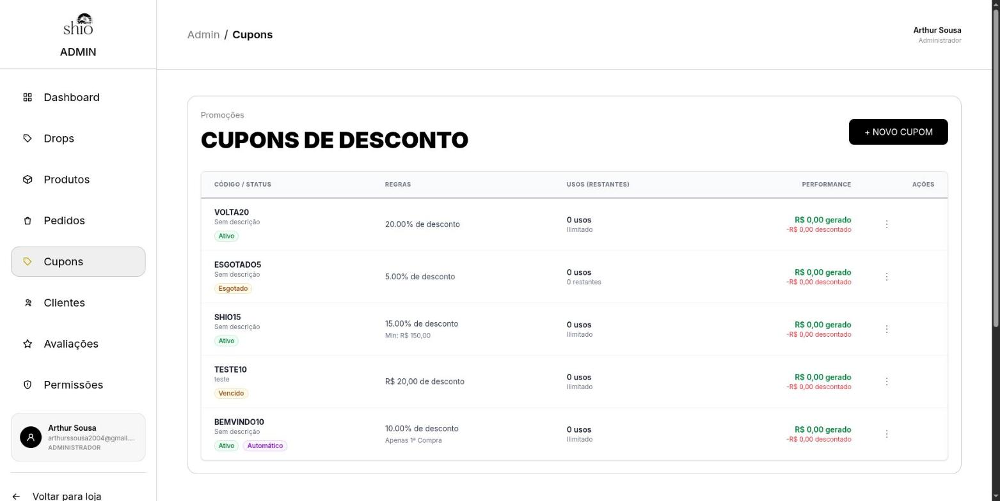

Aviso que aparece logo depois de criar um cupom:

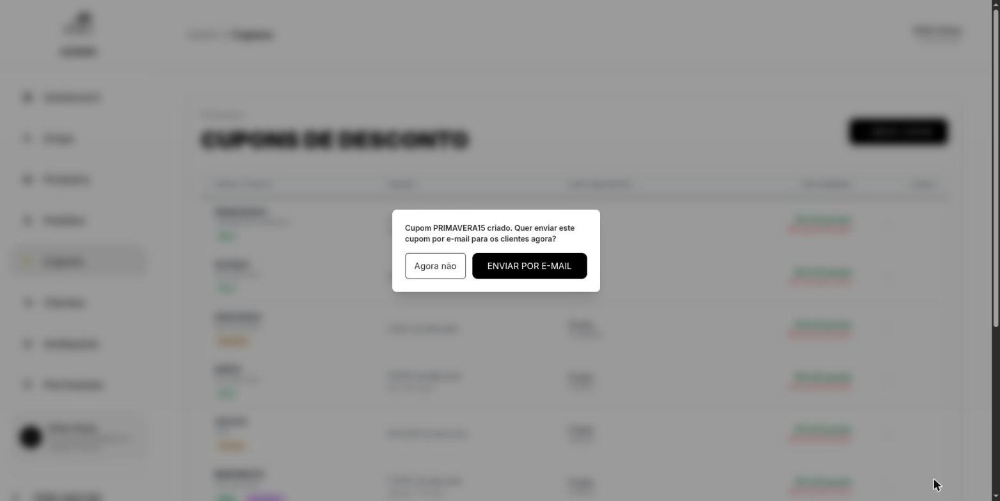

Tela de envio com o público, a mensagem e a pré-visualização do e-mail:

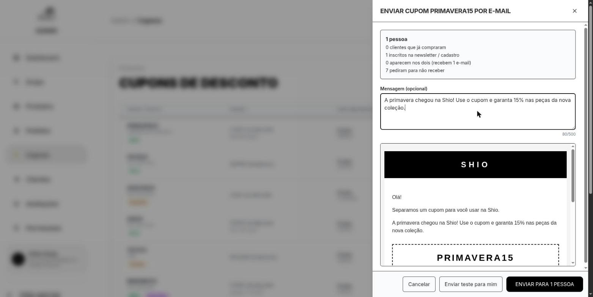

Opção "Enviar por e-mail" no menu Ações da lista de cupons:

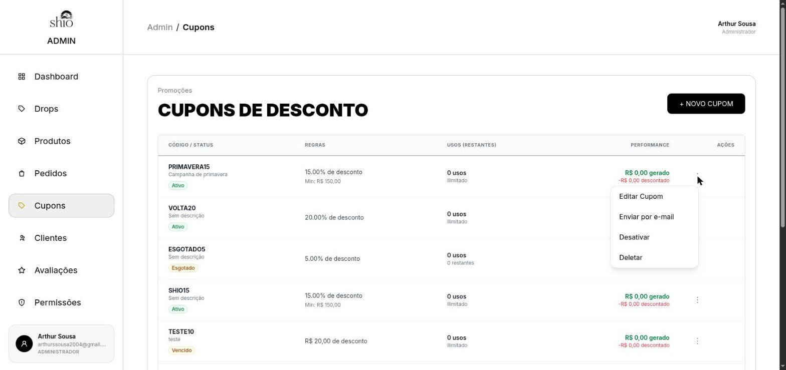

Confirmação antes do envio real:

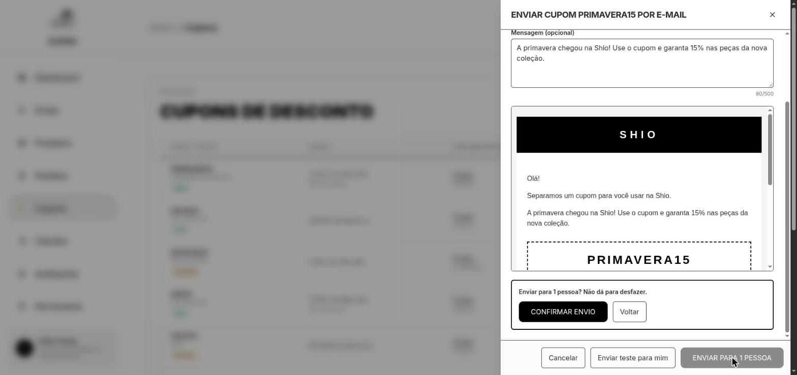

Resultado do envio e condições do cupom na pré-visualização:

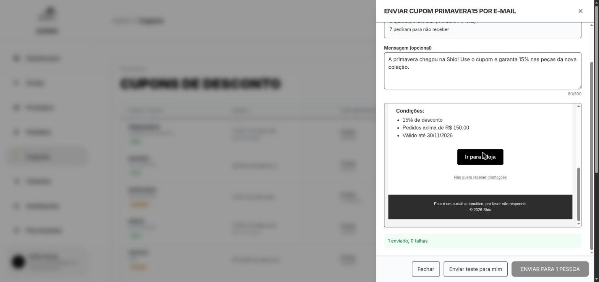

Histórico de envios ao reabrir a tela:

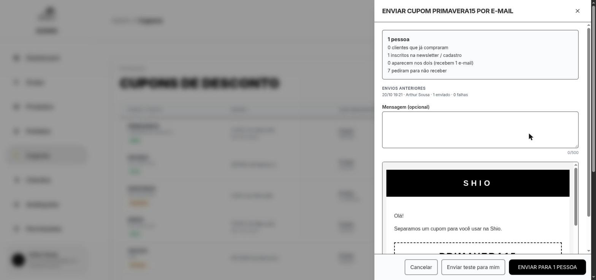

E-mail do cupom como chega para o cliente:

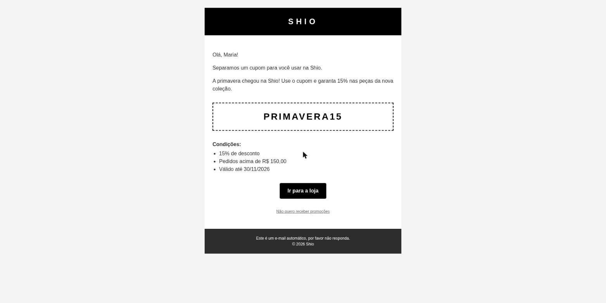

Página de descadastro (abrir o link não descadastra; é preciso confirmar):

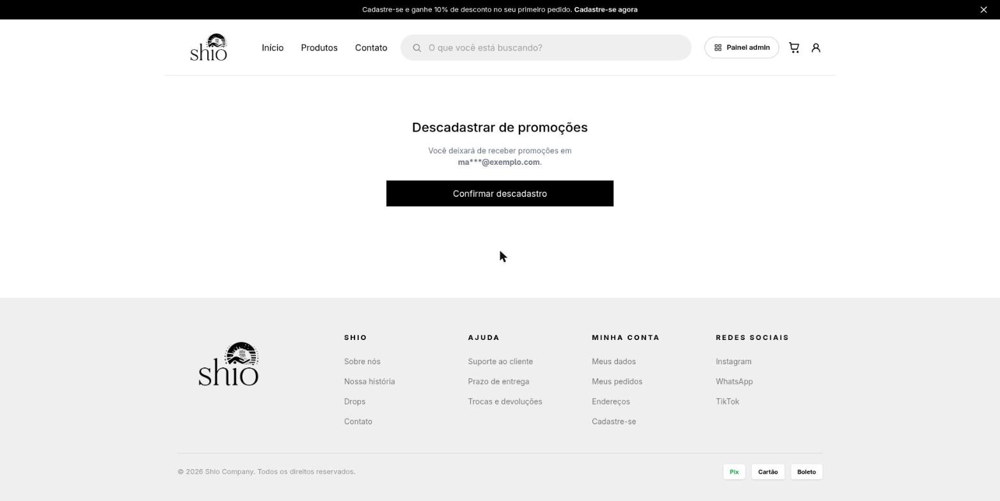

Descadastro confirmado:

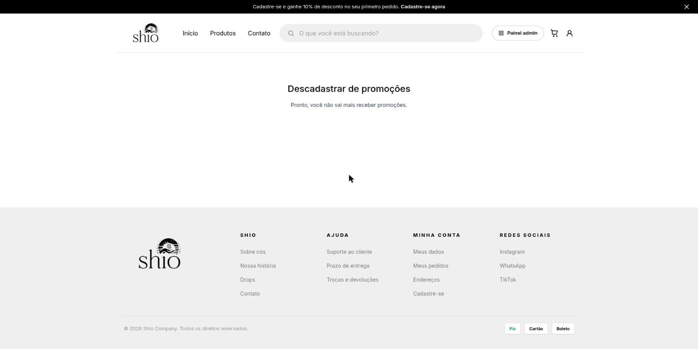

Caixa de aceite no cadastro (desmarcada por padrão; aqui marcada pelo usuário):

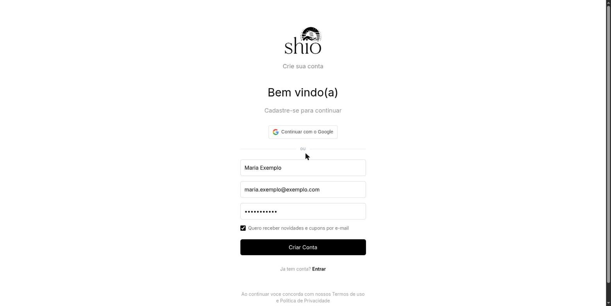

Interruptor de promoções em "Minha conta":

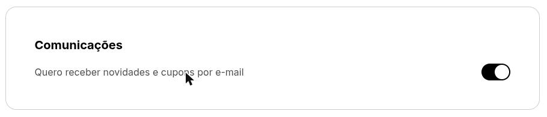
