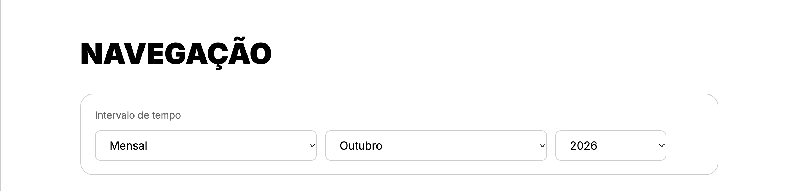
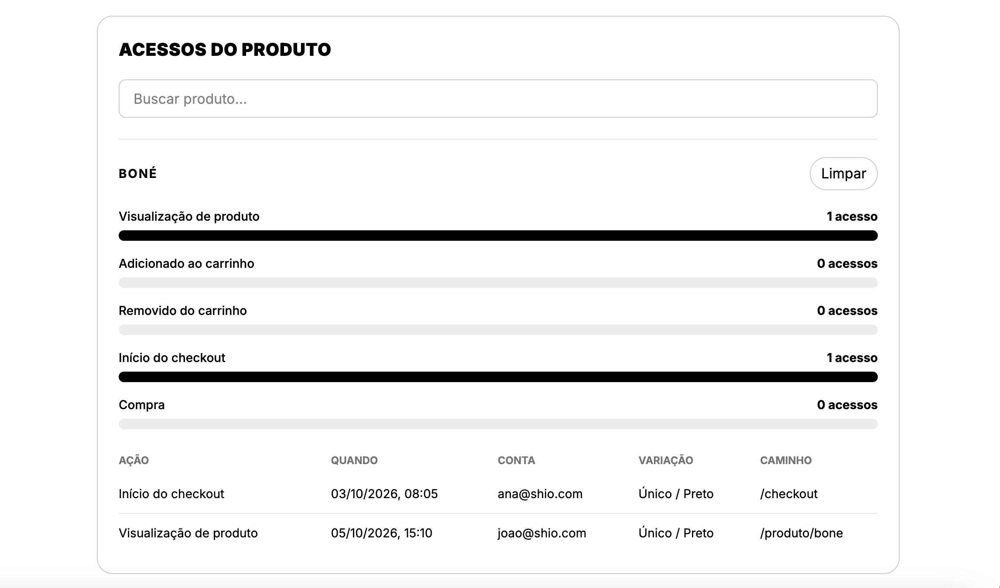
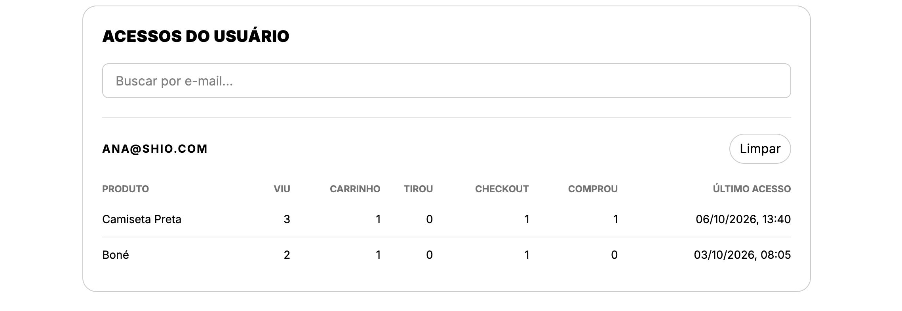
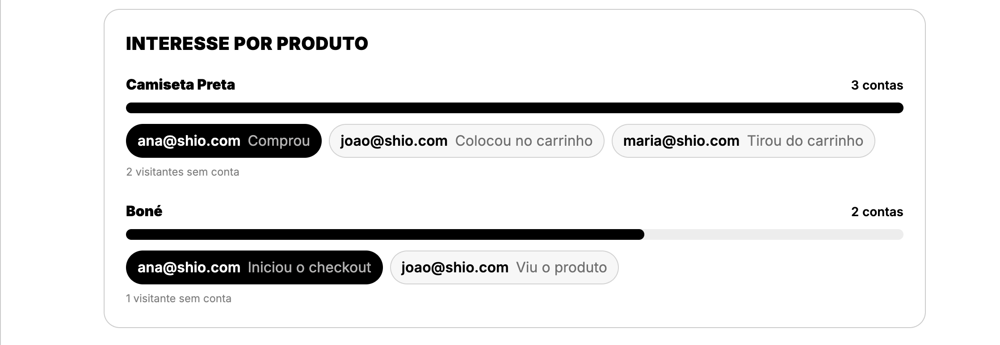
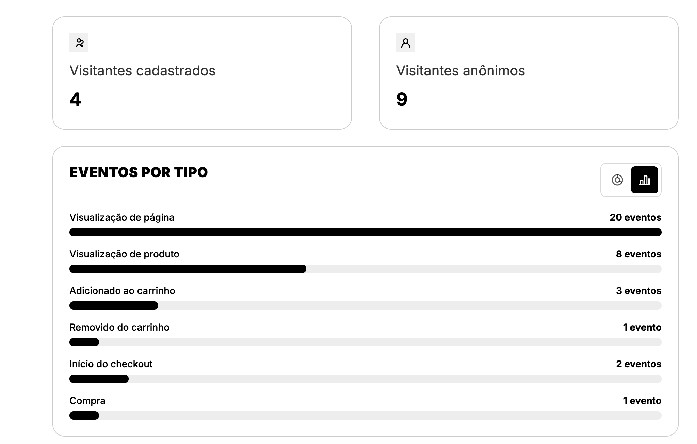
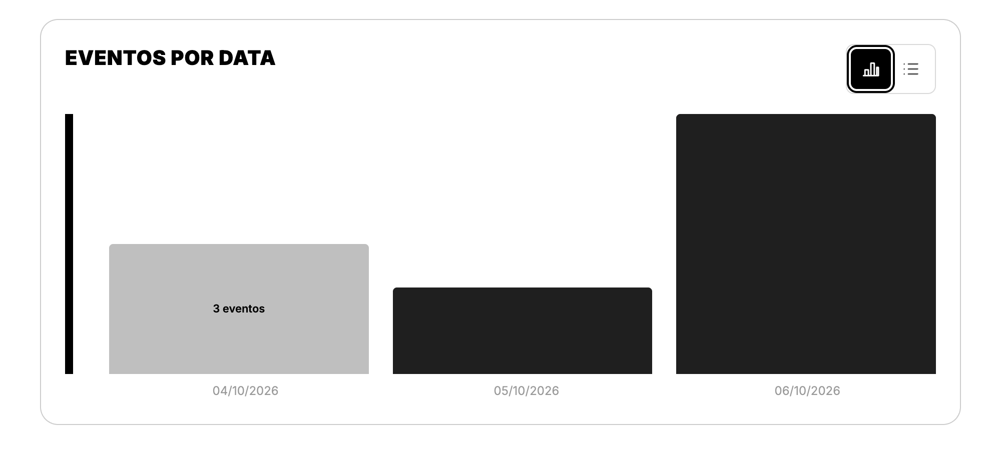

## Dashboard de navegação do usuário
**Responsável:** Pedro Siqueira

**Origem:**
- [Issue #68](https://github.com/Shio-Enterprise/Documentacao/issues/68) — dashboard de navegação do usuário, que expõe todo o caminho na aplicação, com a ação final registrada.

**Por que a melhoria foi relevante?**
A página permite ao admin analisar de maneira mais sucinta quais produtos geram interesse do usuário num nível superficial e profundo, ao observar quais deles tendem a gerar ações que proporcionam ou não acrescentar o carrinho, um checkout e até mesmo uma compra. Além disso, também é possível entrar em contato com os usuários com uma vantagem fundamental para as vendas, como promoções específicas etc.

**Decisões técnicas:**
- A compra confirmada é uma leitura de Payment, não uma linha nova em SiteEvent. A consulta pega OrderItem cujo pagamento está PAID e cujo paid_at cai na janela do período.
- Os outros sinais continuam em SiteEvent. O front grava PAGE_VIEW, PRODUCT_VIEW, ADD_TO_CART, REMOVE_FROM_CART e CHECKOUT_STARTED nos fluxos da loja e não envia PURCHASE. O JSON do painel segue com events_by_type.PURCHASE, preenchido pela leitura do pagamento.
- O visitante sem conta carrega um anonymous_id estável no navegador (shio_anonymous_id). Sem esse id o front não chama a API, porque o POST /api/analytics/events/ responderia 400. Com token, o corpo vai sem anonymous_id e o evento já nasce na conta. 
- A navegação tem página própria, /admin/navigation, com a permissão access_admin_dashboard. O dashboard de vendas, /admin/dashboard, não muda.
- Paths /admin ficam fora das métricas gerais, o front não envia esses eventos.
- O interesse por produto exige duas contas no mesmo produto. De cada conta fica o sinal mais forte: viu, tirou do carrinho, colocou no carrinho, iniciou o checkout, comprou. Visitante anônimo só aumenta a contagem.
- Item pago sem variação entra no total do resumo e na linha do tempo, com o product_name gravado no item. Fica de fora do interesse, dos acessos do produto e da tabela de produtos da conta, porque esses recortes precisam da variação ligada ao produto.
- O registro é operação da loja: não há tela de consentimento. Falha do POST não interrompe carrinho, login nem checkout. O mesmo evento, na mesma aba, é ignorado por 1 segundo para o StrictMode não gravar duas vezes.

**Regras:**
- A navegação tem página própria. O dashboard de vendas permanece como está.
- O período é o calendário de São Paulo. 
- A loja grava página, produto, carrinho e abertura do pagamento. Rotas de admin ficam fora do resumo. Visitante sem conta entra só nos totais.
- No resumo, na tabela da conta e nos acessos do produto, cada ação conta. No interesse por produto, cada conta aparece uma vez, com a ação mais forte, e o produto só entra com pelo menos duas contas acessando.
- Compra é pagamento confirmado no período, um sinal por item do pedido. Abrir o pagamento não conta como compra. Pagamento reembolsado sai da conta.
- No login, a navegação anônima daquele navegador passa para a conta. Evento que já pertence a outra conta permanece nela.

**Evidências (Pull Requests):**
- [Backend PR #41](https://github.com/Shio-Enterprise/backend/pull/41) — dashboard de navegação dos usuários (em revisão).
- [Frontend PR #37](https://github.com/Shio-Enterprise/frontend/pull/37) — dashboard de navegação dos usuários (em revisão).

**Validações registradas nos PRs:**
- Testes no backend (analytics/test_metrics.py): o resumo exige admin, rejeita período inválido e mês futuro, agrupa o mensal por dia e o anual por mês, conta visitantes cadastrados e anônimos sem duplicar, e ordena os produtos mais vistos. O interesse em comum fica com o sinal mais forte de cada conta. Acessos trazem ação, horário, conta e variação. Os produtos da conta contam cada ação. A linha do tempo é só daquela conta, traz o nome do produto e responde 404 para usuário inexistente. O mês e o ano escolhidos cobrem o calendário e ignoram o mês seguinte. A compra confirmada entra com um pagamento PAID, ignora o PENDING e ignora uma linha PURCHASE solta em SiteEvent: o resumo e a série contam 1, a linha do tempo traz o produto, e a conta fica com purchases = 1 e views = 0.
- Testes já existentes do mesmo app, que continuam na suíte: evento anônimo exige identificador e sem ele a API responde 400; o login vincula só os eventos daquele id ainda sem conta; evento já ligado a outra conta não muda; paths /admin ficam fora das métricas gerais e permanecem na linha do tempo; a busca de usuário exige ao menos 2 caracteres, devolve no máximo 10 e recusa quem não é admin.
- Testes no frontend: a captura guarda o id anônimo, envia a visualização com esse id, não grava caminho administrativo, omite o id quando há login e vincula os eventos depois do login (src/lib/navigationAnalytics.test.js). A página mostra visitantes, eventos, série e produtos no mensal, alterna a série para lista e o período para anual, pede o mês e o ano escolhidos, mostra o estado vazio, permite tentar de novo depois de uma falha, busca por e-mail e lista os produtos da conta com a coluna Comprou, filtra um produto e mostra os acessos, preenche o mock com Comprou e com Tirou, e bloqueia quem não é admin (NavigationDashboardPage).
- A suíte do app analytics rodou no Postgres local, 40 testes, sem falha. No frontend, os 5 da captura e os 10 da página passaram. O ESLint do frontend e o ruff check e ruff format do backend, que o CI tinha apontado, foram corrigidos nos commits seguintes.

**Pendências:**
- Validar com o cliente.
- Merge do [Backend PR #41](https://github.com/Shio-Enterprise/backend/pull/41) - (em revisão).
- Merge do [Frontend PR #37](https://github.com/Shio-Enterprise/frontend/pull/37) = (em revisão).

### Evidências (prints)

**Evidência do frontend (com mock)**

**Dashboard de navegação do usuário.** A página contém filtro de mês/ano, campo de busca por produto/cliente, campo interesse por produto que lista todos os produtos e seus acessos referentes ao período selecionado, campo com o número de acessos de clientes cadastrados e anônimos, eventos por tipo e data, com disposição de lista e de gráfico.

