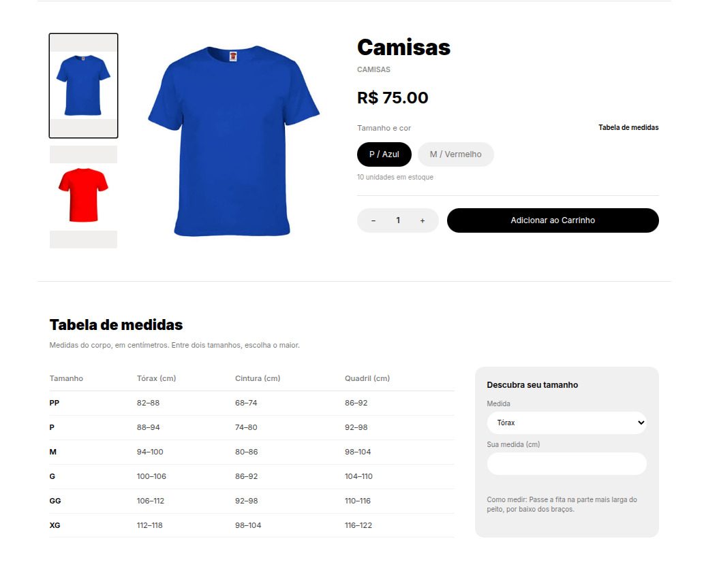

## Guia de medidas por categoria
**Responsável:** João Gabriel

**Origem:**
- Tarefa da Sprint 3 do Squad 4: guia de medidas por categoria (tabela P/M/G/GG) na página do produto, para ajudar a reduzir trocas.

**Por que a melhoria foi relevante?**
A página do produto mostrava só os nomes dos tamanhos (P, M, G…), sem dizer a que medidas cada um corresponde. O cliente escolhia o tamanho no escuro, e a peça que não servia virava pedido de troca. A entrega mostra, na própria página do produto, uma tabela de medidas que depende do tipo de roupa (camiseta e moletom usam uma tabela, calça e short outra) e uma calculadora em que o cliente digita a própria medida e recebe a sugestão de tamanho.

**Decisões técnicas:**
- O guia fica ligado à **categoria**, não ao produto: todos os produtos de uma categoria usam a mesma tabela, e várias categorias podem compartilhar um guia (por exemplo, camisetas e moletons usam o guia "Parte de cima").
- O guia é um modelo próprio (`SizeGuide`), com as medidas em centímetros guardadas como faixas `[mín, máx)`. O máximo de um tamanho é o mínimo do próximo, então não sobra medida sem tamanho.
- O guia vem junto no detalhe do produto (`size_guide` em `GET /api/catalog/products/{id}/`), sem consulta extra ao banco. A listagem de produtos não muda.
- Uma migration cria dois guias padrão, "Parte de cima" (tórax, cintura e quadril) e "Parte de baixo" (cintura e quadril), de PP a XG, e liga a eles as categorias existentes pelo nome (camiseta, moletom, calça, short…).
- Os guias são editados no admin do Django, e a validação impede tabela incompleta, faixa invertida ou tamanhos fora de ordem.
- No cadastro de produto, os tamanhos passaram a ser escolhidos numa lista de múltipla escolha (PP a XG ou Único), em vez de digitados à mão, para os nomes baterem com os da tabela. Cada tamanho marcado vira uma linha com estoque próprio.
- O cadastro de produto ganhou o campo de categoria. Antes, a categoria só podia ser escolhida editando o produto depois de criado, e o produto nascia sem tabela de medidas.

**Regras:**
- A tabela aparece na página do produto só quando a categoria dele tem um guia ligado; sem guia, a página fica como antes.
- As medidas são do corpo, não da peça. Entre dois tamanhos, a orientação é escolher o maior.
- A calculadora sugere o tamanho cuja faixa contém a medida digitada. Na fronteira entre dois tamanhos, sugere o maior. Abaixo do menor ou acima do maior tamanho, indica o mais próximo.
- As medidas cadastradas são médias de mercado e ainda serão confirmadas com o cliente. Elas podem ser ajustadas no admin, sem mudança de código.

**Evidências (Pull Requests):**
- [Backend PR #35](https://github.com/Shio-Enterprise/backend/pull/35) — modelo `SizeGuide` ligado à categoria, guias padrão, validação e `size_guide` no detalhe do produto.
- [Frontend PR #31](https://github.com/Shio-Enterprise/frontend/pull/31) — seção "Tabela de medidas" na página do produto, calculadora de tamanho e seleção de tamanhos no cadastro.
- [Frontend PR #35](https://github.com/Shio-Enterprise/frontend/pull/35) — campo de categoria no cadastro do produto (em revisão).

**Validações registradas nos PRs:**
- Testes no backend (`products/tests.py`): o detalhe traz o guia da categoria ou `null`, sem consulta extra; a listagem não traz o guia; a validação recusa faixa invertida, medida faltando e tamanhos fora de ordem; os guias padrão criados pela migration são válidos.
- Testes no frontend: a sugestão de tamanho dentro da faixa, na fronteira, no último tamanho, entre faixas e fora da tabela (`src/lib/sizeGuide.test.js`); a tabela aparece na página só com guia e a calculadora responde (`ProductDetailPage`); a lista de tamanhos cria e remove as linhas certas (`ProductFields`); o cadastro envia a categoria escolhida (`NewProductPage`).
- Suíte completa do backend em SQLite (CI) e em Postgres, sem falhas novas; o CI do backend e do frontend passou nos PRs.

**Pendências:**
- Confirmar com o cliente as medidas de cada tamanho e ajustá-las no admin.
- Merge do [Frontend PR #35](https://github.com/Shio-Enterprise/frontend/pull/35) (categoria no cadastro).

**Evidências (prints):**

### Evidência do frontend

**Tabela de medidas na página do produto.** O produto da categoria "camisas" mostra, abaixo da compra, a seção "Tabela de medidas" com as faixas de tórax, cintura e quadril de PP a XG. Ao lado de "Tamanho e cor" fica o link que leva até ela, e à direita o quadro "Descubra seu tamanho", onde o cliente digita a própria medida e recebe a sugestão.

