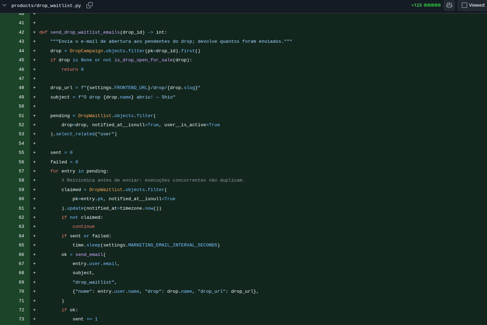

## Lista de espera do drop — E-mail de abertura
**Dupla:** João Gabriel e João Lucas

**Origem:**
- Tarefa da Sprint 3 do Squad 4: lista de espera dos drops (`DropWaitlist`), com aviso quando o `launch_date` chega — modal ao abrir a plataforma e e-mail para a lista. Esta página cobre o **e-mail de abertura**, que depende da lista de espera e foi feito primeiro, como base para o restante.

**Por que a melhoria foi relevante?**
Um drop é uma coleção com data de lançamento e estoque limitado, e as peças costumam acabar nas primeiras horas. Quem se interessava por um drop antes da abertura não tinha como ser avisado: precisava lembrar a data e voltar ao site na hora certa, e quem chegava tarde encontrava tudo esgotado. A entrega cria a lista de espera do drop e envia um e-mail para cada pessoa da lista assim que o drop abre, com o link direto para a página dele.

**Decisões técnicas:**
- A lista de espera é um modelo próprio (`DropWaitlist`), ligado ao usuário e ao drop, com uma entrada por pessoa em cada drop.
- Só usuários com conta entram na lista; o e-mail usado é o da conta.
- O envio segue o mesmo padrão do "Avise-me quando chegar", que já mandava e-mails desse tipo: antes de enviar, cada pessoa é marcada como avisada (`notified_at`). Se duas execuções rodarem ao mesmo tempo, só uma consegue marcar, e ninguém recebe o e-mail duas vezes.
- Se o envio para uma pessoa falha, a marcação é desfeita e ela volta para a fila; as demais continuam recebendo.
- O projeto não tem fila de tarefas nem agendador, e a abertura do drop é um evento de **tempo** (o `launch_date` chegar), não uma ação de alguém. Por isso o envio roda de duas formas, como a liberação de reservas vencidas do checkout:
  - numa varredura dentro das requisições (listagem de produtos e página pública do drop), no máximo uma vez por minuto em cada processo e numa thread, sem atrasar a resposta;
  - no comando `notify_drop_openings`, que pode ser agendado num cron para o e-mail sair no horário exato, mesmo sem ninguém acessando o site.
- O e-mail usa a infraestrutura de envio que já existia (`notifications.email.send_email`) e um template próprio, em texto e HTML.

**Regras:**
- O e-mail só sai quando o drop está aberto: público, ativo e dentro da janela entre `launch_date` e `end_date`.
- Drop privado, inativo, ainda não lançado ou já encerrado não dispara e-mail.
- Cada pessoa da lista recebe o e-mail uma única vez por drop.
- Usuário desativado não recebe.
- O e-mail avisa que não há reserva: quem comprar primeiro leva.

**Evidências (Pull Requests):**
- [Backend PR #40](https://github.com/Shio-Enterprise/backend/pull/40) — modelo `DropWaitlist`, envio do e-mail de abertura, template, varredura nas requisições, comando `notify_drop_openings` e testes (em andamento, junto com a entrada na lista e o modal).

**Validações registradas no PR:**
- Testes automatizados em `products/test_drop_waitlist.py`: o e-mail sai para a lista quando o drop abre, com o link do drop; não sai antes do `launch_date` nem para drop privado, inativo ou encerrado; cada pessoa recebe uma vez só; a falha num envio não interrompe os outros e devolve a pessoa à fila; usuário inativo não recebe; a mesma pessoa não entra duas vezes na lista do mesmo drop.
- Testes da varredura (dispara pela página pública do drop, respeita o intervalo e não quebra a requisição em caso de erro) e do comando (`--dry-run` só lista; sem a opção, envia).
- Suíte completa do backend executada em SQLite e os testes de produtos também em Postgres, sem falhas.

**Pendências:**
- Entrar e sair da lista pelo site (endpoint e botão na página do drop).
- Modal de aviso ao abrir a plataforma, com controle próprio de "já visto".
- Agendar o comando `notify_drop_openings` em produção.
- O plano grátis do Resend envia até 100 e-mails por dia; listas maiores precisam de um plano maior ou de envio em mais de um dia.

**Evidências (prints):**

### Evidência do trecho de código do backend

**Envio do e-mail de abertura — `products/drop_waitlist.py`.** A função só envia se o drop já abriu e percorre as pessoas da lista ainda não avisadas. Para cada uma, primeiro marca como avisada (o `update` só funciona se ninguém tiver marcado antes, o que impede e-mail duplicado), espera o intervalo entre envios e manda o e-mail com o nome da pessoa, o nome do drop e o link para a página dele.

