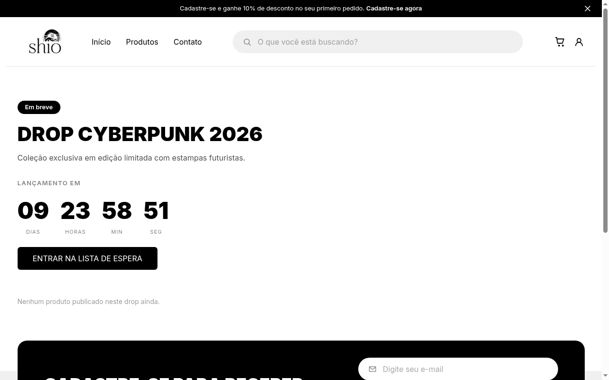
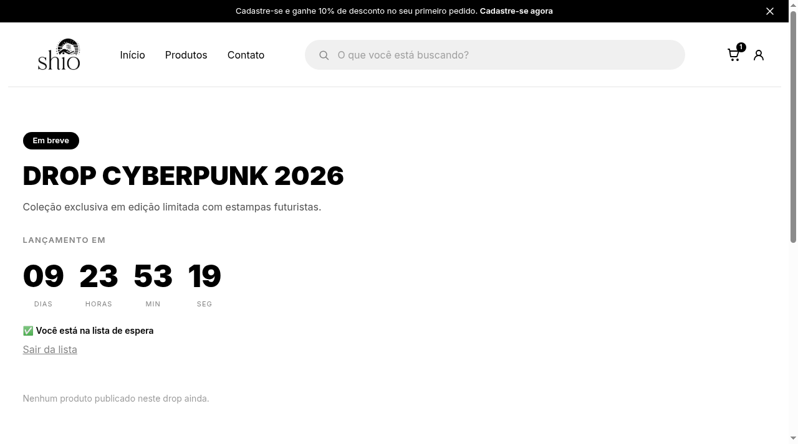
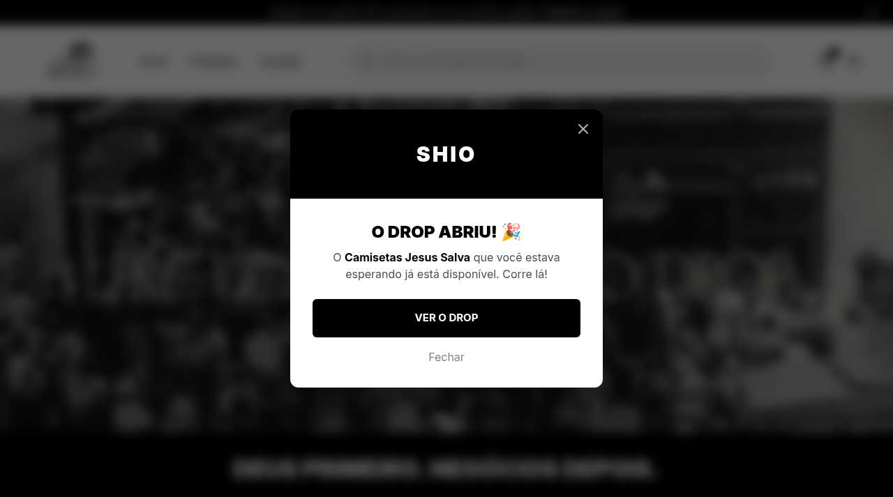

## Lista de espera do drop — Endpoints, Interface e Modal de Aviso
**Dupla:** João Gabriel e João Lucas  
**Responsável pela entrega:** João Lucas Ramos

**Origem:**
- Tarefa da Sprint 3 do Squad 4: lista de espera dos drops (`DropWaitlist`), com aviso quando o `launch_date` chega — modal ao abrir a plataforma e e-mail para a lista. Esta página cobre os **endpoints de inscrição/remoção, o controle de visualização do aviso (`seen_at`), a integração na página do drop e o modal automático de abertura ao navegar na plataforma**, complementando a entrega do [e-mail de abertura](lista-espera-email-evidencias.md).

**Por que a melhoria foi relevante?**
Os drops da Shio são lançamentos exclusivos com quantidade limitada e alta demanda nos primeiros minutos. Antes desta implementação, o cliente interessado em um drop futuro não possuía uma forma de registrar seu interesse direto na interface da loja e nem de ser notificado visualmente no momento exato em que as vendas fossem liberadas. Com esta entrega, o cliente logado pode se inscrever na lista de espera diretamente na página pública do drop em lançamento (`/drop/:slug`) com um clique. Além disso, assim que o drop abre, ao acessar ou navegar por qualquer página pública da plataforma, um modal de celebração e aviso é disparado automaticamente para o usuário, permitindo o redirecionamento imediato para compra com um clique no botão "Ver o Drop".

**Decisões técnicas:**
- **Separação de responsabilidades no banco:** o modelo `DropWaitlist` teve a adição do campo `seen_at` (`DateTimeField`, nulo por padrão), isolado do campo `notified_at` (utilizado pelo disparo de e-mail). Essa separação garante que o envio do e-mail de abertura e a exibição do modal visual no navegador operem de maneira independente e escalável, sem concorrência ou bloqueios mútuos.
- **Endpoints RESTful completos e autenticados:**
  - `POST /api/catalog/drops/<id>/waitlist/`: inscreve o usuário autenticado na lista de espera. É idempotente (se já estiver inscrito, retorna `200 OK` em vez de erro de integridade; caso contrário, cria e retorna `201 Created`). Valida se o drop está ativo, público e com data futura (antes do `launch_date`).
  - `DELETE /api/catalog/drops/<id>/waitlist/`: cancela a inscrição do usuário no drop (`204 No Content`). Responde `404` caso a inscrição não exista.
  - `GET /api/catalog/drop-waitlist/`: lista todas as inscrições ativas do usuário logado ordenadas por data decrescente.
  - `GET /api/catalog/drop-waitlist/unseen/`: retorna os drops abertos nos quais o usuário está inscrito e cujo modal ainda não foi visualizado (`seen_at__isnull=True`, `drop__is_public=True`, `drop__is_active=True`, dentro do período vigente).
  - `POST /api/catalog/drop-waitlist/<id>/seen/`: marca o aviso como visualizado populando `seen_at = timezone.now()`, impedindo que o modal volte a ser exibido para o mesmo drop.
- **Integração na página pública do drop (`DropPage`):**
  - O botão de lista de espera é exibido condicionalmente apenas quando o drop está na fase "Em breve" (`upcoming`), isto é, antes da contagem regressiva zerar.
  - Se o usuário não estiver autenticado, o clique no botão redireciona para a tela de login (`/login?next=/drop/:slug`) preservando o retorno após a autenticação.
  - Para o usuário autenticado, a interface reflete imediatamente o estado: se ainda não inscrito, exibe o botão estilizado "Entrar na lista de espera"; se já inscrito, exibe a confirmação visual "✅ Você está na lista de espera" acompanhada da opção em texto "Sair da lista".
- **Modal automático global (`DropOpenedModal` e `PublicLayout`):**
  - O componente `DropOpenedModal` foi injetado diretamente no `PublicLayout`, garantindo que a verificação de drops abertos não visualizados aconteça globalmente na navegação pública para clientes logados.
  - Suporte a fila de múltiplos drops: se mais de um drop abrir no mesmo intervalo, o modal exibe a contagem (ex.: "1 de 2") e avança sequencialmente ao dispensar cada um.
  - Acessibilidade e boas práticas: implementado com `role="dialog"`, `aria-modal="true"`, foco automático ao abrir, bloqueio de scroll do body, suporte a fechamento pela tecla `Esc` e pelo clique no fundo escurecido com efeito blur.
  - Ao fechar ou clicar no CTA "Ver o Drop", a API `markWaitlistEntrySeen` é disparada em segundo plano para persistir o `seen_at`.

**Regras:**
- Apenas usuários com conta ativa e autenticados podem entrar na lista de espera.
- O botão de inscrição só fica disponível enquanto o drop não abriu (`launch_date` futuro, público e ativo).
- Drop inativo, privado, já aberto ou encerrado recusa novas inscrições com erro `400 Bad Request`.
- Cada usuário pode ter apenas uma entrada na lista de espera por drop (garantido por restrição única `unique_together` e idempotência na API).
- O modal automático só é disparado para drops abertos no período vigente e cuja entrada na waitlist ainda tenha `seen_at` nulo.
- Ao dispensar o modal ou navegar para o drop através dele, o registro é atualizado e o modal não volta a incomodar o usuário.

**Evidências (Pull Requests):**
- [Backend PR — `shio-backend`](https://github.com/Shio-Enterprise/backend/tree/feat/drop-waitlist-email) (Branch `feat/drop-waitlist-email`): inclusão do campo `seen_at` no modelo `DropWaitlist`, migration `0014_dropwaitlist_seen_at`, endpoints de join, leave, listagem, unseen e marcação de visualização, com 25 testes automatizados dedicados.
- [Frontend PR — `shio-frontend`](https://github.com/Shio-Enterprise/frontend/tree/feat/drop-waitlist) (Branch `feat/drop-waitlist`): módulo de cliente de API `dropWaitlistApi.js`, controle de estado na `DropPage`, componente `DropOpenedModal`, injeção global no `PublicLayout` e testes unitários.

**Validações registradas nos PRs:**
- **Testes no Backend (`products/test_waitlist_endpoints.py`):**
  - `DropWaitlistJoinTests`: recusa sem autenticação (401), criação com sucesso (201), idempotência ao chamar repetidamente (200 sem duplicar), recusa de drop já aberto (400), recusa de drop encerrado (400) e recusa de drop privado (400).
  - `DropWaitlistLeaveTests`: saída da lista com sucesso (204), 404 para drop não inscrito, remoção isolada sem afetar outros usuários.
  - `DropWaitlistMyEntriesTests`: listagem das inscrições do próprio usuário, isolamento de dados de outros usuários e ordenação decrescente por data.
  - `DropWaitlistUnseenTests`: listagem estrita apenas de drops que já abriram e possuem `seen_at` nulo; exclusão correta de drops futuros, drops privados, drops inativos, drops encerrados e drops já vistos (`seen_at` preenchido).
  - `DropWaitlistMarkSeenTests`: persistência de data/hora atual no campo `seen_at`, remoção imediata da listagem do endpoint `/unseen/` e bloqueio de usuários anônimos (401).
  - *Resultado:* 25/25 testes passando na suíte de endpoints + 13/13 testes de e-mail da waitlist (total de 38 testes de waitlist 100% aprovados).
- **Testes no Frontend (`vitest`):**
  - `src/components/ui/DropOpenedModal.test.jsx` (10 testes): renderização do modal quando há drops abertos pendentes; atributos de acessibilidade (`dialog`, `aria-modal`); chamada de `markWaitlistEntrySeen` ao fechar; fechamento via tecla `Escape`; navegação em múltiplos drops em fila; avanço de posição (ex.: "1 de 2").
  - `src/pages/public/DropPage/index.test.jsx` (13 testes): renderização condicional do botão "Entrar na lista de espera" na fase futura; redirecionamento de usuário não logado para `/login?next=...`; transição para o estado "✅ Você está na lista de espera" ao confirmar inscrição; acionamento do cancelamento ao clicar em "Sair da lista".
  - *Resultado:* 23/23 testes de componentes e páginas passando; suite completa do frontend com 420 testes aprovados.

**Como testar manualmente:**
1. Subir o ambiente com `docker compose up -d` no backend e `npm run dev` no frontend.
2. Acessar o Django Admin (`/admin/`) ou API e cadastrar um Drop com data de lançamento no futuro (`launch_date > agora`).
3. No frontend, acessar a página pública do drop em `/drop/<slug>`:
   - Sem login: clicar em "Entrar na lista de espera" e verificar o redirecionamento para login.
   - Com login: clicar em "Entrar na lista de espera" e verificar a alteração imediata para "✅ Você está na lista de espera" com link "Sair da lista".
4. No admin ou banco, alterar a data de lançamento desse drop para o passado (`launch_date < agora`) para simular a abertura.
5. Recarregar qualquer página da plataforma com o usuário logado: verificar a exibição imediata do modal "O Drop abriu! 🎉" em tela cheia com efeito blur.
6. Clicar em "Ver o Drop" ou dispensar no "X" / "Fechar": verificar que a requisição de marcação foi enviada e que o modal não reaparece ao recarregar a página.

---

## Evidências (prints)

### 1. Botão "Entrar na lista de espera" na página pública do drop futuro
Na página do drop (`/drop/:slug`), enquanto o drop está na fase "Em breve" (contagem regressiva ativa), o botão **"Entrar na lista de espera"** é disponibilizado com destaque abaixo do contador de lançamento:

---

### 2. Confirmação de inscrição e opção de cancelamento
Após o cliente autenticado clicar para participar da lista, a interface confirma visualmente a inscrição com **"✅ Você está na lista de espera"** e disponibiliza a opção amigável **"Sair da lista"**, permitindo cancelar o interesse a qualquer momento:

---

### 3. Disparo automático do modal "O Drop abriu! 🎉" ao abrir a plataforma
Assim que a data de lançamento do drop é atingida e o drop se torna ativo para vendas, o usuário inscrito é recepcionado automaticamente pelo modal ao navegar pela loja, com link direto ("Ver o Drop") para efetuar a compra:

