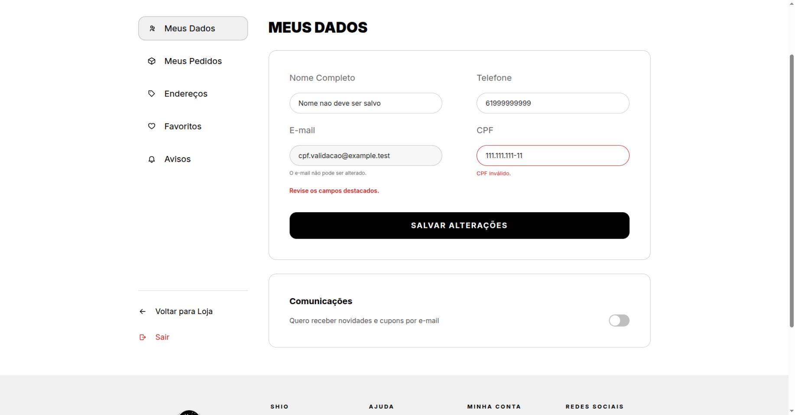
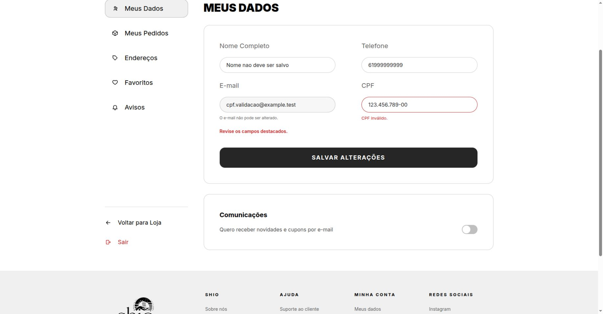
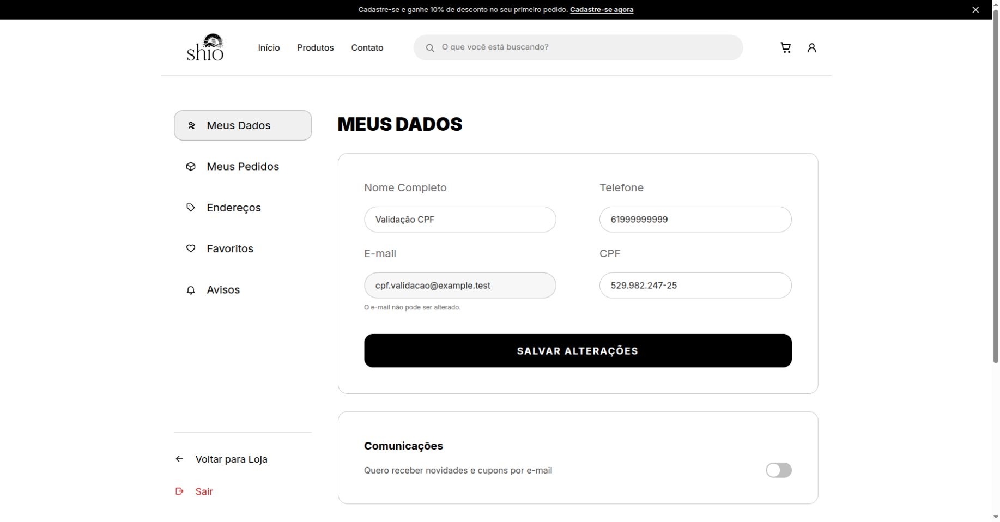
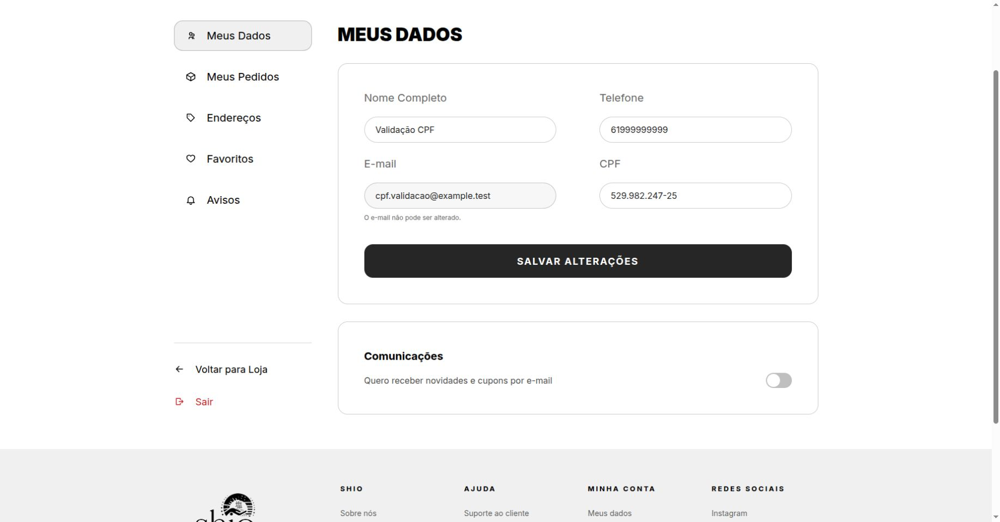
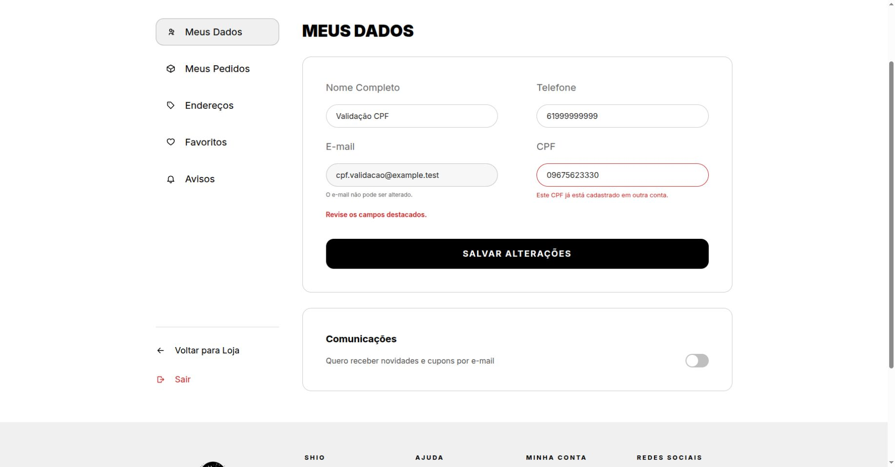
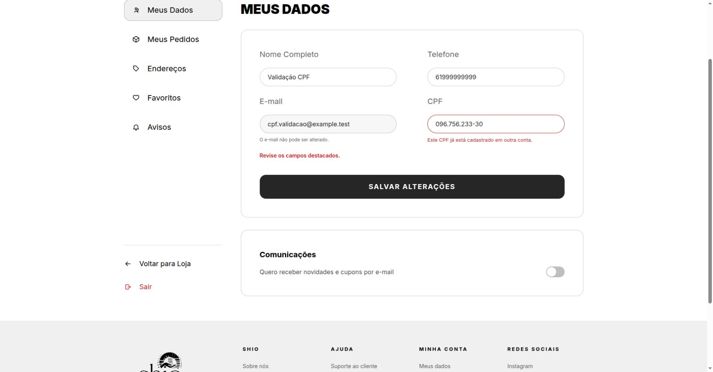

# Validação e padronização de CPF

**Dupla:** Matheus de Alcântara e Vilmar Fagundes

**Origem:**
- [Issue #91](https://github.com/Shio-Enterprise/Documentacao/issues/91): CPF inválido e duplicidade entre formatos, identificados durante a validação da acessibilidade na #64.

**Status:** implementação em revisão; validação manual local concluída em 10/11/2026, com prints registrados.

## Contexto e Relevância

Em “Meus Dados”, o cliente conseguia salvar qualquer sequência de 11 dígitos. A checagem de duplicidade comparava o texto recebido, permitindo que o mesmo CPF fosse cadastrado em duas contas quando uma delas usava pontuação. O documento também seguia para os Correios no formato armazenado.

## Regras Implementadas

- Validar os dois dígitos verificadores e recusar as dez sequências de dígitos repetidos.
- Aceitar CPF válido com ou sem pontuação e armazenar somente os 11 números.
- Devolver o CPF formatado pela API e atualizar a exibição após salvar.
- Recusar duplicidade entre contas, inclusive nos formatos antigos preservados.
- Manter vazio como `NULL` e permitir apagar o CPF do perfil.
- Exibir “CPF inválido.” ou “Este CPF já está cadastrado em outra conta.” junto ao campo, com `aria-invalid` e `aria-describedby`.
- Enviar aos Correios somente números. O payload atual da InfinitePay não inclui CPF.

## Migração dos Dados Antigos

A migração `authentication.0006_normalize_profile_cpf` padroniza os CPFs válidos sem conflito e transforma vazios em `NULL`. Os inválidos e todos os registros de cada grupo duplicado mantêm seus valores originais. Nenhuma conta é excluída e nenhum titular é escolhido automaticamente.

Durante a migração, as linhas `[CPF #91]` listam e-mails e IDs dos perfis que exigem revisão, sem imprimir o CPF. O campo mantém o limite de 14 caracteres para preservar os casos pendentes.

Na preparação do ambiente local, cinco contas sintéticas cobriram um CPF válido com pontuação, duas contas com o mesmo CPF em formatos diferentes, um inválido e um vazio. As verificações confirmaram a normalização do válido, a preservação dos conflitos e do inválido, o vazio como `NULL` e as cinco contas mantidas.

Antes da aplicação em produção, ainda é necessário executar a migração em um banco isolado com cópia dos dados reais e revisar o relatório. A reversão da migração não restaura a pontuação anterior dos valores normalizados.

## Evidências (Pull Requests)

- [Backend #50](https://github.com/Shio-Enterprise/backend/pull/50), commit `137fc4f`: validação, padronização, migração, envio aos Correios e testes.
- [Frontend #58](https://github.com/Shio-Enterprise/frontend/pull/58), commit `0a97efe`: atualização do campo após salvar e testes de exibição e erro acessível.

Ambos os commits incluem Vilmar Fagundes como coautor.

## Validação Automatizada

Resultados registrados em 09/11/2026:

| Verificação | Resultado |
| :--- | :--- |
| Suíte geral do backend | 983 testes e 408 subcasos aprovados; 20 testes ignorados |
| Cenários focados em PostgreSQL isolado | 16 testes e 17 subcasos aprovados, incluindo perfil, duplicidade, migração e Correios |
| Suíte geral do frontend | 687 testes aprovados em 84 arquivos |
| “Meus Dados” | 15 testes aprovados, incluindo os casos de CPF |
| Build do frontend | Aprovado |
| Lint do frontend | Zero erros e 16 avisos preexistentes |
| Ruff e formatação dos arquivos alterados | Aprovados |
| `makemigrations --check --dry-run` | Sem mudanças de esquema pendentes |
| [CI do backend](https://github.com/Shio-Enterprise/backend/actions/runs/42735319515) | Aprovada |
| [CI do frontend](https://github.com/Shio-Enterprise/frontend/actions/runs/42735359950) | Aprovada |

Os testes específicos cobrem CPF válido com e sem pontuação; verificador errado; todas as sequências repetidas; tamanho incorreto; letras e pontuação sem números; vazio e `null`; duplicidade entre formatos; normalização do próprio CPF; limpeza do campo; resposta atualizada após salvar; migração sem perda de dados e CPF enviado aos Correios.

O Selenium teve a fixture de CPF atualizada, mas não foi executado nesta validação.

### Revalidação após atualização das branches

Em **11/11/2026**, as branches da #91 foram atualizadas com a `dev`: backend no commit `4b67785` e frontend no commit `588ff6f`. A integração preservou a validação de CPF e conciliou as migrações paralelas de `authentication` e `products` com três migrações de merge sem operações adicionais.

- **Backend:** 1.061 testes e 426 subcasos aprovados; 20 testes ignorados.
- **PostgreSQL isolado:** 20 testes e 17 subcasos aprovados, incluindo a migração de CPF, o perfil, as permissões da página inicial e o envio aos Correios.
- **Frontend:** 796 testes aprovados em 91 arquivos; build aprovado e lint com zero erros e 19 avisos.
- **Checagens do backend:** Ruff, formatação, `system check` e `makemigrations --check --dry-run` aprovados.

Os prints abaixo continuam registrando os commits utilizados na validação manual descrita a seguir; esta atualização registra a nova execução dos testes automatizados.

## Validação Manual

Executada em **10/11/2026**, pela interface do **Chrome**, usando o plugin do navegador, o frontend do commit `0a97efe` e a API do commit `137fc4f`. O ambiente local utilizou SQLite isolado, cinco contas sintéticas e CPFs de teste. Os dados reais de clientes não foram utilizados.

Os formulários foram preenchidos e enviados pela UI. As recargas verificaram a persistência, e consultas ao banco isolado confirmaram o armazenamento somente com números ou `NULL`.

| Cenário | Resultado observado | Situação |
| :--- | :--- | :--- |
| Salvar `111.111.111-11` e `123.456.789-00` | “CPF inválido.” junto ao campo. Após recarregar, o nome original e o CPF anterior continuaram salvos | Aprovado |
| Salvar `16899535009`, sem pontuação | “Dados salvos com sucesso!”; exibição `168.995.350-09`, mantida após recarregar; banco com `16899535009` | Aprovado |
| Salvar `529.982.247-25`, com pontuação | Sucesso, exibição formatada e banco com `52998224725` | Aprovado |
| Salvar `09675623330` e `096.756.233-30`, usados por contas legadas | “Este CPF já está cadastrado em outra conta.” nos dois envios. Após recarregar, o perfil manteve `529.982.247-25` | Aprovado |
| Apagar o CPF e salvar | Sucesso, campo vazio após recarregar e `NULL` no banco | Aprovado |
| Editar o CPF após o erro | O erro e `aria-invalid` foram removidos ao editar; novos envios funcionaram | Aprovado |

Nos dois tipos de erro, a inspeção do campo na página confirmou `aria-invalid="true"`, `aria-describedby="cpf-error"` e o texto correto no elemento descritor. As cinco contas foram preservadas, incluindo os dois registros duplicados e o CPF inválido mantidos pela migração.

Não foi necessária alteração no código funcional durante a validação. A geração de etiqueta real, o pagamento e a migração com cópia de produção não fizeram parte destes testes de interface.

## Evidências (prints)

Capturas feitas no Chrome, em ambiente local com contas sintéticas. Os arquivos seguem o padrão `docs/assets/evidencias-cpf/` e estão vinculados abaixo.

### Perfil inicial

O CPF normalizado pela migração aparece formatado em “Meus Dados”:

### CPF inválido e preservação dos dados

A sequência repetida `111.111.111-11` é recusada. O nome foi alterado no formulário para verificar que a requisição inválida não salva outros campos:

O número `123.456.789-00`, com dígitos verificadores inválidos, também é recusado:

Após recarregar, o nome original “Validação CPF” e o CPF anterior permanecem salvos:

### CPF válido com e sem pontuação

Ao enviar `16899535009`, o campo passa a mostrar `168.995.350-09`. A recarga manteve essa exibição e o banco armazenou somente os números:

O envio de `529.982.247-25`, com pontuação, também foi aceito e armazenado como `52998224725`:

### Duplicidade entre formatos

O CPF `09675623330`, sem pontuação, é recusado porque já está em outras contas, incluindo um registro legado com pontuação:

O mesmo CPF, enviado como `096.756.233-30`, recebe a mesma mensagem:

### Limpeza do campo

Depois de apagar, salvar e recarregar, o CPF continua vazio e está como `NULL` no banco. O texto cinza `000.000.000-00` é o placeholder do campo:

