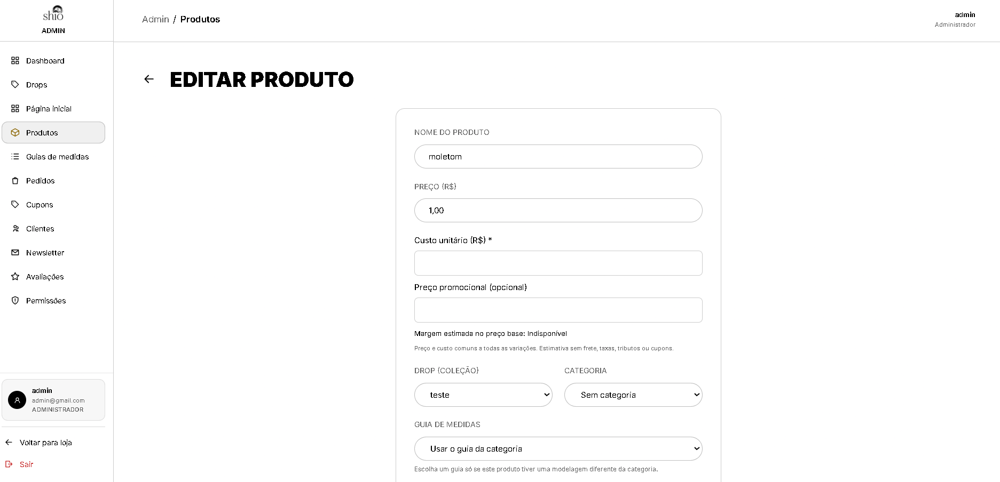
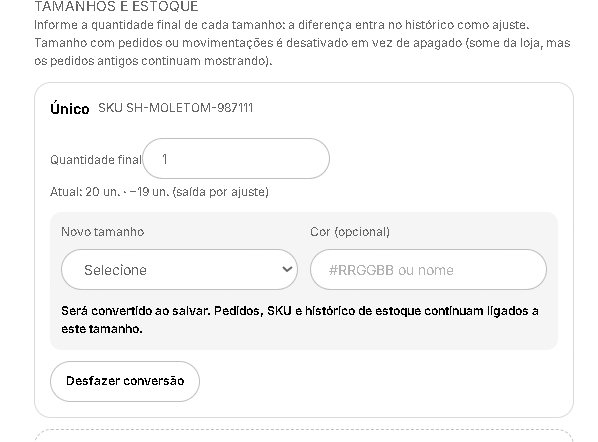

# Edição completa do produto no painel admin

**Dupla:** Matheus de Alcântara e Vilmar Fagundes

**Origem:**
- [Issue #79](https://github.com/Shio-Enterprise/Documentacao/issues/79): a tela de editar produto tinha menos informações que a de criar. Não era possível mudar imagens, tamanhos nem o estoque de um tamanho específico, e o admin às vezes precisava excluir e cadastrar o produto de novo.

**Status:** concluída. Os PRs [backend #52](https://github.com/Shio-Enterprise/backend/pull/52) e [frontend #60](https://github.com/Shio-Enterprise/frontend/pull/60) foram integrados à `dev` em 11/11/2026, e a issue foi fechada em 17/11/2026.

## Contexto e Relevância

A edição era uma gaveta lateral que permitia alterar nome, descrição, preços, drop, categoria e status. As variações apareciam só para leitura, sem opção de alterar as imagens. Pedido do cliente: editar o produto por completo, na mesma tela, sem perder o histórico de pedidos e de estoque.

A edição passou a ser uma **página própria em `/admin/edit-product/:id`**, no padrão do “Editar Drop”, com os mesmos campos da criação já preenchidos, além de imagens, tamanhos e estoque.

## Decisão sobre o Estoque

A issue deixava em aberto como o admin informaria o estoque. A dupla escolheu a **quantidade final**: o admin digita quanto o tamanho deve ter, e a tela calcula a diferença. A diferença vira uma movimentação de **entrada ou saída com motivo “Ajuste”** e justificativa obrigatória. Assim, toda mudança feita pela edição continua passando pelo registro de movimentações, como em “Gerenciar estoque”.

## Regras Implementadas

### Página de edição
- Campos da criação já preenchidos: nome, preço, custo, promoção (início e fim no horário de Brasília), drop, categoria, status, descrição e guia de medidas.
- Mesmas validações da criação. Os erros do backend aparecem na tela com o motivo do campo.
- Tudo fica pendente na tela e só é enviado em “Salvar alterações”. “Cancelar” não altera o produto.
- A gaveta antiga de edição foi removida. “Gerenciar estoque” continua funcionando como antes.

### Imagens
- Adicionar várias de uma vez (até 5 MB cada), substituir, remover, subir, descer e “Tornar principal”.
- A primeira imagem é a principal, usada como capa no card e no detalhe do produto.
- O backend ganhou o endpoint `PUT /api/catalog/products/<id>/images/order/`. Ele recebe todas as imagens do produto na ordem desejada e recusa lista incompleta, repetida ou com imagem de outro produto.

### Tamanhos
- **Adicionar tamanho**, com estoque inicial registrado no histórico como “Estoque inicial”.
- **Remover tamanho:** se houver estoque, a tela primeiro zera o saldo com uma saída por ajuste. Um tamanho **com histórico** (pedido, movimentação ou saldo de abertura) é **desativado**, e um tamanho **sem histórico** é apagado.
- **Reativar** um tamanho inativo.
- **Converter a variação padrão “Único”** em um tamanho real (P, M, G…) antes de adicionar os demais. A conversão altera a mesma variação, então pedidos, SKU e movimentações continuam ligados a ela. Esse ajuste foi solicitado por Matheus de Alcântara na revisão do PR do frontend.
- Desativar exige estoque zerado e ao menos um tamanho ativo no produto.

### Tamanho inativo
- Desaparece da loja: detalhe, listagem, filtros de tamanho e cor, recomendações e disponibilidade.
- Continua visível no painel admin, marcado como inativo.
- É recusado no carrinho, no checkout, na troca e no “Avise-me”, e não dispara aviso de reposição.
- Não aceita entrada manual de estoque antes de ser reativado. Devoluções e cancelamentos continuam sendo registrados.
- Pedidos antigos continuam mostrando o produto e o tamanho. O item do pedido guarda o nome e o SKU da época e o vínculo com a variação.

A migração `products.0016_productvariation_is_active` adiciona o campo `is_active` às variações e mantém ativas todas as variações existentes.

### Estoque e salvamento
- Antes de gravar a diferença, a tela confere o estoque atual no servidor. Se ele mudou desde a abertura da página (por uma venda, por exemplo), nada é gravado e o admin é avisado.
- Estoque negativo é bloqueado antes de qualquer envio.
- Ordem de envio: dados do produto; imagens; reativações; conversão do “Único”; novos tamanhos; ajustes de estoque; remoções. Assim, o produto nunca fica sem tamanho ativo.
- Cada movimentação leva uma `idempotency_key`. Se uma etapa falhar, a tela mostra o motivo e guarda o que já foi feito, para que uma nova tentativa não duplique imagens nem movimentações.

### Acessibilidade
- Os botões informam qual imagem ou tamanho será alterado, por exemplo “Subir imagem 2” e “Remover tamanho G / Preto”.
- O foco acompanha a linha que muda de posição e o botão que substitui outro (Remover ⇄ Desfazer).
- As mudanças nas imagens são anunciadas para leitores de tela.
- Os testes com `vitest-axe` não encontraram violações, seguindo o padrão da [#64](https://github.com/Shio-Enterprise/Documentacao/issues/64).

## Integração com Outras Entregas

Durante o desenvolvimento, a `dev` recebeu outras entregas que alteravam os mesmos arquivos. As integrações foram feitas antes do merge:

- **Visibilidade de estoque (#85):** a API passou a mostrar `stock_quantity` somente ao admin. A desativação de tamanho passou a enviar o `request` ao serializer para manter o estoque na resposta do admin (commit `c18207f`).
- **Página inicial editável:** a migração dessa entrega ocupou o número `0015`, então a migração da #79 foi renumerada para `0016`.
- **Guia de medidas por produto (#55):** o campo havia sido adicionado à gaveta antiga. Ele foi levado para a nova página de edição, com os testes correspondentes (commit `7776d63`).

## Evidências (Pull Requests)

- [Backend #52](https://github.com/Shio-Enterprise/backend/pull/52), aprovado por Matheus de Alcântara e integrado em 11/11/2026:
  - `6271a79`: endpoint de ordem das imagens;
  - `46b2fb5`: desativação de tamanho, regras na loja, carrinho, checkout, troca e “Avise-me”, migração e testes;
  - `b828a95`: atualização com a `dev`;
  - `c18207f`: estoque na resposta da desativação para o admin.
- [Frontend #60](https://github.com/Shio-Enterprise/frontend/pull/60), com alterações solicitadas e depois aprovadas por Matheus de Alcântara, integrado em 11/11/2026:
  - `e16c40c`: página “Editar produto”;
  - `e927cb4`: imagens, tamanhos e estoque;
  - `10a881b`: conversão do tamanho “Único”, a partir da revisão;
  - `7776d63`: atualização com a `dev` e o guia de medidas.

Os commits foram feitos por Vilmar Fagundes e revisados por Matheus de Alcântara.

## Validação Automatizada

| Verificação | Resultado |
| :--- | :--- |
| Suíte geral do backend, após atualização com a `dev` (10/11/2026) | 1.042 testes e 386 subcasos aprovados; 20 testes ignorados |
| Testes novos do backend | `ImageOrderTests` (5), `VariationDeactivationTests` (8) e `CheckoutInactiveVariationTests` (1) |
| Ruff, formatação, `system check` e `makemigrations --check --dry-run` | Aprovados, sem migrações pendentes |
| Suíte geral do frontend, após atualização com a `dev` (11/11/2026) | 793 testes aprovados em 91 arquivos |
| Testes novos do frontend | Página de edição (27), envio de imagens (6) e envio de tamanhos e estoque (10) |
| Lint do frontend | Zero erros e 19 avisos preexistentes |
| Build do frontend | Aprovado |
| [CI do backend](https://github.com/Shio-Enterprise/backend/actions/runs/42756791791) | Aprovada |
| [CI do frontend](https://github.com/Shio-Enterprise/frontend/actions/runs/42938900061) | Aprovada |

Os testes cobrem os “Testes mínimos” da issue: edição com nova imagem, novo tamanho e estoque alterado; recusa de estoque negativo; desativação de tamanho com pedido, mantendo o tamanho no pedido antigo; e geração de movimentação no histórico. Também cobrem a conversão do “Único”, o estoque alterado durante a edição, novas tentativas sem duplicação e o guia de medidas.

Como os testes do frontend simulam as respostas da API, a dupla também executou um **teste de integração local, não versionado**, que repete na API real as mesmas chamadas e os mesmos dados da página. Os 7 cenários foram aprovados. Eles incluem a conversão do “Único” com um pedido real vinculado: depois da conversão, o pedido permaneceu ligado à mesma variação, com nome e SKU da época, e o histórico registrou “Estoque inicial 2 + Ajuste 3”.

## Validação Manual

Executada em **10/11/2026**, em ambiente local, com o backend e o frontend das branches da #79, conforme os “Testes mínimos” da issue:

| Cenário | Resultado observado | Situação |
| :--- | :--- | :--- |
| Adicionar imagem e torná-la principal, adicionar o tamanho M com estoque inicial e alterar a quantidade final de outro tamanho, com justificativa | Dados salvos; nova capa no detalhe e na loja; “Ajuste” e “Estoque inicial” no histórico de “Gerenciar estoque” | Aprovado |
| Informar quantidade final negativa | Envio bloqueado com o motivo junto ao campo; nada salvo | Aprovado |
| Remover tamanho de produto com pedido | Tamanho inativo na edição e fora da loja; o pedido antigo continua mostrando o tamanho | Aprovado |
| Consultar o histórico após as alterações | Todas as mudanças de estoque da edição aparecem como movimentações | Aprovado |
| Converter “Único” em tamanho real e adicionar outro tamanho | Coberto pelos testes automatizados e pela integração local | Registrar print |
| Alterar o guia de medidas pela página de edição | Coberto pelos testes automatizados | Registrar print |

## Evidências (prints)

Capturas em ambiente local. Os arquivos ficam em `docs/assets/evidencias-editar-produto/`. Depois de adicionar cada print, remova o comentário da linha correspondente.

### Página de edição

 

### Tamanhos e estoque

 

### Conversão do “Único” e guia de medidas

 

## Fora do Escopo e Pendências

- Edição de vários produtos de uma vez e mudanças em “Gerenciar estoque”, conforme a issue.
- A página converte somente a variação padrão “Único”. A troca de tamanho ou cor de outras variações continua em “Gerenciar estoque”.
- “Duplicar produto” ainda copia os tamanhos inativos. Sugestão: abrir uma issue separada.
