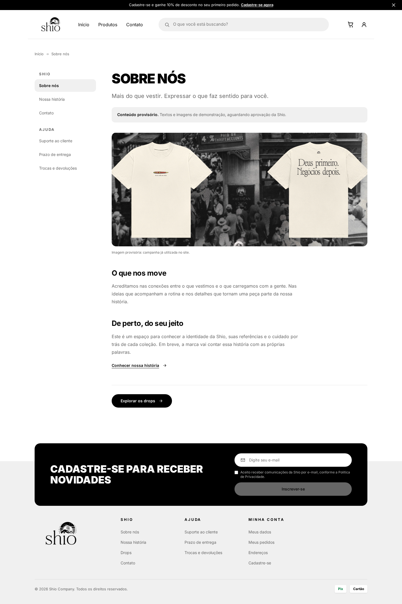
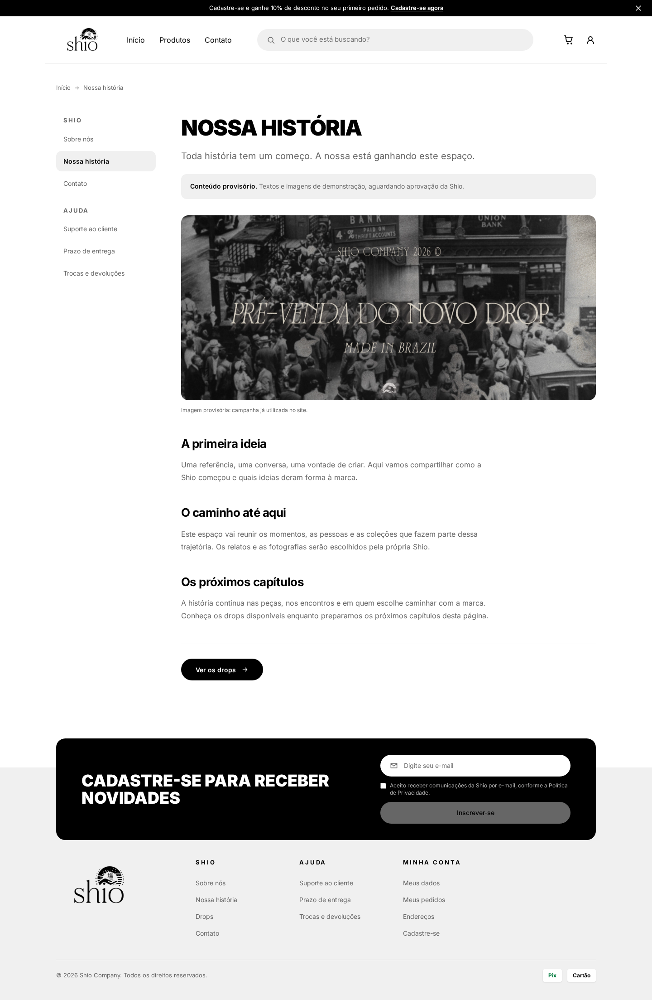
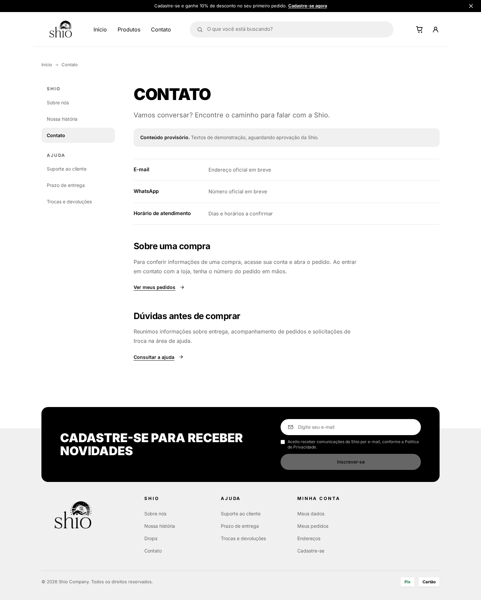
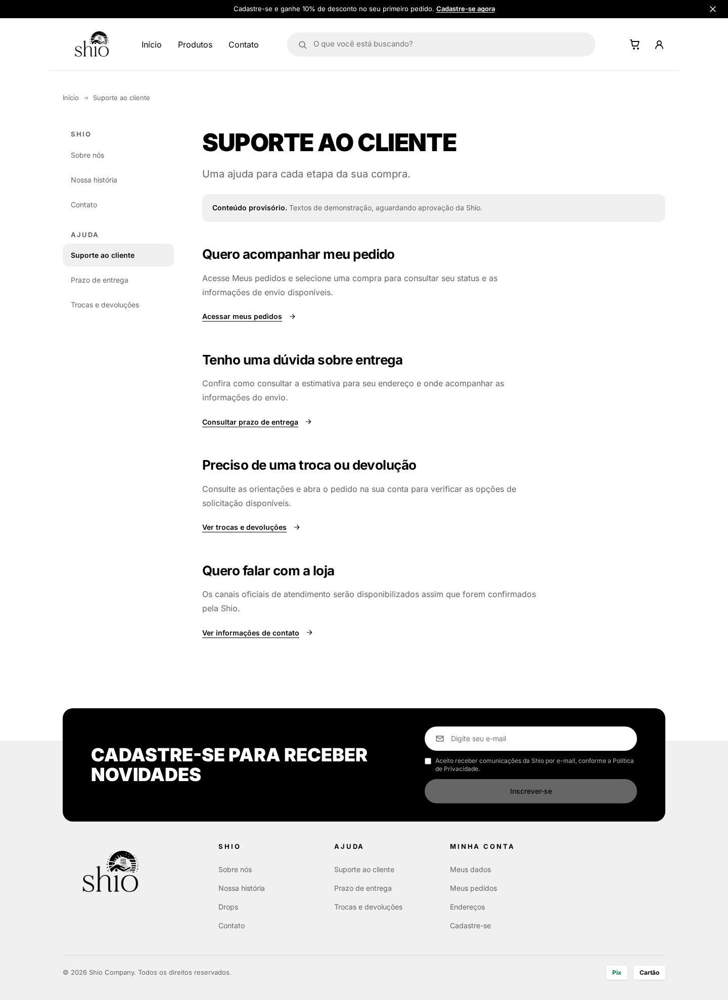
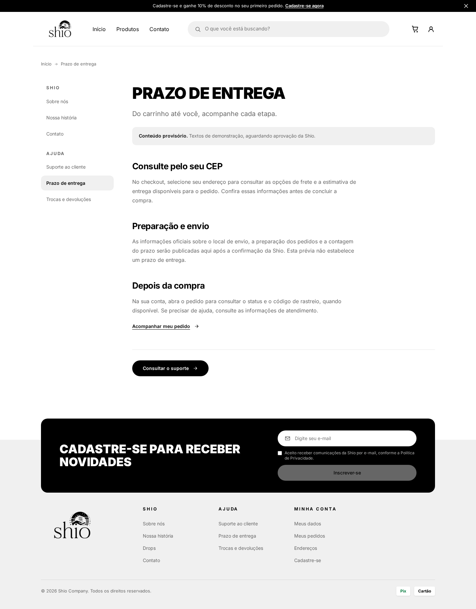
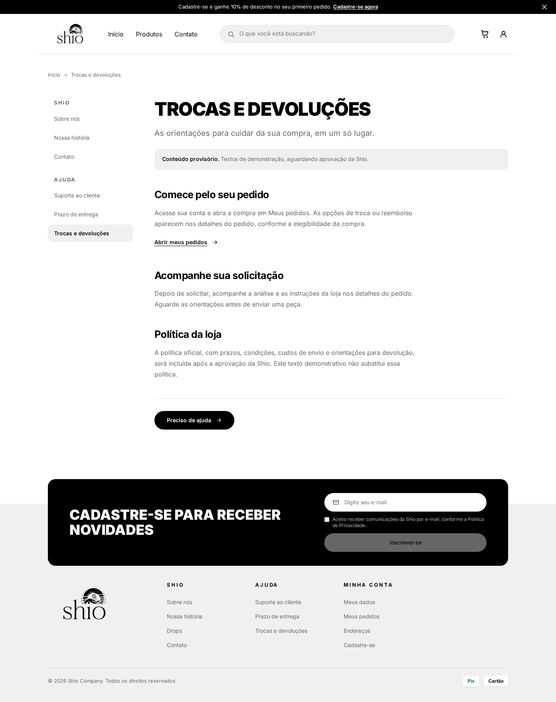
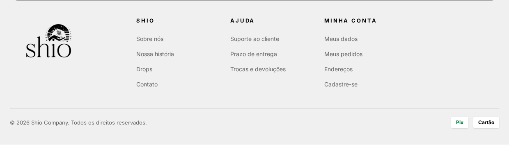
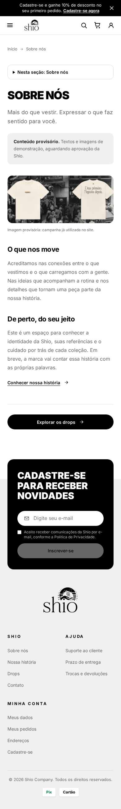

# Páginas institucionais e ajuda — issue #83

**Atualizado:** 18/11/2026.

**Status:** estrutura implementada e integrada; entrega parcial, aguardando conteúdo oficial da Shio.

## Contexto e entrega

Os links Sobre nós, Nossa história, Contato, Suporte ao cliente, Prazo de entrega e Trocas e devoluções do rodapé retornavam para a página inicial. Agora cada um abre sua própria página pública. O item Contato do cabeçalho também abre a nova página.

Por solicitação do responsável pela implementação, os textos de exemplo e as imagens de campanha existentes foram mantidos enquanto a empresa prepara o material real. As seis páginas mostram um aviso de **conteúdo provisório**. Os rascunhos não são apresentados como política oficial ou relato histórico aprovado.

- [Issue #83 — Completar o rodapé com conteúdo do cliente](https://github.com/Shio-Enterprise/Documentacao/issues/83).
- [Frontend PR #61](https://github.com/Shio-Enterprise/frontend/pull/61), integrado à `dev` em 11/11/2026.
- [CI da revisão final do PR](https://github.com/Shio-Enterprise/frontend/actions/runs/43035769921): aprovada.
- Conteúdo centralizado em `src/data/institutionalContent.js`; apresentação em `src/pages/public/InstitutionalPage/index.jsx`.

## Evidências visuais

As capturas mostram as páginas em desktop e celular, com os textos e imagens provisórios.

### Sobre nós

Rota: `/sobre-nos`. Imagem de campanha reutilizada, aviso de conteúdo provisório e acesso à história da marca.

[Captura completa no celular](../../../assets/evidencias-83/sobre-nos-390.png).

### Nossa história

Rota: `/nossa-historia`. Estrutura de narrativa preparada, sem datas, fundadores ou marcos históricos inventados.

[Captura completa no celular](../../../assets/evidencias-83/nossa-historia-390.png).

### Contato

Rota: `/contato`. E-mail, WhatsApp e horários aparecem como informações pendentes. Não há telefone ou endereço de e-mail inventado.

[Captura completa no celular](../../../assets/evidencias-83/contato-390.png).

### Suporte ao cliente

Rota: `/ajuda/suporte`. Orientações para consultar pedidos, entrega, trocas e atendimento, com links para os destinos correspondentes.

[Captura completa no celular](../../../assets/evidencias-83/suporte-390.png).

### Prazo de entrega

Rota: `/ajuda/prazo-de-entrega`. Orientação para consultar a estimativa no checkout. Não estabelece prazo ou origem de envio sem confirmação da empresa.

[Captura completa no celular](../../../assets/evidencias-83/prazo-entrega-390.png).

### Trocas e devoluções

Rota: `/ajuda/trocas-e-devolucoes`. Direciona para as opções elegíveis nos pedidos e informa que a política oficial ainda será incluída.

[Captura completa no celular](../../../assets/evidencias-83/trocas-devolucoes-390.png).

### Navegação e rodapé

O rodapé mantém os links de conta e drops. Os seis links institucionais têm destinos próprios; nenhum dos links exibidos aponta para `/` por engano. Perfis de Instagram, TikTok e WhatsApp sem URL oficial ficam ocultos. O rodapé mostra Pix e cartão, conforme as opções apresentadas no checkout; boleto não é anunciado.

[Rodapé no celular](../../../assets/evidencias-83/rodape-390.png).

No celular, o índice de seções é recolhível. Ao escolher outra página, o índice fecha e a navegação volta ao topo. No desktop, a página atual fica destacada na navegação lateral.

## Critérios de aceite e pendências

| Critério da #83 | Situação nesta entrega |
| --- | --- |
| Conteúdo recebido do cliente e registrado na issue | **Pendente** |
| Links do rodapé com destino próprio | **Implementado e revalidado** |
| Seis páginas publicadas com conteúdo do cliente | Estrutura integrada pelo PR #61; conteúdo oficial **pendente** |
| Redes sociais abrindo os perfis oficiais | URLs oficiais **pendentes**; links não confirmados ficam ocultos |
| Links externos abrindo nova aba | Comportamento preparado e coberto por testes com URLs sintéticas; perfis reais não foram validados |
| Formas de pagamento coerentes com o checkout | Pix e cartão no rodapé; boleto retirado. Não houve transação real nesta validação |

Ainda é necessário receber e aprovar os textos de Sobre nós e Nossa história, as fotos, o e-mail, o WhatsApp, os horários, os perfis sociais, os detalhes de preparação/envio e a política de trocas e devoluções. Depois, substituir os rascunhos e remover o aviso provisório.

Este registro comprova a implementação das páginas e a navegação, **não a conclusão integral da issue #83**. Não houve validação de produção, confirmação de conteúdo comercial, teste de pagamento ou alteração das políticas da loja.
