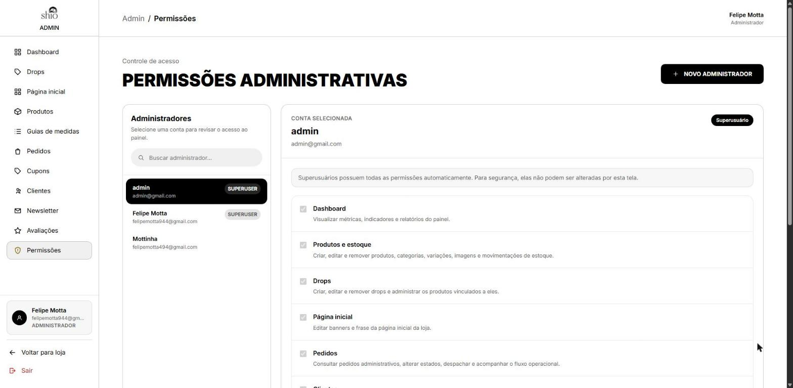
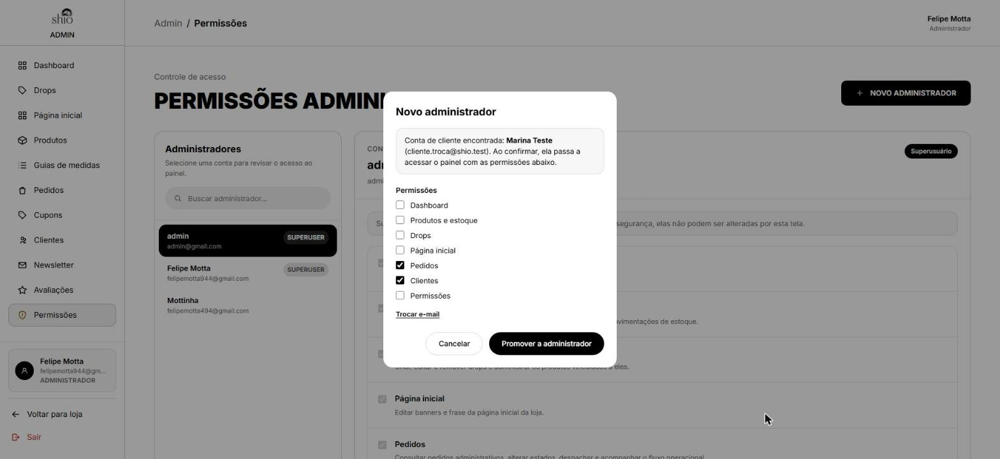
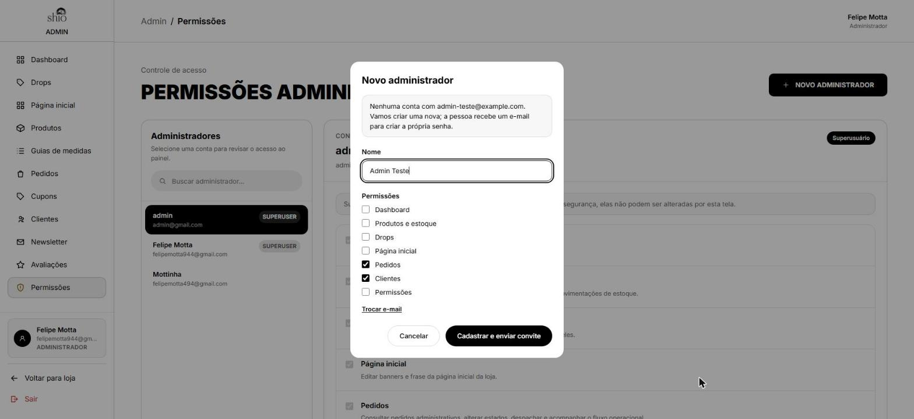
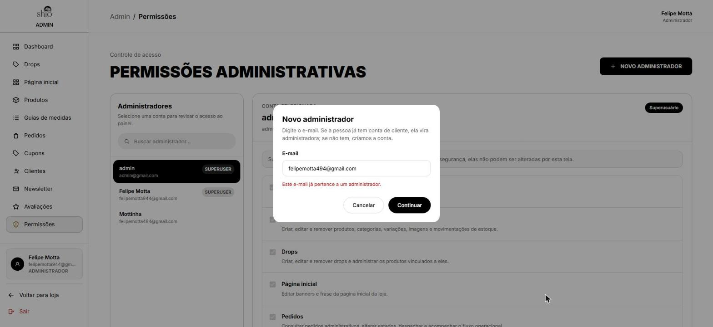
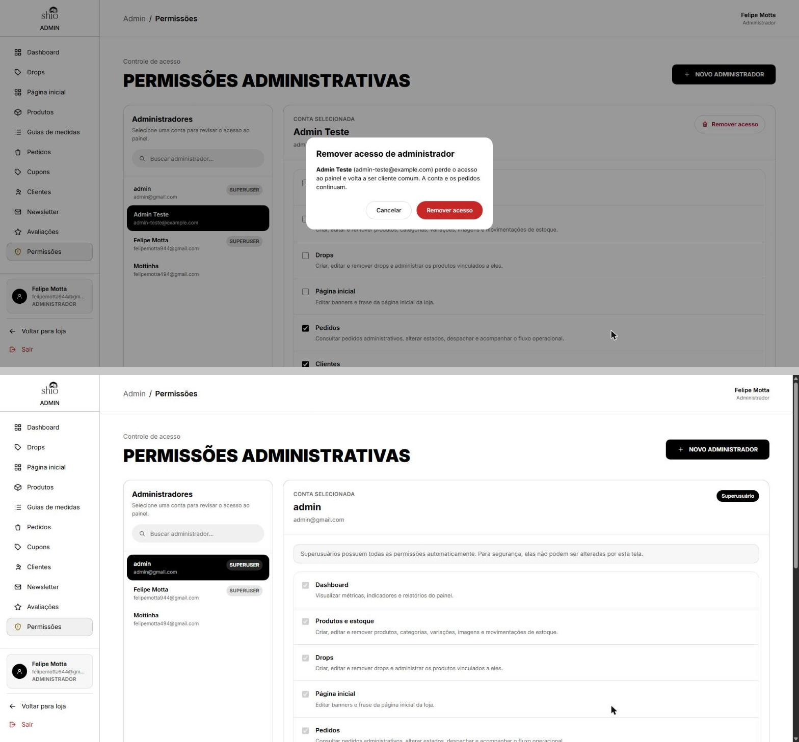
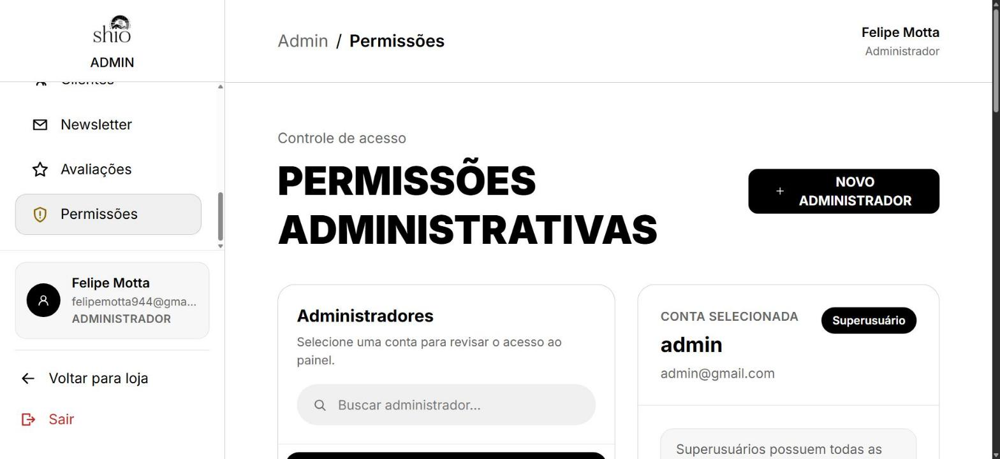

## Cadastro de administradores — Promoção, convite e remoção de acesso pelo painel
**Trio:** Amanda, Felipe e Cauã

**Origem:**
- [Issue #81](https://github.com/Shio-Enterprise/Documentacao/issues/81) — criar, promover e remover administradores pela tela Permissões do painel, sem depender do admin do Django.

**Por que a melhoria foi relevante?**
A tela **Permissões**, entregue na Sprint 2, deixava alterar o que cada administrador podia acessar, mas não deixava criar um administrador novo. Isso só era possível pelo admin do Django ou por comando no servidor, ou seja, dependia de um desenvolvedor. Agora, quem tem a permissão **Permissões** promove uma conta de cliente que já existe ou cadastra uma conta nova já como administrador, escolhendo na criação as áreas que ela vai acessar. A conta nova recebe um e-mail para criar a própria senha (o administrador não define nem vê a senha) e já entra com as permissões escolhidas no primeiro login. Também é possível remover o acesso de outro administrador; a conta volta a ser cliente comum. Ninguém remove o próprio acesso, e superusuários não podem ser alterados pelo painel. A entrega também corrige a rolagem da sidebar do painel: só a lista de seções rola, e a conta e o botão "Sair" ficam fixos embaixo.

**Regras implementadas:**
- Só quem tem a permissão **Permissões** vê o botão "Novo administrador" e acessa os endpoints (sem login `401`, sem permissão `403`).
- O modal pede primeiro o e-mail e consulta se ele já tem conta:
  - **Já é cliente:** mostra a conta e pede confirmação da promoção. A senha da pessoa não muda e nenhum e-mail é enviado.
  - **E-mail novo:** pede o nome e avisa que a pessoa vai receber um e-mail para criar a senha.
  - **Já é administrador, superusuário ou conta desativada:** mostra o motivo e não deixa seguir.
- As permissões são escolhidas no próprio modal, com no mínimo uma.
- A conta nova é criada sem senha e recebe o e-mail "Você foi convidado para o painel", com o link de definição de senha e o nome de quem convidou.
- "Remover acesso" pede confirmação e não aparece na própria conta nem em superusuários.
- Mensagens de sucesso e erro são lidas por leitor de tela, e o foco volta ao lugar certo ao fechar o modal.

**Endpoints adicionados:**
- `GET /api/auth/admins/lookup/?email=` — informa se o e-mail já tem conta e se ela já é administradora.
- `POST /api/auth/admins/` — promove um cliente existente (`200`) ou cria uma conta nova de administrador (`201`).
- `DELETE /api/auth/admins/{id}/` — remove o acesso administrativo; a conta volta a ser cliente.

**Validação automatizada:**
- Backend: 24 testes novos em `authentication/test_admin_accounts.py`, cobrindo `401` e `403`, consulta de e-mail, promoção com as permissões escolhidas, recusa de e-mail que já é administrador, de superusuário e de conta desativada, criação sem senha, envio do convite, primeiro login com as permissões escolhidas e remoção de acesso.
- Frontend: testes do modal, das chamadas da API, da tela Permissões e da sidebar, com checagem de acessibilidade.

**Evidências (Pull Requests):**

- [Frontend PR #56](https://github.com/Shio-Enterprise/frontend/pull/56)
- [Backend PR #48](https://github.com/Shio-Enterprise/backend/pull/48)

**Evidências (prints):**

### Botão "Novo administrador" na tela Permissões

_Descrever: tela Permissões com o botão "Novo administrador", visível apenas para quem tem a permissão Permissões._

> **Imagem pendente:** `assets/evidencias-cadastro-admin/01-permissoes-botao-novo-admin.png`

<!--  -->

### Promoção de um cliente existente

_Descrever: modal após informar o e-mail de um cliente, mostrando a conta encontrada, as permissões escolhidas e a confirmação da promoção._

> **Imagem pendente:** `assets/evidencias-cadastro-admin/02-modal-promover-cliente.png`

<!--  -->

### Cadastro de uma conta nova

_Descrever: modal com e-mail novo, pedindo o nome, com o aviso de que a pessoa vai receber um e-mail para criar a senha, e as permissões escolhidas._

> **Imagem pendente:** `assets/evidencias-cadastro-admin/03-modal-nova-conta.png`

<!--  -->

_Descrever: e-mail de convite recebido pela nova conta, com o link para criar a senha e o nome de quem convidou._

> **Imagem pendente:** `assets/evidencias-cadastro-admin/04-email-convite.png`

<!--  -->

### E-mail que não pode ser promovido

_Descrever: modal informando que o e-mail já pertence a um administrador (ou a um superusuário, ou a uma conta desativada), sem permitir continuar._

> **Imagem pendente:** `assets/evidencias-cadastro-admin/05-modal-email-ja-admin.png`

<!--  -->

### Primeiro login com as permissões escolhidas

_Descrever: painel da nova conta após definir a senha, com a sidebar exibindo apenas as áreas escolhidas na criação._

> **Imagem pendente:** `assets/evidencias-cadastro-admin/06-primeiro-login-permissoes.png`

<!--  -->

### Remoção de acesso

_Descrever: confirmação de "Remover acesso" de outro administrador e a lista atualizada, com a conta de volta a cliente._

> **Imagem pendente:** `assets/evidencias-cadastro-admin/07-remover-acesso.png`

<!--  -->

### Sidebar do painel com rolagem corrigida

_Descrever: sidebar do painel em tela baixa, com a lista de seções rolando e a conta e o botão "Sair" fixos embaixo._

> **Imagem pendente:** `assets/evidencias-cadastro-admin/08-sidebar-rolagem.png`

<!--  -->
