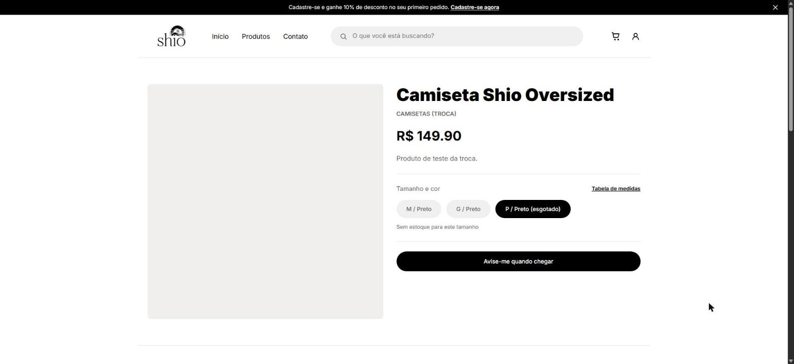
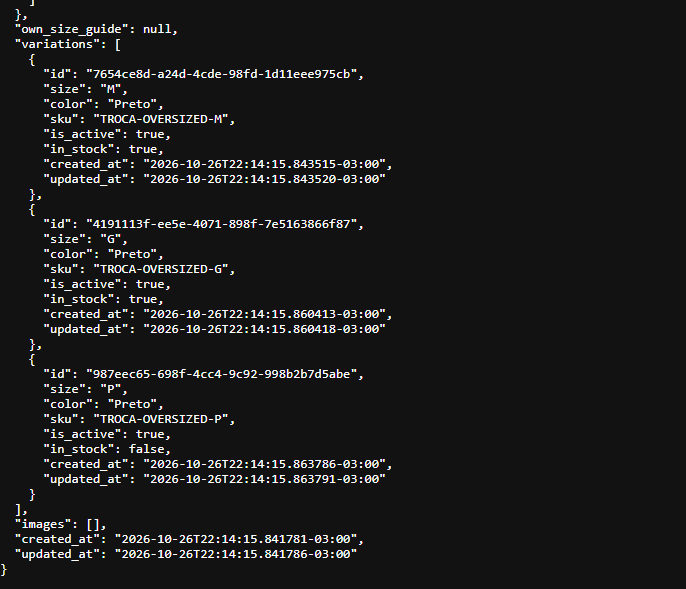
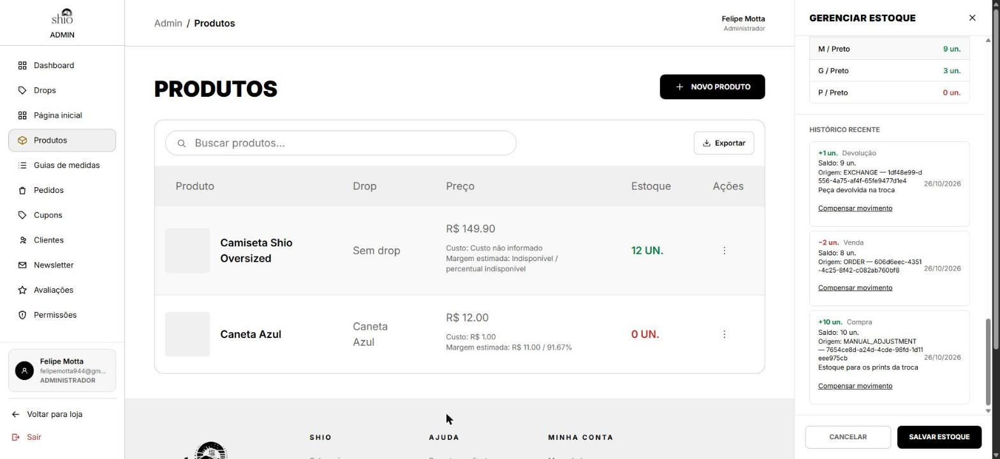
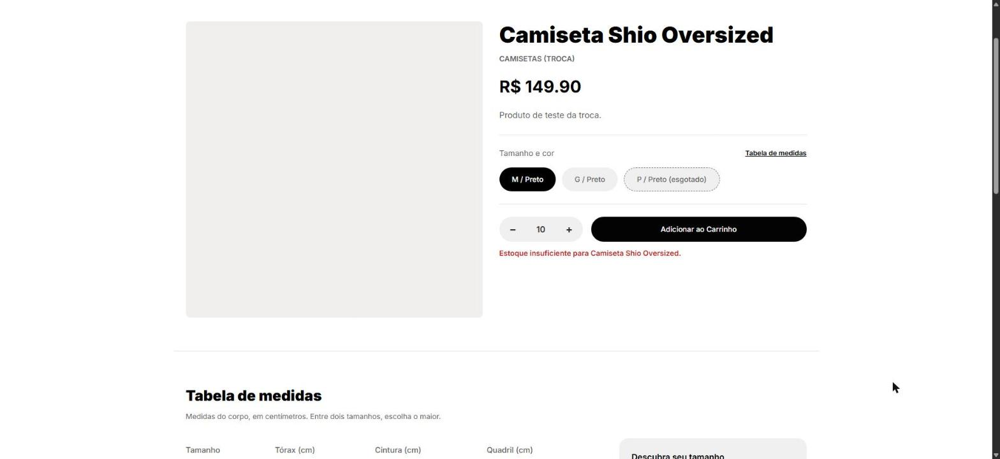

## Quantidade em estoque oculta — Disponibilidade sem expor o número de unidades
**Trio:** Amanda, Felipe e Cauã

**Origem:**
- [Issue #85](https://github.com/Shio-Enterprise/Documentacao/issues/85) — esconder do cliente a quantidade em estoque da página do produto e mantê-la visível só para administradores.

**Por que a melhoria foi relevante?**
A página pública do produto mostrava quantas unidades existiam de cada tamanho (por exemplo, "12 unidades em estoque"). A pedido do cliente, esse número deve aparecer só para administradores, no painel, onde já aparecia. Não bastava esconder o texto na tela: a API pública também enviava a quantidade exata, que continuaria visível para quem inspecionasse a página. A entrega troca a quantidade por um indicador de disponibilidade (`in_stock`) em todas as respostas públicas e mantém o número só nas rotas do painel administrativo. O cliente continua vendo quando um tamanho está esgotado e pode usar o "Avise-me quando chegar", e o carrinho e o checkout continuam recusando compras acima do estoque.

**Regras implementadas:**
- Cada variação envia `in_stock` (`true`/`false`) para todos; `stock_quantity` só vai para administradores (lista, detalhe e rotas de variação do painel).
- Lista, detalhe, página do drop, favoritos e carrinho não enviam mais o número para o cliente.
- A página do produto não mostra mais "N unidades em estoque".
- Tamanho esgotado continua marcado como "(esgotado)", com o "Avise-me quando chegar"; o selo "Esgotado" e o botão de carrinho continuam funcionando.
- O erro "Estoque insuficiente" não mostra mais "Disponível: N".
- Comprar mais que o estoque continua sendo recusado no carrinho e no checkout.
- O painel administrativo não muda: continua mostrando as quantidades.

**Validação automatizada:**
- Backend: 16 testes novos em `products/test_stock_visibility.py` e `orders/test_cart_stock_visibility.py`, cobrindo a API pública sem quantidade, a API do painel com quantidade, tamanho com estoque 0 como esgotado e a recusa de quantidade acima do estoque no carrinho.
- Frontend: testes novos na página do produto, no card de produto e em favoritos.

**Evidências (Pull Requests):**

- [Frontend PR #57](https://github.com/Shio-Enterprise/frontend/pull/57)
- [Backend PR #49](https://github.com/Shio-Enterprise/backend/pull/49)

**Evidências (prints):**

### Página do produto antes e depois

_Descrever: página do produto antes da mudança, exibindo "N unidades em estoque" abaixo da seleção de tamanho._

> **Imagem pendente:** `assets/evidencias-estoque-oculto/01-produto-antes.png`

<!--  -->

_Descrever: a mesma página depois da mudança, sem a quantidade, com o tamanho esgotado marcado como "(esgotado)" e o "Avise-me quando chegar"._

> **Imagem pendente:** `assets/evidencias-estoque-oculto/02-produto-depois.png`

<!--  -->

### Resposta da API pública

_Descrever: resposta da API pública do produto (aba Rede do navegador ou cliente HTTP), com `in_stock` em cada variação e sem `stock_quantity`._

> **Imagem pendente:** `assets/evidencias-estoque-oculto/03-api-publica-in-stock.png`

<!--  -->

### Painel administrativo com as quantidades

_Descrever: tela de produtos do painel administrativo, que continua mostrando a quantidade de cada variação._

> **Imagem pendente:** `assets/evidencias-estoque-oculto/04-admin-quantidades.png`

<!--  -->

### Carrinho recusando quantidade acima do estoque

_Descrever: tentativa de adicionar ao carrinho mais unidades do que há em estoque, recusada com "Estoque insuficiente", sem mostrar o número disponível._

> **Imagem pendente:** `assets/evidencias-estoque-oculto/05-carrinho-estoque-insuficiente.png`

<!--  -->
