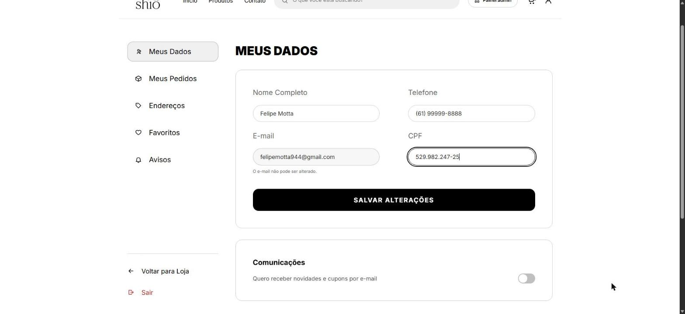
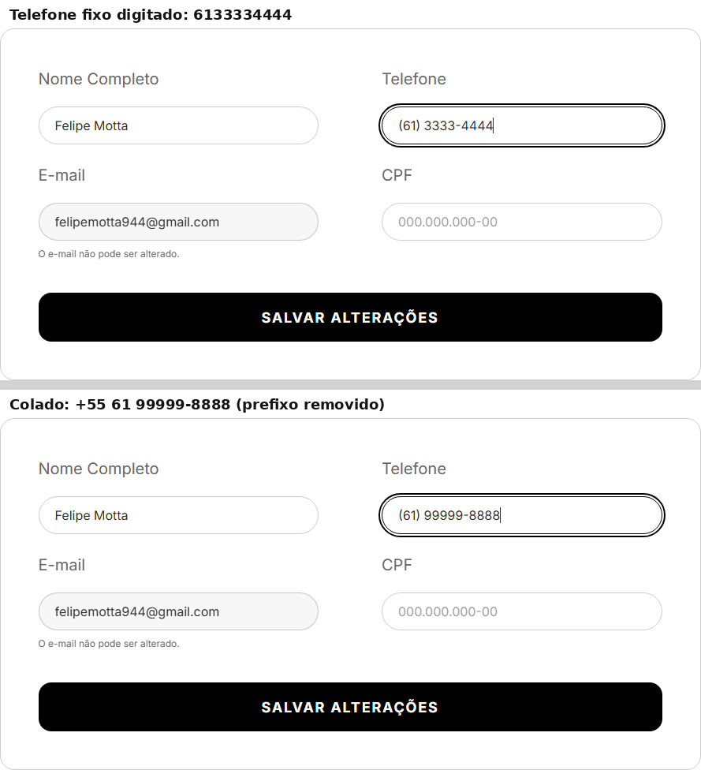
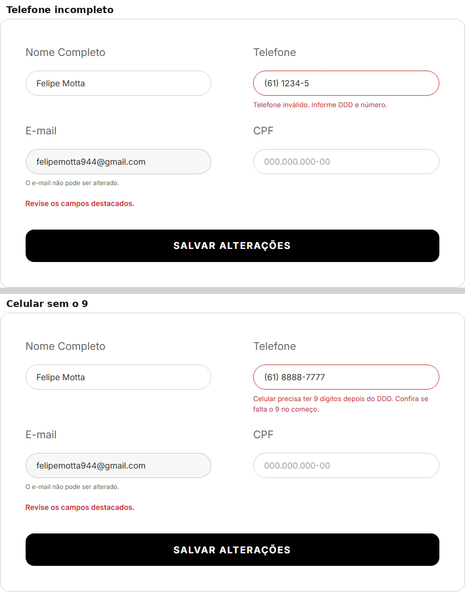
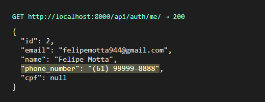
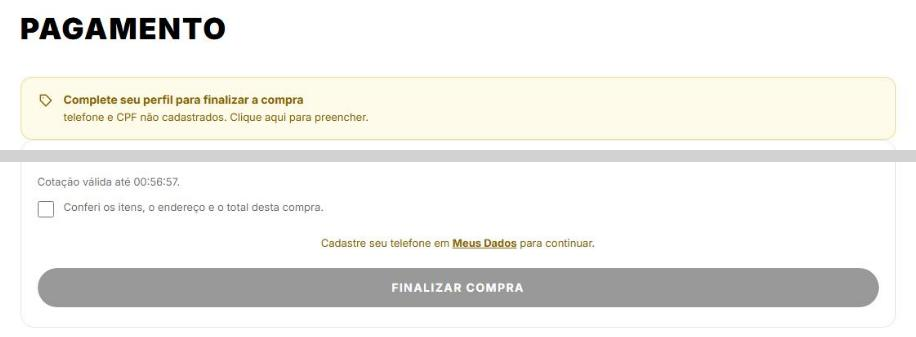

## Máscaras de telefone e CPF — Formato único em Meus Dados, no banco e no pagamento
**Trio:** Amanda, Felipe e Cauã

**Origem:**
- [Issue #111](https://github.com/Shio-Enterprise/Documentacao/issues/111) — mostrar máscara de telefone e CPF enquanto a pessoa digita em Meus Dados e guardar um formato único do telefone no banco.

**Por que a melhoria foi relevante?**
Telefone e CPF eram digitados em **Meus Dados** sem formato definido. O telefone aceitava qualquer texto e seguia como veio até o pagamento na InfinitePay. A entrega mostra a máscara enquanto a pessoa digita, `(61) 99999-9999` para celular, `(61) 3333-4444` para fixo e `000.000.000-00` para CPF, e passa a validar o telefone brasileiro no backend, gravando só os dígitos. Os telefones antigos válidos são padronizados por migração; os fora do padrão não são apagados, aparecem como estão e bloqueiam o checkout até a pessoa corrigir. O telefone vai para a InfinitePay no formato internacional (`+55`). A validação e a normalização do CPF no backend já existiam desde a [#91](https://github.com/Shio-Enterprise/Documentacao/issues/91); aqui o CPF ganha só a máscara.

**Regras implementadas:**
- A máscara se forma a cada tecla e também é aplicada quando a página carrega, padronizando a exibição de dados antigos.
- Um `+55` colado ou preenchido pelo navegador é aceito e removido. Os campos não têm `maxLength`, para não cortar um número colado com `+55`.
- O backend exige DDD e 10 ou 11 dígitos: celular começa com 9 e fixo com 2 a 5. Aceita o número com ou sem pontuação e com `+55`.
- A API grava só os dígitos e devolve o telefone formatado. Campo vazio vira `NULL`.
- Telefone inválido retorna `400` em `phone_number` e nada é salvo. Quando falta o 9 do celular, a mensagem diz isso.
- Telefone ou CPF antigo fora do padrão aparece como está, sem a máscara inventar um número.
- No pagamento, telefone ausente ou inválido bloqueia o botão e mostra um link para corrigir em Meus Dados.
- O checkout envia o telefone para a InfinitePay como `+55DDDNÚMERO`.

**Migração dos dados antigos:**
A migração `authentication.0010_normalize_profile_phone` padroniza os telefones antigos válidos. Os inválidos ficam como estão, e o `migrate` lista o e-mail e o id de cada perfil no log `[Telefone]`, sem mostrar o número. Segue o mesmo esquema da migração de CPF da #91. Antes do deploy, a migração deve ser executada numa cópia do banco de produção, com revisão do log `[Telefone]` e um pagamento de teste em homologação.

**Validação automatizada:**
- Backend: `authentication/test_phone.py` (validação e gravação), `authentication/test_phone_migration.py` (normaliza o válido, preserva o inválido, limpa o vazio) e o payload da InfinitePay em `orders/tests.py`.
- Frontend: `src/lib/masks.test.js` (celular, fixo, `+55` e CPF, na digitação e na exibição de valor vindo da API), `MyAccountPage/index.test.jsx` e `PaymentPage/index.test.jsx` (bloqueio com telefone ausente ou inválido).

**Evidências (Pull Requests):**

- [Frontend PR #62](https://github.com/Shio-Enterprise/frontend/pull/62)
- [Backend PR #53](https://github.com/Shio-Enterprise/backend/pull/53)

**Evidências (prints):**

### Máscaras em Meus Dados

Meus Dados com a máscara aplicada durante a digitação: celular `(61) 99999-8888` e CPF `529.982.247-25`:

Telefone fixo digitado como `6133334444` vira `(61) 3333-4444`. Ao colar `+55 61 99999-8888`, o prefixo é removido e fica `(61) 99999-8888`:

### Telefone inválido recusado

Ao salvar um telefone incompleto, aparece "Telefone inválido. Informe DDD e número.". Para celular sem o 9, a mensagem pede para conferir se falta o 9 no começo. Nada é salvo:

### Telefone salvo só com dígitos

Depois de salvar `+55 (61) 99999-8888`, a API (`GET /api/auth/me/`) devolve o telefone formatado. A conferência no banco (só dígitos) ainda depende de um print do admin do Django:

### Checkout bloqueado com telefone inválido

Checkout com telefone ausente: o aviso "Complete seu perfil para finalizar a compra" leva a Meus Dados, a revisão pede "Cadastre seu telefone em Meus Dados para continuar" e o botão "Finalizar compra" fica desabilitado:

