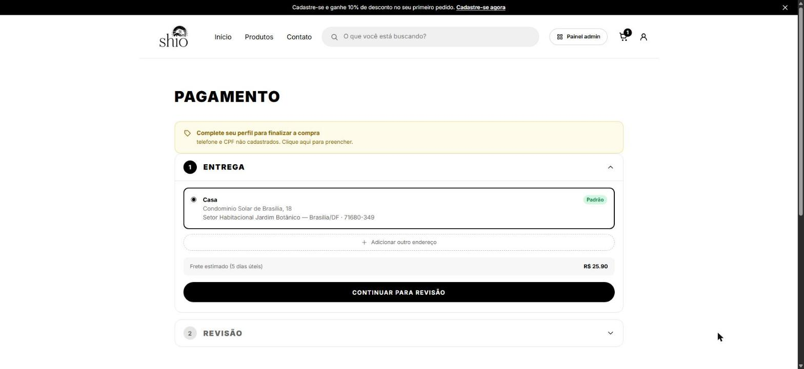
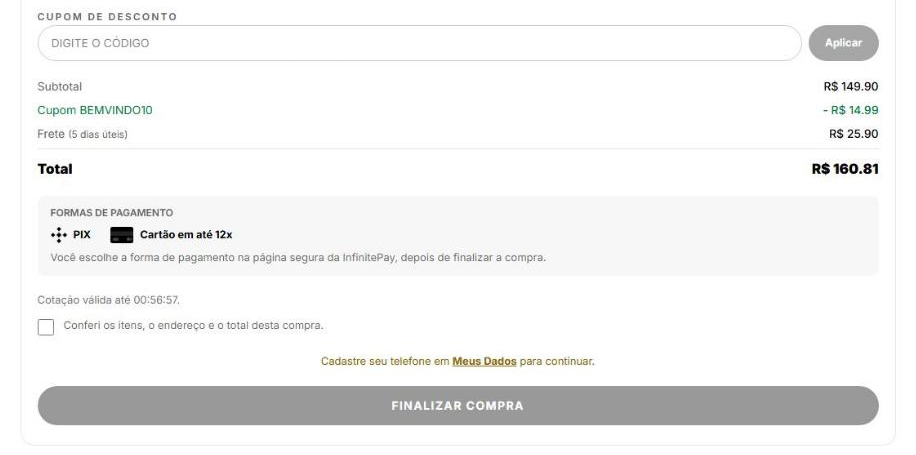

## Etapa de métodos de pagamento removida — Checkout em duas etapas
**Trio:** Amanda, Felipe e Cauã

**Origem:**
- Sem issue. Ajuste combinado pelo time: a escolha entre PIX e cartão já é feita na página da InfinitePay, então a etapa "Pagamento" do checkout não tinha função.

**Por que a melhoria foi relevante?**
O checkout tinha três etapas: **Entrega**, **Pagamento** e **Revisão**. A etapa **Pagamento** só mostrava os ícones de PIX e cartão, sem deixar escolher nada, porque a escolha acontece na InfinitePay depois de finalizar a compra. Era um clique a mais sem função. A entrega remove essa etapa e passa a informar as duas formas de pagamento na **Revisão**, junto do total e do botão "Finalizar Compra".

**Regras implementadas:**
- O checkout passa a ter duas etapas: **Entrega** e **Revisão**.
- O botão da Entrega passa de "Continuar para Pagamento" para "Continuar para Revisão".
- A Revisão mostra o bloco **Formas de pagamento**: PIX e cartão em até 12x.
- O bloco avisa que a forma de pagamento é escolhida na página segura da InfinitePay, depois de finalizar a compra.
- Leitores de tela anunciam "Etapa 1 de 2" e "Etapa 2 de 2", e o foco vai para o título da Revisão ao avançar.
- O backend não muda: o pedido segue para a InfinitePay como antes.

**Validação automatizada:**
- Frontend: `PaymentPage/index.test.jsx` atualizado para as duas etapas, com teste novo do bloco de formas de pagamento na Revisão e verificação `vitest-axe` sem violações na Entrega e na Revisão.

**Evidências (Pull Requests):**

- Frontend PR: [[Fix] Retirando método de pagamento](https://github.com/Shio-Enterprise/frontend/pull/72)

**Evidências (prints):**

### Checkout depois

Checkout depois da mudança, só com as etapas 1 Entrega e 2 Revisão:

### Formas de pagamento na Revisão

Revisão com o bloco "Formas de pagamento" (PIX e cartão em até 12x) e o aviso da InfinitePay, acima do botão "Finalizar compra":

