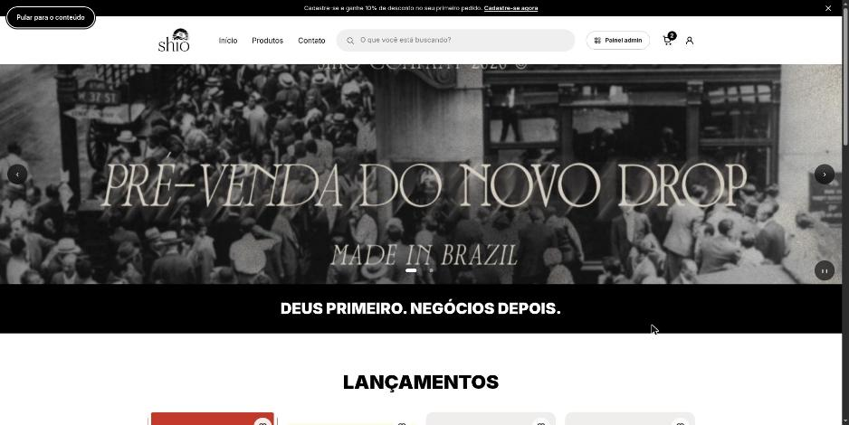
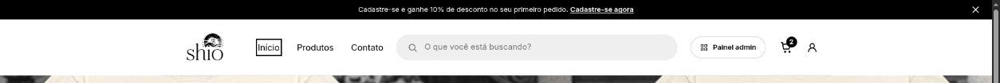
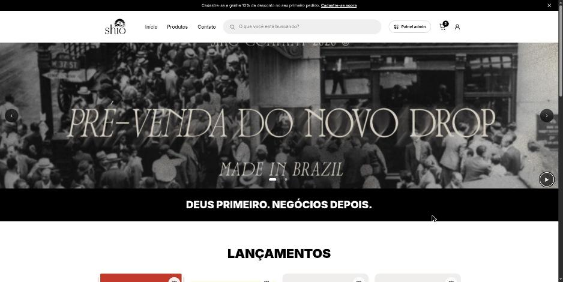
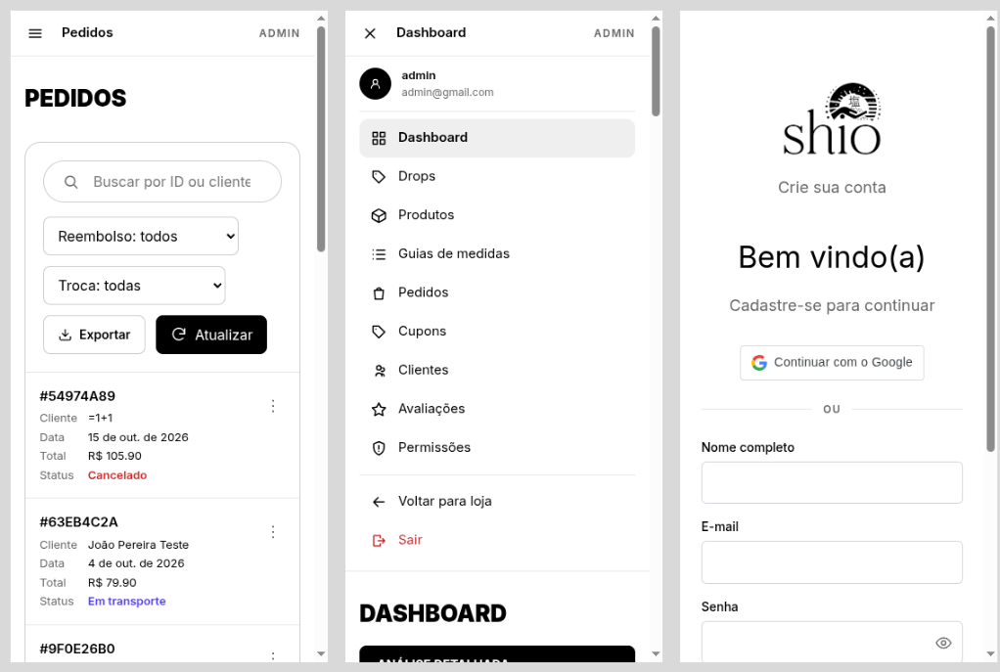

# Responsividade e acessibilidade (WCAG 2.1 AA)

**Trio:** Ian, Arthur e Danilo

**Origem:**
- [Issue #64](https://github.com/Shio-Enterprise/Documentacao/issues/64): responsividade e acessibilidade do site (WCAG 2.1 AA).

## Contexto e Relevância

Várias telas não funcionavam bem no celular: tabelas que estouravam a largura, painéis com largura fixa e botões pequenos demais para o toque. Também havia problemas de acessibilidade, como texto cinza-claro sem contraste, foco do teclado invisível, modais que não fechavam com Esc e carrossel que trocava sozinho sem pausa.

O trabalho cobriu o **sistema inteiro**: a loja, a área do cliente e o painel administrativo. A identidade visual da Shio foi mantida, e a única mudança perceptível é o cinza dos textos secundários, que ficou mais escuro para atingir o contraste mínimo.

Por ser uma entrega muito grande, esta página resume o que foi feito e mostra **apenas algumas evidências** como exemplo. Os detalhes de cada área estão nos PRs.

---

## O que foi feito

O trabalho foi dividido em etapas, com um PR por área:

| Etapa | Área | Exemplos do que mudou |
| :---: | :--- | :--- |
| 0 | Fundação (site inteiro) | cores com contraste mínimo, contorno de foco em todo o site, link "Pular para o conteúdo", fonte mínima de 12 px, respeito ao "reduzir animações" |
| 1 | Modais | componente único de modal: fecha com Esc, prende o foco dentro dele e devolve o foco ao botão que o abriu |
| 2 | Layout e navegação | menu ☰ no painel admin no celular, ícones com área de toque de 44 px |
| 3 | Vitrine | carrossel com botão de pausar, filtros acessíveis pelo teclado |
| 4 | Compra | carrinho e pagamento usáveis só com o teclado, mensagens anunciadas ao leitor de tela |
| 5 | Conta | rótulos visíveis nos formulários, botão para mostrar a senha, erros ligados ao campo |
| 6 e 7 | Painel admin | tabelas de Pedidos e Produtos viram cartões no celular; menus "⋯" navegáveis pelas setas |
| 8 | Dashboards | gráficos e tabelas com rolagem dentro do próprio quadro no celular |

Ao longo do trabalho, também foram encontrados bugs que já existiam no sistema. Eles foram registrados como issues separadas (#87 a #91).

---

## Evidências (Pull Requests)

Frontend: [#40](https://github.com/Shio-Enterprise/frontend/pull/40), [#41](https://github.com/Shio-Enterprise/frontend/pull/41), [#42](https://github.com/Shio-Enterprise/frontend/pull/42), [#43](https://github.com/Shio-Enterprise/frontend/pull/43), [#44](https://github.com/Shio-Enterprise/frontend/pull/44), [#46](https://github.com/Shio-Enterprise/frontend/pull/46), [#47](https://github.com/Shio-Enterprise/frontend/pull/47), [#48](https://github.com/Shio-Enterprise/frontend/pull/48), [#49](https://github.com/Shio-Enterprise/frontend/pull/49), [#50](https://github.com/Shio-Enterprise/frontend/pull/50), [#51](https://github.com/Shio-Enterprise/frontend/pull/51) e o PR final [#52](https://github.com/Shio-Enterprise/frontend/pull/52), que levou tudo para a `dev`.

---

## Validação

- **Testes automáticos**: testes `vitest-axe` (sem violações de acessibilidade) nos componentes principais, como menu, rodapé, carrossel da Home, formulários de login, cadastro, endereço e pagamento, modais e tabelas. Suíte do frontend com 623 testes passando, com o CI verde no PR final.
- **Lighthouse**: nota 100 de acessibilidade em 15 páginas, no celular e no computador.
- **Varredura automática no navegador**: 683 verificações em 41 páginas, como visitante, cliente e admin, nas larguras de 360, 768, 1024 e 1440 px e com zoom de 200% e 400%. Foram checados rolagem lateral, teclado, áreas de toque, cores forçadas e animação reduzida.
- **Teste manual**: compra completa feita só com o teclado.

---

## Limitações Conhecidas

- Ainda falta o teste com leitor de tela (NVDA).

---

## Evidências (prints)

Algumas amostras do resultado. As demais estão nos PRs.

O primeiro Tab da página mostra o link **"Pular para o conteúdo"**, que leva direto ao conteúdo sem passar pelo menu:

**Foco visível**: navegando pelo teclado, o item em foco do menu ganha um contorno:

**Carrossel com pausa**: o botão no canto do banner pausa a troca automática dos slides (aqui acionado pelo teclado, e o botão passa a mostrar "retomar"):

**Celular (360 px)**, da esquerda para a direita:
- Pedidos do admin em cartões, sem tabela estourando a tela;
- menu ☰ do painel admin aberto;
- cadastro com rótulos visíveis nos campos e o botão de mostrar a senha.

