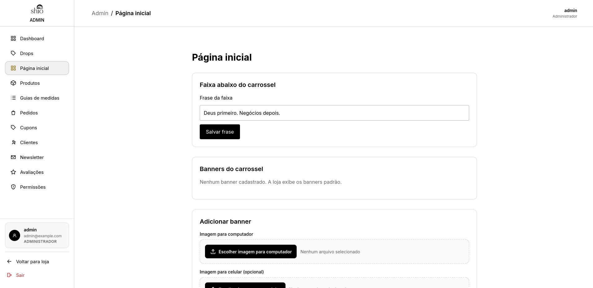
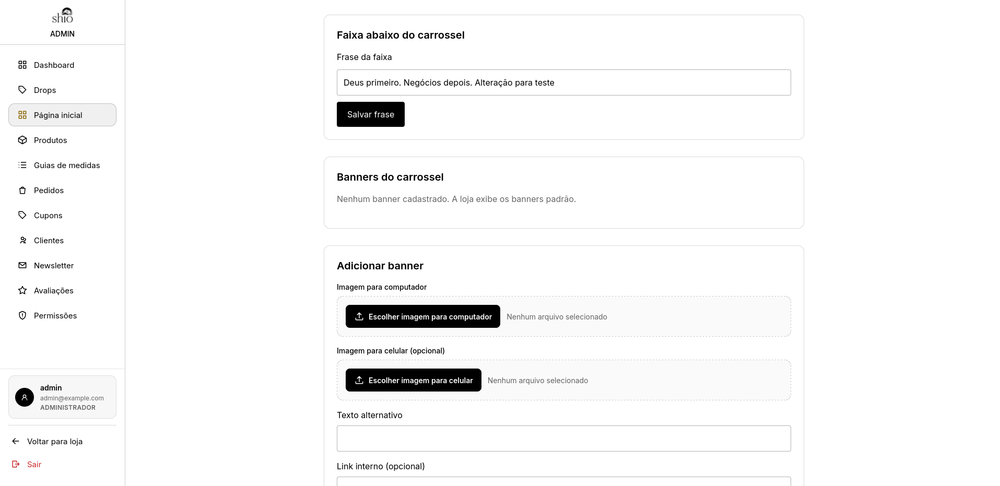
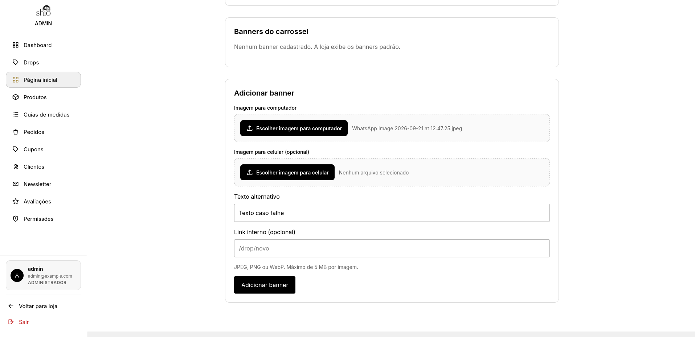
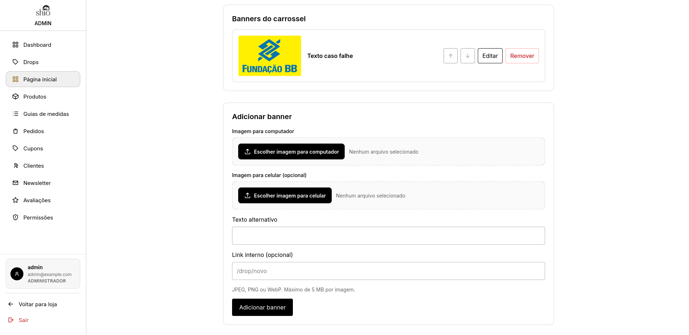
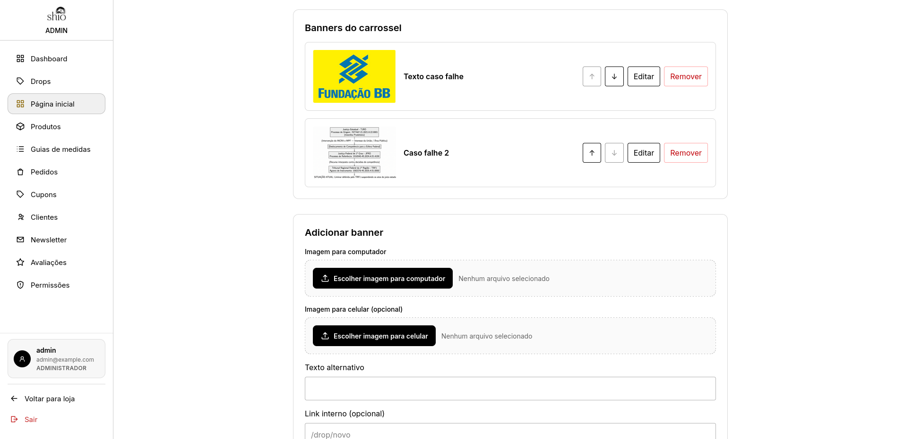

# Edição dos banners e da frase da página inicial

**Trio:** Ian Costa, Arthur Sousa e Danilo Naves

**Origem:**
- [Issue #82](https://github.com/Shio-Enterprise/Documentacao/issues/82) — `[Feature] Editar banners e frase da página inicial pelo painel admin`.

---

## Contexto e Relevância

O carrossel de banners e a frase da faixa preta abaixo dele estavam definidos no código. Alterar uma campanha ou um novo drop exigia a intervenção de um desenvolvedor e uma nova publicação do site. A tarefa acrescenta ao painel administrativo a gestão desse conteúdo, para que as mudanças apareçam na loja após o recarregamento da página.

---

## Regras e Especificações da Tarefa

1. **Página inicial no painel:** área administrativa para editar a frase e gerenciar os banners do carrossel.
2. **Frase da faixa:** campo de texto e ação para salvar a mensagem mostrada abaixo do carrossel.
3. **Banners:** cadastro com imagem para computador, imagem opcional para celular, texto alternativo e link interno opcional. A lista oferece ações para editar, remover e alterar a ordem dos banners.
4. **Exibição na loja:** os banners cadastrados e a frase salva devem aparecer na página inicial ao recarregar. Se não houver banners cadastrados, a loja usa os banners padrão.
5. **Controle de acesso e arquivos:** a issue exige permissão administrativa para a tela e a API, além de rejeição de imagens inválidas ou acima do limite com mensagem de erro. O formulário informa formatos JPEG, PNG ou WebP e limite de 5 MB por imagem.

---

## Evidências Visuais

### Estado inicial e edição da frase

Tela **Página inicial** do painel, com a frase original e o aviso de que, sem banners cadastrados, a loja exibe os banners padrão:

Página pública antes da alteração, com o banner padrão e a frase original:

Frase de teste preenchida no painel e resultado exibido na faixa preta da página pública:

### Cadastro e gestão dos banners

Formulário de inclusão com imagem para computador, imagem opcional para celular, texto alternativo e link interno opcional:

Banner cadastrado exibido no carrossel da loja:

Lista administrativa após a inclusão do primeiro banner, com controles de ordem, edição e remoção:

Lista com dois banners cadastrados e controles para reordená-los:

[Vídeo: carrossel da loja com dois banners cadastrados](../../../assets/Evidencias_editar_banner/9_demo_banner_duplo.mp4).

---

## Validação Registrada

- Os prints mostram a frase editada no painel e a nova frase na loja.
- Os prints mostram um banner incluído no painel e exibido na loja.
- A lista mostra dois banners e oferece ações de reordenação, edição e remoção; o vídeo registra a exibição dos dois banners no carrossel.
- O painel informa o comportamento padrão quando não há banners cadastrados; o print inicial da loja mostra o banner padrão.

---

## Fora do Escopo

- Edição das demais seções da página inicial, como **Lançamentos**.
- Agendamento de início ou fim da exibição de banners.
