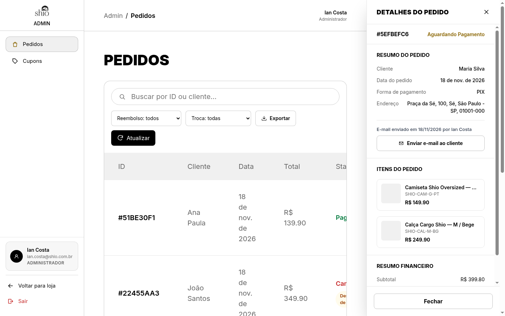
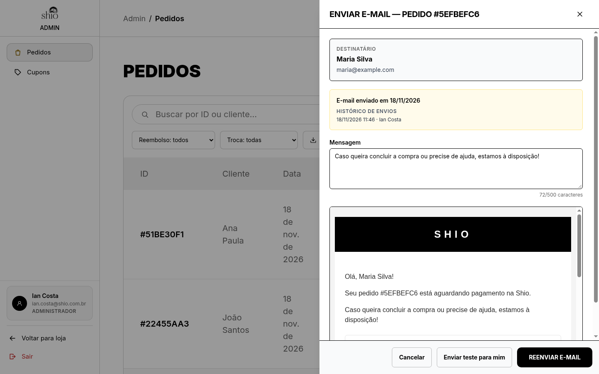

# E-mail de recuperação para pedidos aguardando pagamento ou cancelados

**Trio:** Ian Costa, Arthur Sousa e Danilo Naves

**Origem:**
- [Issue #102](https://github.com/Shio-Enterprise/Documentacao/issues/102) — `[Feature] E-mail para clientes com pedido aguardando pagamento ou cancelado`.

---

## Contexto e Relevância

Clientes com pedidos em aberto (aguardando pagamento) ou cancelados não recebiam contato direto a partir do painel administrativo para retomada da compra ou suporte. Esta entrega permite ao administrador visualizar, testar e enviar um e-mail personalizado diretamente pelo detalhe do pedido no painel, mantendo histórico dos envios realizados.

---

## Regras e Especificações Implementadas

1. **Status elegíveis**:
   - A ação de envio de e-mail fica disponível no detalhe de pedidos com status **Aguardando Pagamento** ou **Cancelado**.
2. **Pré-visualização e envio de teste**:
   - O administrador pode editar a mensagem complementar, conferir a pré-visualização do e-mail com os dados do pedido e disparar um e-mail de teste para si mesmo antes do envio ao cliente.
3. **Histórico de envios (`OrderRecoveryEmailSend`)**:
   - Cada disparo registra data/hora e administrador responsável, exibidos no detalhe do pedido e dentro do modal (permitindo inclusive reenvio com histórico visível).
4. **Templates HTML e texto simples**:
   - Templates dedicados (`order_recovery.html` e `order_recovery.txt`) no app `notifications`.

---

## Endpoints e Arquivos do Backend

- `GET /api/orders/admin/<uuid:order_id>/email/` (`OrderRecoveryEmailSummaryView`) — Resumo do pedido e histórico de e-mails de recuperação enviados.
- `POST /api/orders/admin/<uuid:order_id>/email/preview/` (`OrderRecoveryEmailPreviewView`) — Geração de pré-visualização do e-mail com a mensagem informada.
- `POST /api/orders/admin/<uuid:order_id>/email/test/` (`OrderRecoveryEmailTestView`) — Envio de e-mail de teste para o administrador autenticado.
- `POST /api/orders/admin/<uuid:order_id>/email/send/` (`OrderRecoveryEmailSendView`) — Disparo do e-mail ao cliente do pedido e registro em `OrderRecoveryEmailSend`.
- `orders/order_email.py` — Lógica de montagem, validação de status e disparo do e-mail de recuperação.

---

## Componentes do Frontend

- **`src/pages/admin/OrdersPage/index.jsx`** — Integração do botão `Enviar e-mail ao cliente` e da indicação de último envio no painel lateral de **Detalhes do Pedido**.
- **`src/components/admin/OrderEmailModal.jsx`** — Modal de envio exibindo destinatário, histórico de envios, campo de mensagem, pré-visualização do e-mail, `Enviar teste para mim` e botão de envio/reenvio.

---

## Evidências (Pull Requests)

- [Backend PR #60](https://github.com/Shio-Enterprise/backend/pull/60)
- [Frontend PR #70](https://github.com/Shio-Enterprise/frontend/pull/70)

---

## Validação Automatizada

### Backend (Pytest)
- **`orders/test_order_recovery_email.py`** — Testes de permissão administrativa, elegibilidade por status do pedido, pré-visualização, envio de teste, envio ao cliente e registro de histórico em `OrderRecoveryEmailSend`.

### Frontend (Vitest & Testing Library)
- **`src/components/admin/OrderEmailModal.test.jsx`** — Renderização do modal, histórico de envios, edição de mensagem, pré-visualização, envio de teste e disparo.
- **`src/pages/admin/OrdersPage/index.test.jsx`** — Exibição da ação de envio de e-mail e histórico no detalhe do pedido.

---

## Evidências Visuais

Painel administrativo de **Pedidos** com o drawer **Detalhes do Pedido** aberto para um pedido `Aguardando Pagamento`, exibindo o registro do último envio e o botão `Enviar e-mail ao cliente`:

Modal **Enviar E-mail** com dados do destinatário, histórico de envios, campo de mensagem, pré-visualização do e-mail e ações de envio de teste e reenvio:

