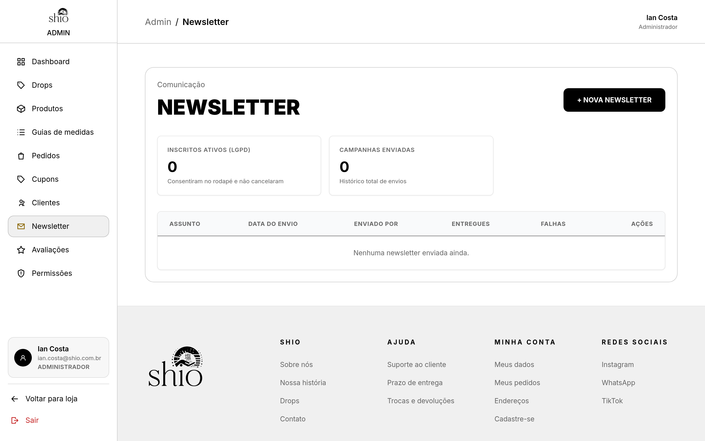
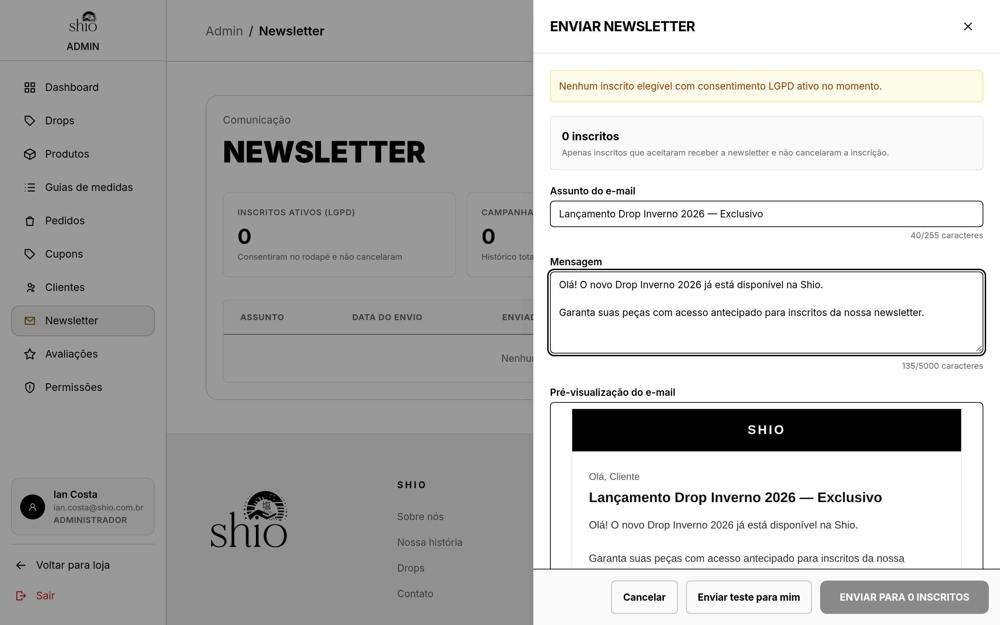

# Envio de newsletter pelo painel administrativo

**Trio:** Ian Costa, Arthur Sousa e Danilo Naves

**Origem:**
- [Issue #65](https://github.com/Shio-Enterprise/Documentacao/issues/65) — `[Feature] Newsletter: envio de e-mails pelo painel admin`.

---

## Contexto e Relevância

A loja já captava inscritos de newsletter com consentimento, mas o painel administrativo não contava com uma área dedicada para redigir, pré-visualizar, testar e disparar campanhas para esses contatos. Esta entrega cria o fluxo completo de envio de newsletter no painel admin, reutilizando o app `notifications` e respeitando o consentimento LGPD e cancelamentos de inscrição.

---

## Regras e Especificações Implementadas

1. **Público elegível (LGPD)**:
   - Apenas inscritos ativos com consentimento registrado e que não cancelaram a inscrição recebem os disparos.
2. **Pré-visualização e envio de teste**:
   - O administrador pode visualizar a prévia do e-mail antes do envio e disparar um e-mail de teste para si mesmo.
3. **Histórico de campanhas (`NewsletterSend`)**:
   - Cada campanha enviada registra assunto, data do envio, responsável, quantidade de entregas e falhas.
4. **Templates HTML e texto simples**:
   - Templates dedicados (`newsletter.html` e `newsletter.txt`) no app `notifications`.

---

## Endpoints e Arquivos do Backend

- `GET /api/auth/admin/newsletter/` (`NewsletterSummaryView`) — Resumo de inscritos ativos e histórico de envios.
- `POST /api/auth/admin/newsletter/preview/` (`NewsletterPreviewView`) — Geração de pré-visualização do e-mail.
- `POST /api/auth/admin/newsletter/test/` (`NewsletterTestView`) — Envio de e-mail de teste para o administrador autenticado.
- `POST /api/auth/admin/newsletter/send/` (`NewsletterSendView`) — Disparo da campanha para os inscritos elegíveis e registro em `NewsletterSend`.
- `notifications/newsletter.py` — Lógica de montagem e disparo da newsletter.

---

## Componentes do Frontend

- **`src/pages/admin/NewsletterPage/index.jsx`** — Tela administrativa `/admin/newsletter` com total de inscritos ativos (LGPD), total de campanhas enviadas, tabela de histórico e botão `+ NOVA NEWSLETTER`.
- **`src/components/admin/NewsletterModal.jsx`** — Modal de envio com contagem de inscritos elegíveis, campos de assunto e mensagem, pré-visualização do e-mail, botão `Enviar teste para mim` e botão de disparo.
- **`src/components/layout/admin/AdminNavbar.jsx`** e **`src/routes/index.jsx`** — Adição do item **Newsletter** no menu lateral e registro da rota administrativa.

---

## Evidências (Pull Requests)

- [Backend PR #46](https://github.com/Shio-Enterprise/backend/pull/46)
- [Frontend PR #54](https://github.com/Shio-Enterprise/frontend/pull/54)

---

## Validação Automatizada

### Backend (Pytest)
- **`notifications/test_newsletter.py`** — Testes unitários da montagem, formatação e disparo da newsletter.
- **`authentication/test_newsletter_api.py`** — Testes dos endpoints administrativos de resumo, prévia, teste e envio com controle de acesso.

### Frontend (Vitest & Testing Library)
- **`src/pages/admin/NewsletterPage/index.test.jsx`** — Renderização do painel, contadores, histórico e abertura do modal.
- **`src/components/admin/NewsletterModal.test.jsx`** — Preenchimento do formulário, pré-visualização, envio de teste e disparo da campanha.

---

## Evidências Visuais

Painel administrativo de **Newsletter** exibindo os cards de inscritos ativos (LGPD) e campanhas enviadas, tabela de histórico e o botão `+ NOVA NEWSLETTER`:

Modal **Enviar Newsletter** com aviso de elegibilidade, campos de assunto e mensagem, pré-visualização do e-mail e ações de envio de teste e disparo:

