# Galeria de fotos do produto

**Trio:** Ian, Arthur e Danilo

**Origem:**
- [Issue #84](https://github.com/Shio-Enterprise/Documentacao/issues/84): ajustar a galeria de miniaturas da página do produto.

## Contexto e Relevância

Na página do produto, a coluna de miniaturas não acompanhava a foto principal. Com muitas fotos, a coluna ficava mais alta que a foto, e a foto principal esticava e cortava a imagem. Com poucas fotos, sobrava espaço. Como a loja recebe fotos em pé, deitadas e quadradas, o problema aparecia em praticamente todo produto.

Agora a galeria mantém o mesmo formato com qualquer quantidade de fotos: a foto principal é sempre quadrada e inteira, e as miniaturas ficam alinhadas e rolam com setas quando não cabem.

---

## Regras e Especificações Implementadas

1. **Foto principal quadrada e inteira**: a imagem nunca é cortada nem esticada. Foto em pé ganha faixas cinza nas laterais; foto deitada, em cima e embaixo.
2. **Coluna com a mesma altura da foto** (computador): as miniaturas ficam à esquerda, numa coluna de 96 px com a altura exata da foto principal.
3. **Setas só quando precisa**: com até 4 fotos as miniaturas cabem e não há setas. Com mais, aparecem as setas ▲ e ▼.
   - A seta do começo fica apagada no início da lista, e a do fim, no fim.
   - Cada clique anda uma miniatura. Cliques seguidos somam, mesmo com a animação anterior em andamento, e param no fim da lista.
   - A rolagem com a roda do mouse ou com o dedo continua funcionando, e as setas acompanham.
4. **Celular**: a foto principal fica em cima e as miniaturas numa linha embaixo, com setas ◀ e ▶ e rolagem lateral. A página não rola para o lado.
5. **Uma foto só**: a coluna de miniaturas não aparece, e a foto ocupa a largura toda.
6. **Tablet**: com a página em uma coluna só, a galeria fica limitada a 570 px e centralizada, para a foto não passar da altura da tela.
7. **Foto que não carrega**: vira o quadro cinza, em vez do ícone de imagem quebrada.
8. **Acessibilidade** (seguindo a [#64](https://github.com/Shio-Enterprise/Documentacao/issues/64)):
   - miniaturas são botões com nome ("Ver foto 2 de 10") e marcam a foto mostrada;
   - setas com nome ("Fotos anteriores" / "Próximas fotos");
   - seta apagada usa `aria-disabled` em vez de `disabled`, para o foco do teclado não se perder quando a lista chega ao fim;
   - quando o sistema pede menos animação (`prefers-reduced-motion`), as setas rolam sem animação.

---

## Componentes do Frontend

- **`src/components/product/ProductGallery.jsx`** (novo): a galeria inteira (foto principal, miniaturas e setas).
- **Página do produto** (`ProductDetailPage`): passa a usar o `ProductGallery` no lugar do código antigo da galeria.

---

## Evidências (Pull Requests)

- [Frontend PR #53](https://github.com/Shio-Enterprise/frontend/pull/53)

---

## Validação Automatizada

Desenvolvido em TDD (o teste é escrito antes e falha antes do código existir).

### Frontend (Vitest & Testing Library): suíte completa com 647 testes passando
- **`src/components/product/ProductGallery.test.jsx`** (20 testes):
  - **Quantidade de fotos**:
    - sem fotos mostra só o quadro vazio;
    - com 1 foto não mostra miniaturas;
    - com 2 fotos já mostra a coluna;
    - com 10 fotos mostra uma miniatura para cada.
  - **Foto principal**:
    - aparece inteira, sem corte;
    - clicar numa miniatura troca a foto e marca a miniatura.
  - **Setas**:
    - não aparecem sem rolagem;
    - aparecem com rolagem, apagadas nas pontas;
    - avançar rola a lista e libera a seta de voltar;
    - cliques rápidos somam e não passam do fim;
    - seta apagada não rola e mantém o foco do teclado;
    - depois de rolar com a roda ou o dedo, a seta parte da posição real.
  - **Movimento reduzido**: rola sem animação quando o sistema pede.
  - **Foto quebrada**: vira o quadro cinza.
  - **Acessibilidade**: nenhuma violação no axe.
- **`src/pages/public/ProductDetailPage/index.test.jsx`**: ao trocar de produto, a galeria volta para a primeira foto.

O CI (GitHub Actions) passou no PR.

---

## Validação Manual

Testes no navegador com backend e frontend rodando localmente, usando produtos com 1, 2, 3, 4, 5 e 10 fotos (em pé, deitadas e quadradas) e um produto com fotos extremas.

1. **Computador**:
   - com 1 foto, sem coluna de miniaturas;
   - com 2, 3 e 4 fotos, coluna sem setas;
   - com 5 e 10 fotos, setas funcionando e coluna da mesma altura da foto.
2. **Teclado**: Tab até as miniaturas e Enter troca a foto. Enter repetido na seta ▼ chega ao fim, a seta apaga e o foco continua nela.
3. **Celular (375 e 500 px)**: miniaturas numa linha embaixo, setas ◀ ▶ e rolagem com o dedo funcionando, sem rolagem lateral da página.
4. **Tablet (900 px) e largura equivalente a zoom de 200%**: galeria centralizada, sem quebrar o layout.
5. **Fotos extremas**: panorâmica (2400 × 300) e foto fina (300 × 2400) aparecem inteiras.
6. **Foto quebrada**: produto com arquivo de imagem ausente mostra o quadro cinza.

---

## Limitações Conhecidas

- Foto muito pequena (por exemplo, 40 × 40 px) é ampliada para preencher o quadro e fica borrada. É uma questão do cadastro da foto, não da galeria.
- A ordem das fotos é a ordem de cadastro. O painel admin ainda não permite reordenar nem trocar fotos de um produto já criado.
- Não foi testado no Firefox nem com leitor de tela (NVDA).

---

## Evidências (prints)

### Antes

Produto com 1 foto: a coluna de miniaturas aparece mesmo sem necessidade, e a foto principal fica esticada:

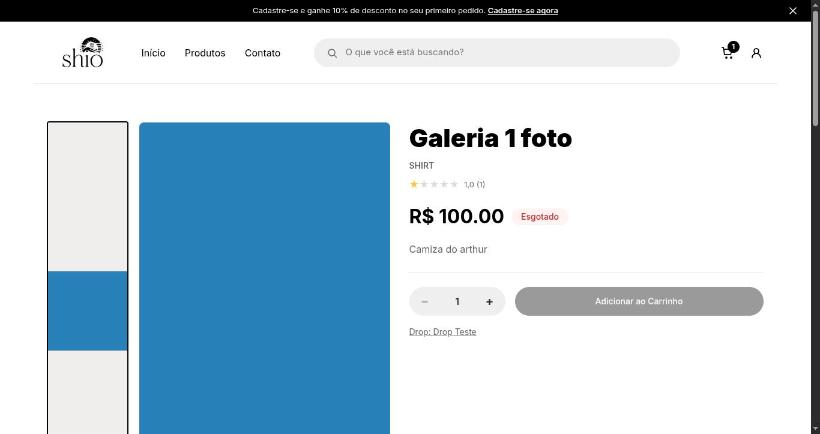

Produto com 3 fotos: a foto principal estica até a altura da coluna e corta a imagem:

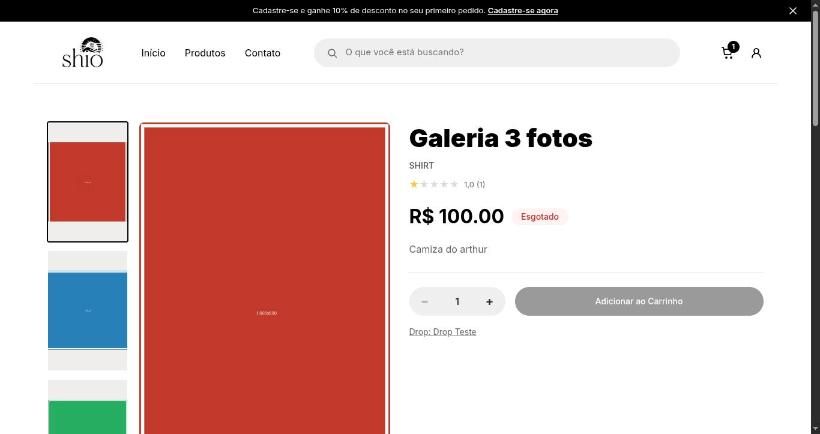

Produto com 10 fotos: a coluna fica muito mais alta que a tela, e a foto principal perde o formato quadrado:

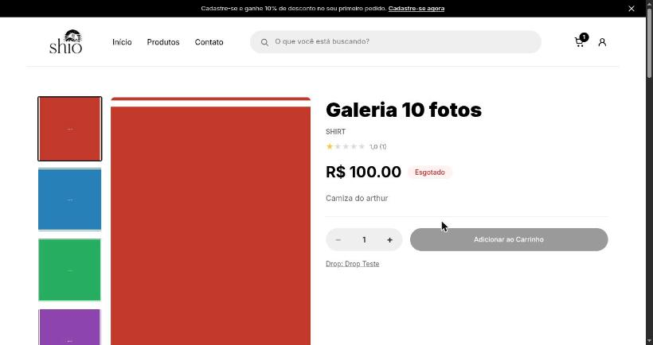

No celular, as 10 miniaturas viravam uma grade antes da foto principal:

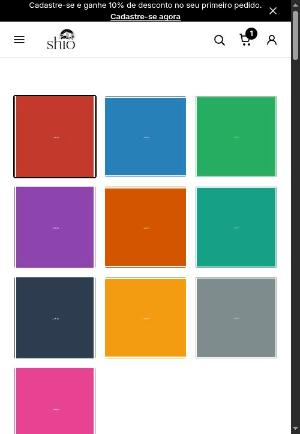

### Depois — computador

1 foto: sem coluna de miniaturas, com a foto quadrada e inteira:

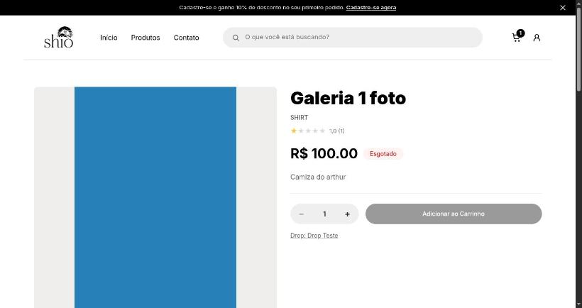

3 fotos: coluna alinhada, sem setas:

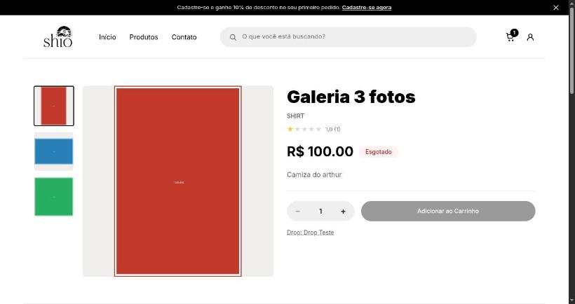

5 fotos: setas ▲ ▼, com a coluna da mesma altura da foto:

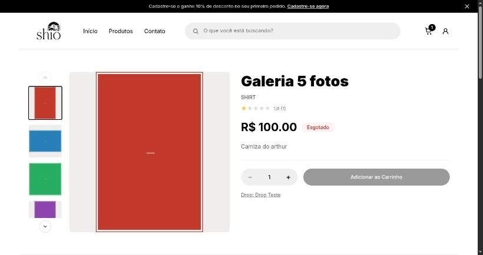

10 fotos: mesma altura, com rolagem pelas setas:

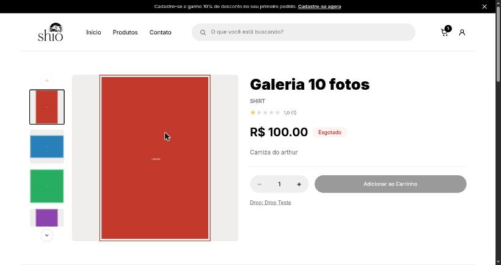

### Depois — celular e tablet

1 foto no celular:

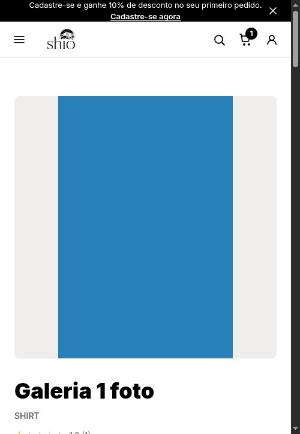

3 fotos no celular: linha de miniaturas embaixo, sem setas:

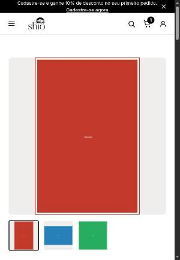

10 fotos no celular: linha de miniaturas com setas ◀ ▶:

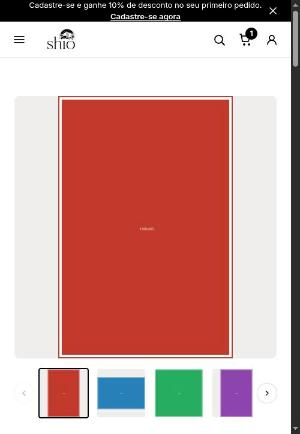

Tablet (900 px): galeria centralizada e limitada a 570 px:

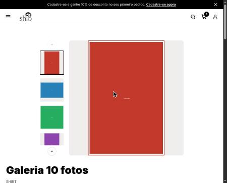

Celular com 375 px (à esquerda) e largura equivalente a zoom de 200% (à direita):

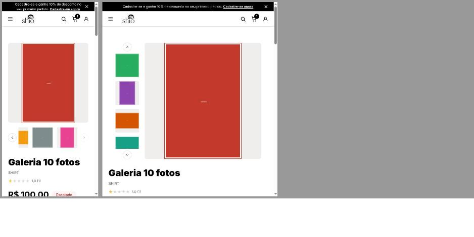
