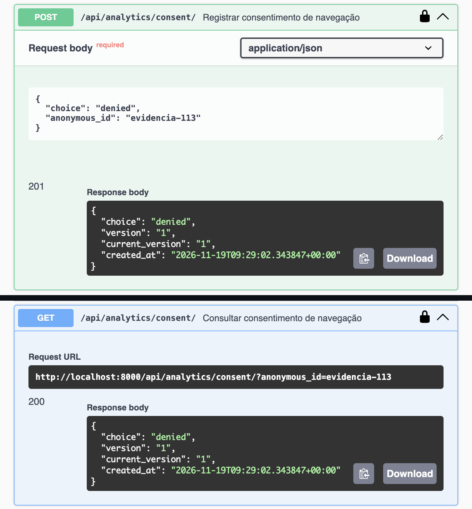
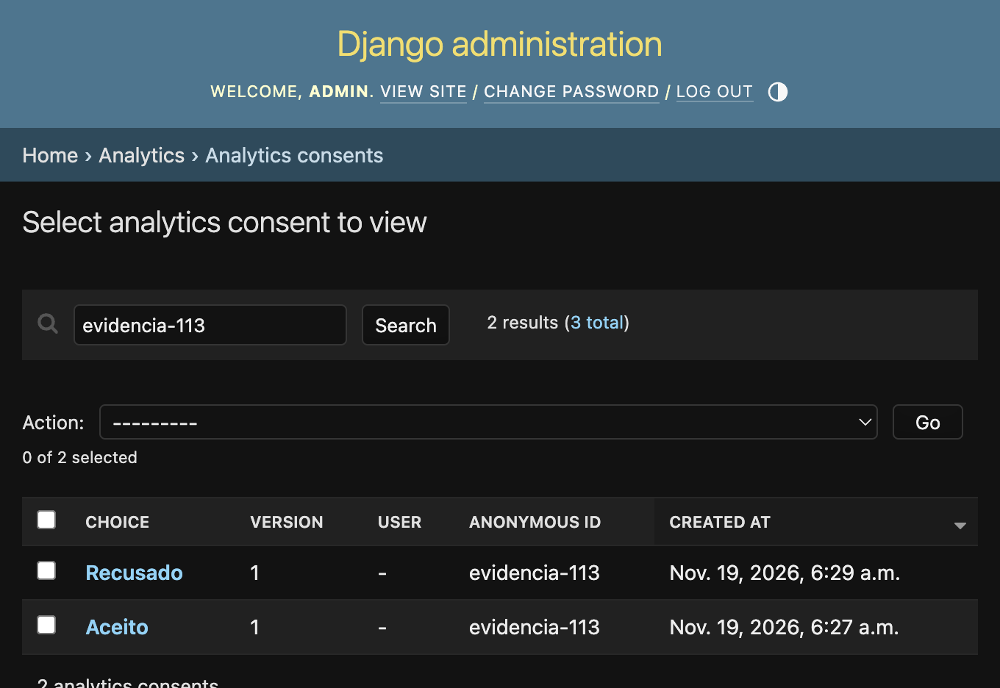
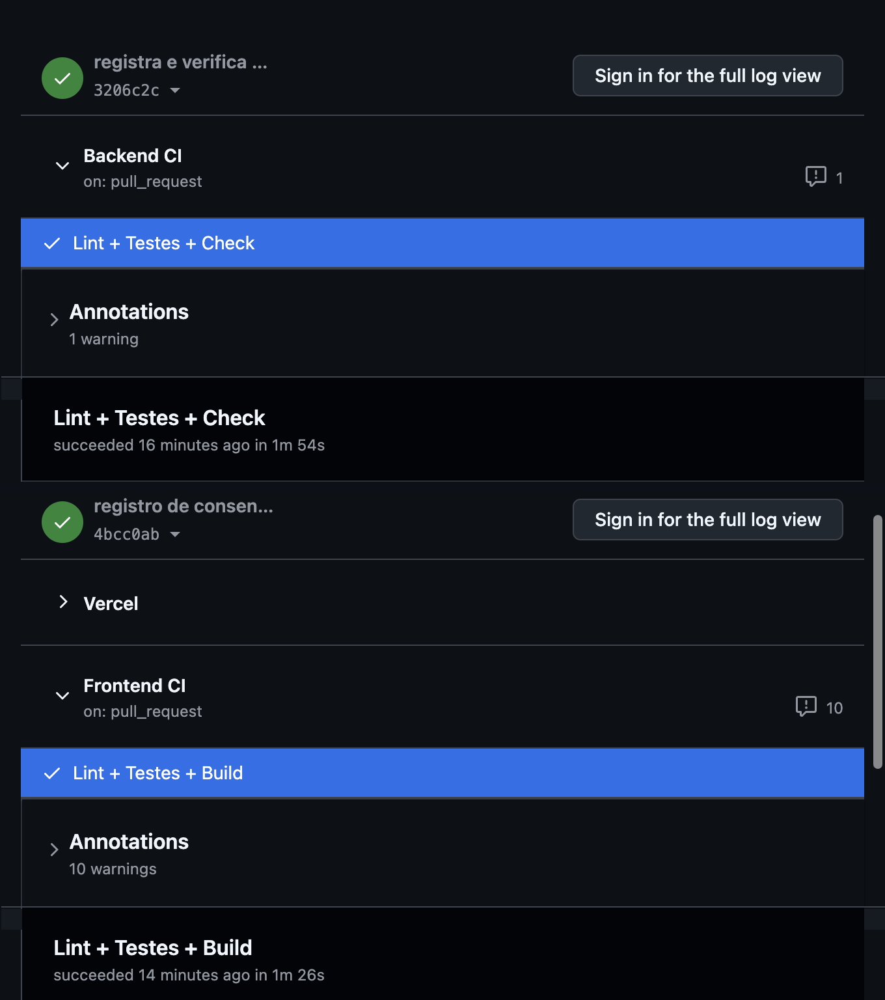

# Registro do consentimento de navegação

**Responsável:** Pedro Siqueira

> **Situação da integração:** os PRs desta tarefa ([backend #62](https://github.com/Shio-Enterprise/backend/pull/62) e [frontend #73](https://github.com/Shio-Enterprise/frontend/pull/73)) foram abertos em 19/11/2026, último dia da Sprint 4, e não foram integrados à `dev` nem à `main` até o fim da sprint. Por isso, a tarefa aparece em "Contribuições não integradas" no README da Sprint 4 e não entra no total de tarefas concluídas.

**Origem:**
- [Issue #113](https://github.com/Shio-Enterprise/Documentacao/issues/113): registro e validação do consentimento de navegação no backend.

## Contexto e Relevância

O banner "Sua privacidade" pede o consentimento para registrar a navegação (páginas, produtos vistos, carrinho e compras), mas a escolha ficava só no navegador. A loja não tinha como provar quem aceitou, quando e para qual texto, e pela LGPD essa prova cabe ao controlador. Limpar o navegador ou trocar de dispositivo apagava a escolha, e recusar depois de ter aceitado mantinha os eventos já gravados ligados à pessoa.

A escolha passa a ser registrada no backend, com histórico e versão do texto do banner, e acompanha a conta entre dispositivos. Quem recusa tem os eventos já gravados anonimizados, sem mudar os totais do dashboard de navegação.

---

## O que foi feito

| Área | Exemplos do que mudou |
| :--- | :--- |
| Registro da escolha | novo modelo `AnalyticsConsent`, com conta ou identificador anônimo do navegador, escolha, versão do texto do banner e data; cada mudança cria um registro novo, e a escolha vigente é a mais recente |
| API | `POST /api/analytics/consent/` registra a escolha; `GET /api/analytics/consent/` devolve a escolha vigente da conta ou do navegador |
| Versão do texto | o aceite só vale para a versão atual do banner (`ANALYTICS_CONSENT_VERSION`); se a versão mudar, o banner volta a aparecer |
| Recusa | os eventos já gravados da conta e do navegador perdem a conta e o identificador, sem alterar os totais |
| Login | o histórico de consentimento do navegador passa para a conta junto com os eventos anônimos; o front adota a escolha salva na conta ou envia a escolha local quando não há registro |
| Banner | registra a escolha no backend antes de enviar a página atual; falhas na comunicação não aparecem para o usuário |
| Admin do Django | histórico de consentimento somente leitura |

---

## Evidências (Pull Requests)

- [Backend PR #62](https://github.com/Shio-Enterprise/backend/pull/62): modelo, rotas de consentimento, anonimização na recusa, transferência no login e migração `analytics/0002_analyticsconsent` (em revisão).
- [Frontend PR #73](https://github.com/Shio-Enterprise/frontend/pull/73): banner integrado ao backend e sincronização da escolha no login (em revisão).

---

## Validação

- **Testes automáticos no backend**: 30 testes novos em `analytics/test_consentimento.py`. Cobrem aceite e recusa de visitante e de conta logada, identificador ausente, histórico com a escolha mais recente, consulta por conta e por navegador, aceite de versão anterior que não vale, anonimização na recusa sem afetar outras pessoas, e o comportamento com a flag desligada e ligada.
- **Testes automáticos no frontend**: 15 testes em `src/lib/analytics.consent.test.js`, 1 em `src/context/AuthContext.analytics.test.jsx` e 5 novos em `ConsentBanner.test.jsx`, com 1 ajustado porque o aceite passou a fazer duas chamadas, registro e página. Cobrem o registro antes do envio da página, a falha do backend sem impedir a navegação, a recusa registrada e a sincronização no login antes do vínculo dos eventos.
- **CI**: "Lint + Testes + Check" do backend e "Lint + Testes + Build" do frontend passaram nos dois PRs.

---

## Limitações Conhecidas

- Não há tratamento completo por meio de Cookies.

---

## Evidências

**Registro no backend**: a escolha enviada em `POST /api/analytics/consent/` e devolvida em `GET /api/analytics/consent/`:

**Histórico no admin do Django**: aceite e recusa da mesma pessoa, com versão e data, sem edição:

**CI verde** no backend e no frontend:

