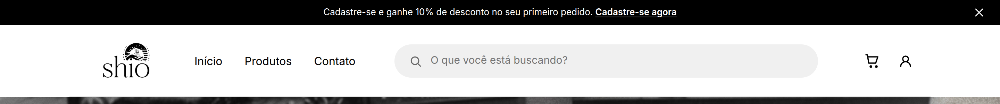
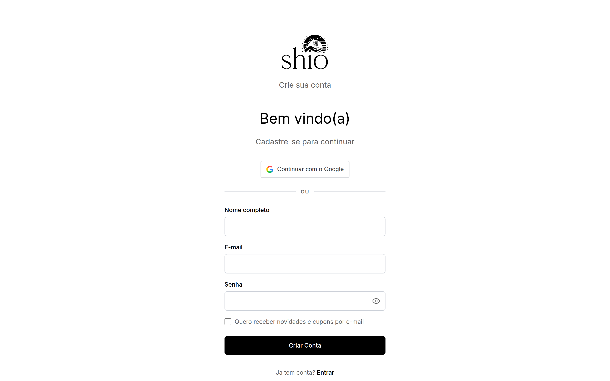
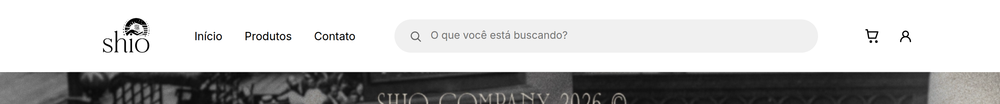
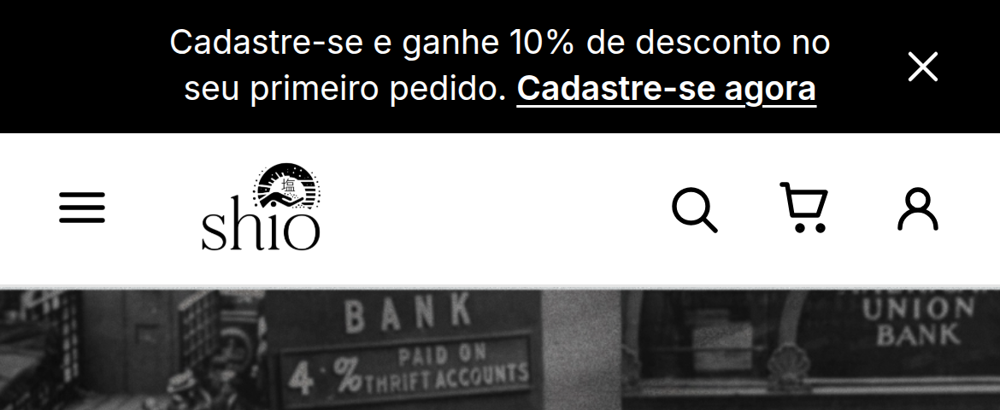

# Faixa de 10% de desconto clicável por inteiro

**Responsáveis:** João Gabriel e João Lucas Ramos

**Origem:**
- [Issue #78](https://github.com/Shio-Enterprise/Documentacao/issues/78): faixa de cadastro com 10% de desconto clicável por inteiro.

## Contexto e Relevância

A faixa preta do topo do site ("Cadastre-se e ganhe 10% de desconto no seu primeiro pedido. **Cadastre-se agora**") só levava ao cadastro quando o cliente clicava exatamente em "Cadastre-se agora". O resto da faixa não fazia nada, e quem clicava na frase não chegava a lugar nenhum. Pedido do cliente: a faixa inteira deve ser clicável.

---

## O que foi feito

| Área | O que mudou |
| :--- | :--- |
| Faixa | A faixa inteira virou um link para `/signup`. Navegação pelo teclado (Tab e Enter) e cursor de "mãozinha" vêm do próprio link |
| Botão de fechar | O X fica **fora** do link, posicionado por cima da faixa. Ele continua fechando a faixa e não leva ao cadastro |
| Visual | Texto, cor e valor do desconto não mudaram |

---

## Decisões técnicas

- **X fora do link.** Um botão dentro de um link (`<button>` dentro de `<a>`) é HTML inválido e é reprovado no teste de acessibilidade (`vitest-axe`). Por isso, o X é um elemento irmão do link, posicionado por cima, e não um filho.

---

## Evidências (Pull Request)

- [Frontend PR #64](https://github.com/Shio-Enterprise/frontend/pull/64): faixa inteira como link para o cadastro e X fora do link. Integrado à `dev` em 11/11/2026.

---

## Validação

- **Testes automáticos no frontend**: 2 testes novos em `src/components/layout/public/Navbar.test.jsx`:
  - clicar em qualquer ponto da faixa leva ao cadastro;
  - o X fecha a faixa sem levar ao cadastro.
- `vitest run src/components/layout`: 49 de 49 testes passando, incluindo o teste de acessibilidade (axe) da Navbar.
- **CI**: "Lint + Testes + Build" do frontend passou no PR.
- **Validação manual**: um clique no texto da frase, fora de "Cadastre-se agora", abriu `/signup`. Um clique no X fechou a faixa e manteve a página inicial.

---

## Critérios de aceitação

| Critério | Situação |
| :--- | :--- |
| Clicar em qualquer lugar da faixa abre a página de cadastro | Atendido |
| Clicar no X fecha a faixa sem abrir o cadastro | Atendido |
| A faixa pode ser ativada pelo teclado (Tab e Enter), como um link normal | Atendido |
| Funciona no celular e no computador | Atendido |

---

## Evidências

**Faixa no computador**: a frase inteira faz parte do link, e o X fica à direita.

**Clique na frase**: clicar em "Cadastre-se e ganhe 10% de desconto", fora de "Cadastre-se agora", abre a página de cadastro.

**Clique no X**: a faixa fecha e a página inicial continua aberta.

**Faixa no celular**: o texto quebra em duas linhas, e a faixa inteira continua clicável.

