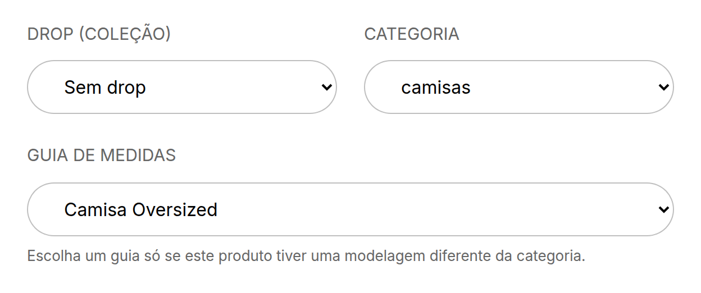
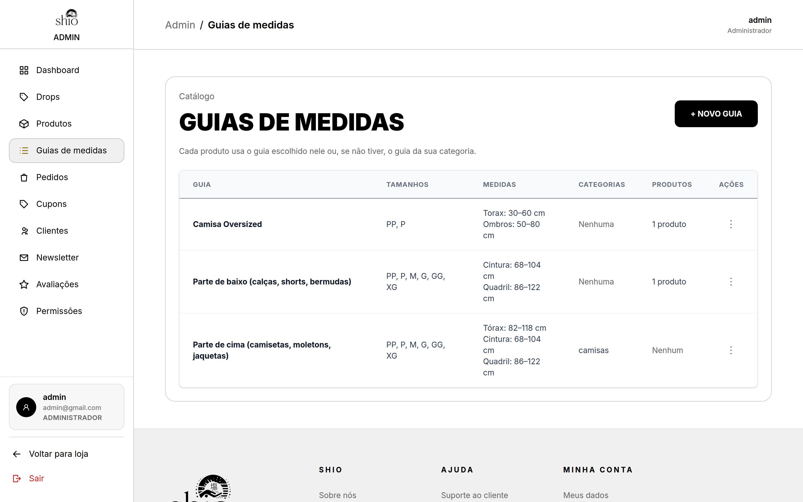
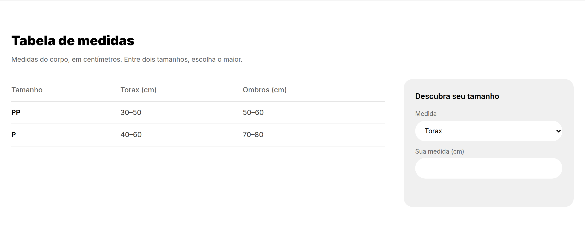

# Vários guias de medidas e escolha do guia por produto

**Responsável:** João Gabriel

**Origem:**
- [Issue #80](https://github.com/Shio-Enterprise/Documentacao/issues/80): vários guias de medidas e escolha do guia em cada produto. Continua a [#74](https://github.com/Shio-Enterprise/Documentacao/issues/74) e a [#75](https://github.com/Shio-Enterprise/Documentacao/issues/75), da Sprint 3.

## Contexto e Relevância

Na Sprint 3, o guia de medidas passou a ser ligado à **categoria**: todos os produtos de uma categoria usavam a mesma tabela. Só que, dentro da mesma categoria, existem modelagens diferentes, como uma camiseta normal e uma camiseta oversized. Com um guia só por categoria, a peça oversized aparecia com as medidas da peça normal, e o cliente escolhia o tamanho errado.

Pedido do cliente: poder criar vários guias e escolher, em cada produto, qual guia ele usa. O guia da categoria continua valendo como padrão, então nada muda para os produtos já cadastrados.

---

## O que foi feito

| Área | O que mudou |
| :--- | :--- |
| Modelo | `Product` ganhou o campo `size_guide`, uma chave estrangeira opcional para `SizeGuide`, com `on_delete=SET_NULL`. Migração `products/0015_product_size_guide` |
| Regra de exibição | O detalhe do produto (`GET /api/catalog/products/{id}/`) devolve em `size_guide` o guia do produto ou, se ele não tiver, o da categoria. Sem nenhum dos dois, devolve `null` e a página fica como antes |
| Guia próprio | O detalhe também traz `own_size_guide`, o id do guia escolhido no próprio produto. A edição usa esse campo para não pré-selecionar o guia da categoria; senão, salvar o produto fixaria o guia da categoria como próprio |
| Cadastro e edição | Novo campo "Guia de medidas" no cadastro e na edição do produto. A opção "Usar o guia da categoria" deixa o produto sem guia próprio |
| Tela de guias | Nova coluna "Produtos", com quantos produtos escolheram cada guia (`product_count`, calculado com `annotate(Count)`), e texto explicando a regra |
| Exclusão | Excluir um guia em uso deixa esses produtos sem guia próprio: eles voltam ao guia da categoria. O aviso de confirmação diz quantos produtos serão afetados |

---

## Decisões técnicas

- **Guia da categoria como padrão.** A issue deixava em aberto se o guia passaria a ser escolhido só no produto. A ligação por categoria foi mantida como padrão, e o guia do produto é uma exceção para modelagens diferentes. Assim, os produtos já cadastrados não precisaram de migração de dados.
- **`SET_NULL` em vez de bloquear a exclusão.** Excluir um guia em uso não dá erro: o produto só perde a exceção e volta ao padrão da categoria.
- **Contagem só dos produtos com guia próprio.** A coluna "Produtos" não conta quem usa o guia pela categoria, porque esses já aparecem na coluna "Categorias".

---

## Evidências (Pull Requests)

- [Backend PR #47](https://github.com/Shio-Enterprise/backend/pull/47): campo `size_guide` no produto, migração, fallback para o guia da categoria, `own_size_guide`, `product_count` e testes.
- [Frontend PR #55](https://github.com/Shio-Enterprise/frontend/pull/55): campo "Guia de medidas" no cadastro e na edição do produto, coluna "Produtos" e textos na tela de guias.

Os dois PRs foram integrados à `dev` em 10/11/2026.

---

## Validação

- **Testes automáticos no backend**: 7 testes novos em `products/test_size_guides_api.py` (classe `ProductOwnSizeGuideTests`):
  - o produto com guia próprio mostra o próprio, e não o da categoria;
  - o produto sem guia próprio mostra o da categoria;
  - dois produtos da mesma categoria mostram guias diferentes;
  - o produto sem guia e sem categoria fica sem guia;
  - excluir um guia em uso faz o produto voltar ao guia da categoria, sem erro;
  - o admin escolhe e remove o guia do produto pela API;
  - o painel mostra quantos produtos usam cada guia.
- **Testes automáticos no frontend**: 4 testes novos:
  - o cadastro envia o guia escolhido (`NewProductPage`);
  - a edição não pré-seleciona o guia da categoria;
  - a edição mostra o guia próprio e envia a troca ao salvar (`ProductsPage`);
  - a tela de guias mostra a contagem de produtos e avisa ao excluir (`SizeGuidesPage`).
- **CI**: "Lint + Testes + Check" do backend e "Lint + Testes + Build" do frontend passaram nos dois PRs.
- **Validação manual**: o produto "Camisas", da categoria "camisas", recebeu o guia "Camisa Oversized". A loja passou a mostrar a tabela desse guia, e não a do guia "Parte de cima" ligado à categoria.

---

## Critérios de aceitação

| Critério | Situação |
| :--- | :--- |
| Admin cria mais de um guia para o mesmo tipo de roupa | Atendido |
| Admin escolhe o guia no cadastro e na edição do produto | Atendido |
| Dois produtos da mesma categoria mostram guias diferentes na loja | Atendido |
| Produto sem guia escolhido continua mostrando o guia da categoria | Atendido |
| A sugestão de tamanho usa o guia que está sendo mostrado | Atendido: a calculadora "Descubra seu tamanho" lê o mesmo `size_guide` da tabela |

---

## Limitações Conhecidas

- Não é possível criar um guia direto pelo formulário do produto: o guia é criado na tela "Guias de medidas" e depois escolhido no produto.
- O guia vale para o produto inteiro, não para cada cor ou variação.

---

## Evidências

**Escolha do guia na edição do produto**: o produto "Camisas", da categoria "camisas", usa o guia "Camisa Oversized". Abaixo do campo, o texto orienta a escolher um guia só quando a modelagem for diferente da categoria.

**Tela de guias**: a coluna "Produtos" mostra quantos produtos escolheram cada guia, e o texto do topo explica a regra.

**Loja**: a página da "Camisas" mostra a tabela do guia oversized (tórax e ombros, PP e P), e não a do guia da categoria.

