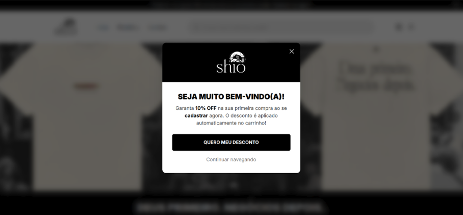

# Modal de boas-vindas em toda visita de usuário deslogado

**Responsável:** João Lucas Ramos

**Origem:**
- [Issue #114](https://github.com/Shio-Enterprise/Documentacao/issues/114): o modal de boas-vindas deve aparecer a cada visita de quem não está logado.

## Contexto e Relevância

O modal de boas-vindas oferece 10% de desconto na primeira compra para quem se cadastra. Depois que o visitante fechava o modal, a data do fechamento ficava salva no navegador (`localStorage`, chave `welcomeModalClosedAt`), e o modal só voltava a aparecer um dia depois. Na prática, o visitante via a oferta uma vez e não a via mais nas visitas seguintes, o que reduzia o alcance da campanha de cadastro.

---

## O que foi feito

| Área | O que mudou |
| :--- | :--- |
| Exibição | O modal aparece em toda visita de quem não está logado, 3 segundos depois de abrir o site |
| Fechamento | Fechar o modal só o esconde na visita atual; nenhuma data é salva no navegador |
| Usuário logado | Continua sem ver o modal |

A lógica de espera de um dia (cooldown) baseada no `localStorage` foi removida de `src/components/ui/WelcomeModal.jsx`.

---

## Evidências (Pull Request)

- [Frontend PR #74](https://github.com/Shio-Enterprise/frontend/pull/74): remoção do cooldown do modal de boas-vindas. Integrado à `dev` em 19/11/2026.

---

## Validação

- **Testes automáticos no frontend**: 4 testes ajustados em `src/components/ui/WelcomeModal.test.jsx` para o novo comportamento:
  - o modal aparece mesmo depois de ter sido fechado há pouco tempo;
  - o modal aparece 3 segundos depois de abrir o site, para quem não está logado;
  - o modal aparece mesmo com uma data antiga salva no navegador;
  - fechar o modal não salva nada no navegador.
- No total, 9 de 9 testes do `WelcomeModal` passam.
- **CI**: "Lint + Testes + Build" do frontend passou no PR.
- **Como testar manualmente**: acessar a página inicial sem login e esperar 3 segundos (o modal aparece); fechar o modal; recarregar a página (o modal aparece de novo depois de 3 segundos).

---

## Evidências

**Modal de boas-vindas**: aparece para o visitante sem login, com a oferta de 10% de desconto no cadastro.

